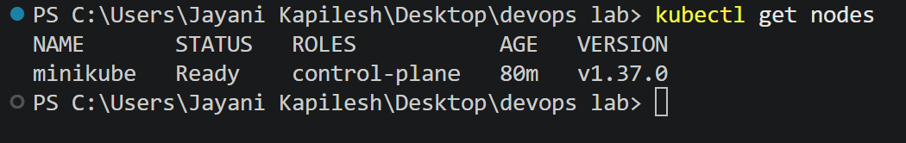
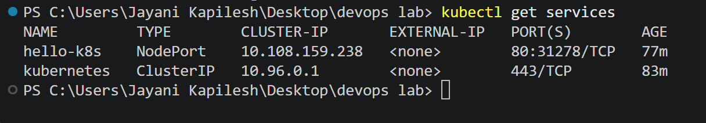
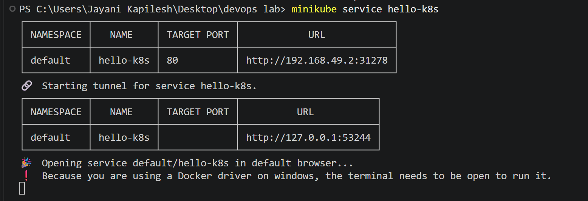
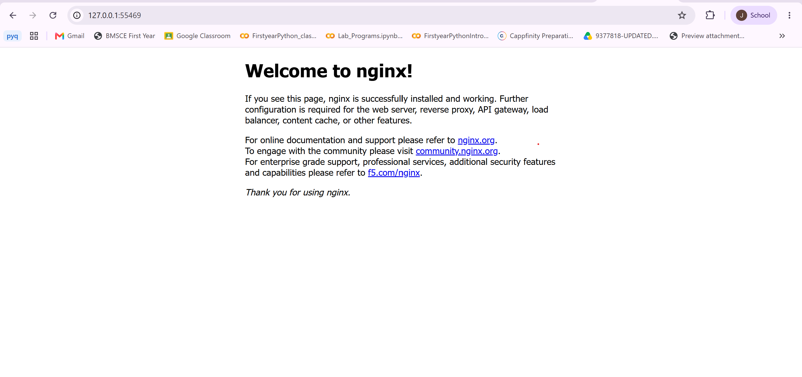

# Assignment 1: Kubernetes Getting Started — Hello Pod

## 1. Aim

To deploy an Nginx web server on Kubernetes using Minikube, expose it through a NodePort Service, and access the application through a web browser.

## 2. Problem Statement

A quick-commerce platform such as Zepto needs its web application to be deployed and accessible to users. Kubernetes can manage application containers, while Services provide a way to access deployed applications.

In this experiment, an Nginx container is deployed as a Kubernetes Pod and exposed through a NodePort Service.

## 3. Environment and Tools

| Component | Details |
|---|---|
| Operating System | Windows 11 |
| Container Platform | Docker Desktop |
| Kubernetes Environment | Minikube |
| Kubernetes CLI | kubectl |
| Web Server | Nginx |
| Minikube Driver | Docker |
| Terminal | PowerShell |
| Editor | Visual Studio Code |

## 4. Prerequisites

- Docker Desktop installed and running.
- Minikube installed.
- kubectl installed.
- Internet connection to download the Nginx image.

## 5. Implementation Steps

### Step 1: Start Minikube

Start the local Kubernetes cluster using the Docker driver.

```powershell
minikube start --driver=docker
```


### Step 2: Verify the Kubernetes Node

Check whether the Minikube node is ready.

```powershell
kubectl get nodes
```

The node should display `Ready` status.



### Step 3: Deploy the Nginx Pod

Create a Pod named `hello-k8s` using the Nginx image and specify port 80.

```powershell
kubectl run hello-k8s --image=nginx --port=80
```

Verify that the Pod is running.

```powershell
kubectl get pods -o wide
```

The Pod should show `1/1` under READY and `Running` under STATUS.


### Step 4: Expose the Pod Using a NodePort Service

Expose the Pod so that the application can be accessed through a Kubernetes Service.

```powershell
kubectl expose pod hello-k8s --type=NodePort --port=80
```

Check the available Services.

```powershell
kubectl get services
```

The output displays the Service type as `NodePort` and maps port 80 to a NodePort.



### Step 5: Access the Application

Run the following command to open the Service through Minikube.

```powershell
minikube service hello-k8s
```

Minikube provides a URL and opens the application in the default browser.

**Note:** When using the Docker driver on Windows, keep the terminal running this command open while accessing the application.



### Step 6: Verify the Nginx Web Page

The browser displays the default Nginx welcome page, confirming that the web server is accessible.



## 6. Kubernetes Configuration Files

The Pod and Service configurations are maintained separately in `pod.yaml` and `service.yaml`. These files can be exported from the running resources or written as declarative Kubernetes manifests.

## 7. Troubleshooting

**Issue: The Pod or Service already exists**

If Kubernetes reports that `hello-k8s` already exists, verify the existing resources:

```powershell
kubectl get pods
kubectl get services
```

If the resources are already running correctly, there is no need to recreate them.

**Issue: The application does not open**

- Check that the Pod status is `Running`.
- Verify that the Service exists.
- Run `minikube service hello-k8s` again if necessary.
- Keep the terminal running the Minikube service command open.

## 8. Key Concepts Learned

- **Minikube:** Runs a local Kubernetes cluster for development and learning.
- **Pod:** The smallest deployable unit in Kubernetes.
- **Container Image:** Nginx provides the web server application.
- **Service:** Provides a stable way to access a Pod.
- **NodePort:** Exposes a Service through a port on the Kubernetes node.
- **kubectl:** Command-line tool used to interact with Kubernetes.

## 9. Result

The Nginx application was successfully deployed as a Kubernetes Pod using Minikube. A NodePort Service was created, and the Nginx welcome page was accessed through a web browser.

## 10. Conclusion

This experiment demonstrated the basic Kubernetes deployment workflow, including starting a local cluster, deploying a containerized application, exposing it through a Service, and verifying application accessibility.
