# Exercise 2: Deploy a Flask App on Minikube using kubectl and YAML

## Objective

Learn Kubernetes basics using Minikube to set up a single-node cluster and deploy Python applications. This exercise involves deploying a Flask app using Minikube.

## Prerequisites

- Minikube v1.39.0 installed (Docker driver)
- kubectl
- Docker Desktop
- Windows 11, PowerShell

> **Platform note:** The lab commands are written for a Linux shell. On Windows PowerShell, `eval $(minikube docker-env)` is replaced by its PowerShell equivalent, and `curl.exe` is used because `curl` in PowerShell is an alias for `Invoke-WebRequest`.

## Files in this Folder

| File | Purpose |
|------|---------|
| `app.py` | Flask application |
| `Dockerfile` | Containerizes the Flask application |
| `flask-deployment.yaml` | Deployment and Service (final version from Step 13) |
| `screenshots/` | Screenshots of each step |

---

## Step 1: Start Minikube

**Command:**

```powershell
minikube start --container-runtime=docker
```

Minikube v1.39.0 uses **containerd** as the default container runtime, but `minikube docker-env` (Step 4) only works with the **Docker** runtime, so `--container-runtime=docker` was added.

**Output:**

```text
😄  minikube v1.39.0 on Microsoft Windows 11 Home Single Language 26H2
✨  Using the docker driver based on existing profile
👍  Starting "minikube" primary control-plane node in "minikube" cluster
🚜  Pulling base image v0.0.51 ...
🔥  Creating docker container (CPUs=2, Memory=3900MB) ...
🐳  Preparing Kubernetes v1.37.0 on Docker 29.7.2 ...
🔗  Configuring bridge CNI (Container Networking Interface) ...
🔎  Verifying Kubernetes components...
    ▪ Using image gcr.io/k8s-minikube/storage-provisioner:v5
🌟  Enabled addons: storage-provisioner, default-storageclass
🏄  Done! kubectl is now configured to use "minikube" cluster and "default" namespace by default
```

**Screenshot:**

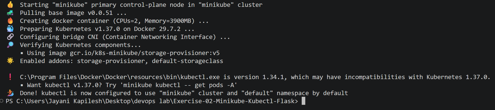

---

## Step 2: Create a Flask Application

**File: app.py**

```python
from flask import Flask

app = Flask(__name__)

@app.route('/')
def home():
    return "Hello from Flask on Kubernetes!"

if __name__ == '__main__':
    app.run(host='0.0.0.0', port=15000)
```

## Step 3: Create a Dockerfile for Flask Application

**File: Dockerfile**

```dockerfile
FROM python:3.8-slim
WORKDIR /app
COPY . /app
RUN pip install flask
CMD ["python", "app.py"]
```

---

## Step 4: Build the Docker Image with Minikube's Docker Daemon

Display the variables that configure the Docker CLI to use Minikube's Docker daemon:

```powershell
minikube docker-env
```

**Output:**

```text
$Env:DOCKER_TLS_VERIFY = "1"
$Env:DOCKER_HOST = "tcp://127.0.0.1:57833"
$Env:DOCKER_CERT_PATH = "C:\Users\Jayani Kapilesh\.minikube\certs"
$Env:MINIKUBE_ACTIVE_DOCKERD = "minikube"
# To point your shell to minikube's docker-daemon, run:
# & minikube -p minikube docker-env --shell powershell | Invoke-Expression
```

**Screenshot:**

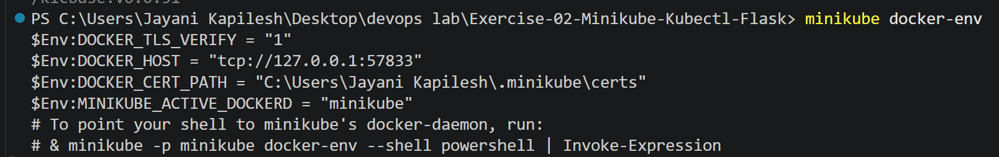

Point the shell to Minikube's Docker daemon (PowerShell equivalent of `eval $(minikube docker-env)`) and build the image:

```powershell
& minikube -p minikube docker-env --shell powershell | Invoke-Expression
docker build -t flask-app .
```

**Output:**

```text
[+] Building 27.8s (10/10) FINISHED                                    docker:default
 => [internal] load build definition from Dockerfile                                0.1s
 => [internal] load metadata for docker.io/library/python:3.8-slim                  3.6s
 => [1/4] FROM docker.io/library/python:3.8-slim@sha256:1d52838af602...             16.8s
 => [2/4] WORKDIR /app                                                              0.2s
 => [3/4] COPY . /app                                                               0.0s
 => [4/4] RUN pip install flask                                                     6.5s
 => exporting to image                                                              0.3s
 => => writing image sha256:668f92576924e769c4e82fa04c79c9b39d86cb50363f4e9abb111d8c3981a43f
 => => naming to docker.io/library/flask-app
```

The builder is `docker:default` (Minikube's Docker daemon), so the image is built directly inside the Minikube cluster.

**Screenshot:**

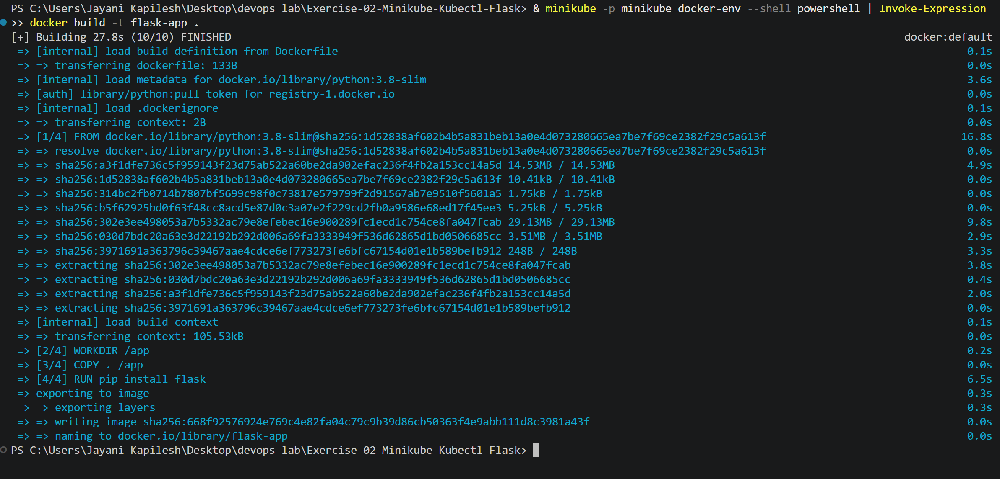

---

## Step 5: Create a Kubernetes Deployment YAML File

**Note: About `imagePullPolicy: Never`**

Kubernetes has three image pull policies:

1. **Always:** Kubernetes always pulls the image from the registry, even if it exists locally.
2. **IfNotPresent:** Kubernetes pulls the image only if it doesn't exist locally.
3. **Never:** Kubernetes never pulls the image from the registry; it only uses local images.

By setting `imagePullPolicy: Never`, Kubernetes uses the local `flask-app:latest` image built in Step 4 and does not pull it from a remote registry like Docker Hub.

**File: flask-deployment.yaml**

```yaml
apiVersion: apps/v1
kind: Deployment
metadata:
  name: flask-app
spec:
  replicas: 1
  selector:
    matchLabels:
      app: flask-app
  template:
    metadata:
      labels:
        app: flask-app
    spec:
      containers:
      - name: flask-app
        image: flask-app:latest
        imagePullPolicy: Never
        ports:
        - containerPort: 15000
```

## Step 6: Deploy the Application

```powershell
kubectl apply -f flask-deployment.yaml
```

**Output:**

```text
deployment.apps/flask-app created
```

**Screenshot:**

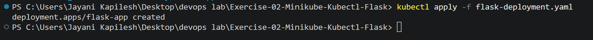

## Step 7: Check Deployment Status

```powershell
kubectl get deployments
```

**Output:**

```text
NAME        READY   UP-TO-DATE   AVAILABLE   AGE
flask-app   1/1     1            1           56s
```

## Step 8: Verify Pods Created by the Deployment

```powershell
kubectl get pods -l app=flask-app
```

**Output:**

```text
NAME                         READY   STATUS    RESTARTS   AGE
flask-app-59f7cdccb4-n8wfn   1/1     Running   0          57s
```

**Screenshot:**

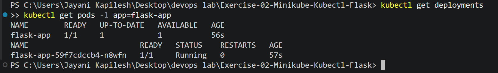

## Step 9: Describe the Deployment

```powershell
kubectl describe deployment flask-app
```

**Output:**

```text
Name:                   flask-app
Namespace:              default
CreationTimestamp:      Thu, 22 Oct 2026 00:37:52 +0530
Labels:                 <none>
Annotations:            deployment.kubernetes.io/revision: 1
Selector:               app=flask-app
Replicas:               1 desired | 1 updated | 1 total | 1 available | 0 unavailable
StrategyType:           RollingUpdate
MinReadySeconds:        0
RollingUpdateStrategy:  25% max unavailable, 25% max surge
Pod Template:
  Labels:  app=flask-app
  Containers:
   flask-app:
    Image:         flask-app:latest
    Port:          15000/TCP
    Host Port:     0/TCP
    Environment:   <none>
    Mounts:        <none>
  Volumes:         <none>
  Node-Selectors:  <none>
  Tolerations:     <none>
Conditions:
  Type           Status  Reason
  ----           ------  ------
  Available      True    MinimumReplicasAvailable
  Progressing    True    NewReplicaSetAvailable
OldReplicaSets:  <none>
NewReplicaSet:   flask-app-59f7cdccb4 (1/1 replicas created)
Events:
  Type    Reason             Age   From                   Message
  ----    ------             ----  ----                   -------
  Normal  ScalingReplicaSet  101s  deployment-controller  Scaled up replica set flask-app-59f7cdccb4 from 0 to 1
```

**Screenshot:**

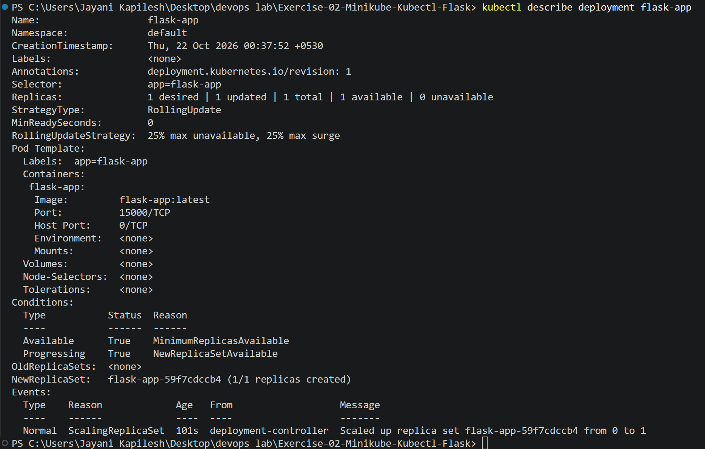

## Step 10: View Deployment Logs

```powershell
kubectl logs flask-app-59f7cdccb4-n8wfn
```

**Output:**

```text
 * Serving Flask app 'app'
 * Debug mode: off
WARNING: This is a development server. Do not use it in a production deployment. Use a production WSGI server instead.
 * Running on all addresses (0.0.0.0)
 * Running on http://127.0.0.1:15000
 * Running on http://10.244.0.3:15000
Press CTRL+C to quit
```

The logs show that Flask is running and listening on port 15000, so the application was deployed successfully.

**Screenshot:**

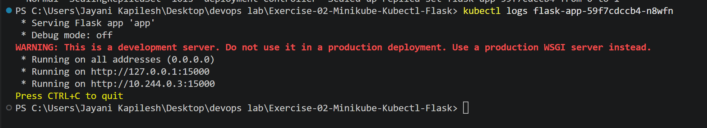

## Step 11: Check Services

```powershell
kubectl get services
```

**Output:**

```text
NAME         TYPE        CLUSTER-IP   EXTERNAL-IP   PORT(S)   AGE
kubernetes   ClusterIP   10.96.0.1    <none>        443/TCP   8m39s
```

Only the default `kubernetes` Service exists; no Service has been created for the Flask app yet.

## Step 12: Try to Access the Flask Service on Port 15000

```powershell
curl.exe http://127.0.0.1:15000
```

**Output:**

```text
curl: (7) Failed to connect to 127.0.0.1:15000 after 2040 ms: Could not connect to server
```

The request fails because:

1. Minikube runs in a separate (virtual) environment.
2. The app exposes port 15000 only inside the cluster, not externally.

**Screenshot:**

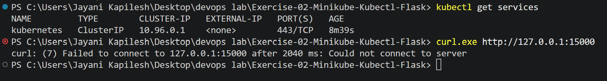

---

## Step 13: Update Deployment File with Service Section to Access Port 15000

**Updated file: flask-deployment.yaml**

```yaml
apiVersion: apps/v1
kind: Deployment
metadata:
  name: flask-app
spec:
  replicas: 1
  selector:
    matchLabels:
      app: flask-app
  template:
    metadata:
      labels:
        app: flask-app
    spec:
      containers:
      - name: flask-app
        image: flask-app:latest
        imagePullPolicy: Never
        ports:
        - containerPort: 15000
---
apiVersion: v1
kind: Service
metadata:
  name: flask-app-service
spec:
  selector:
    app: flask-app
  ports:
  - port: 15000
    targetPort: 15000
  type: NodePort
```

**Apply the changed deployment file:**

```powershell
kubectl apply -f flask-deployment.yaml
```

**Output:**

```text
deployment.apps/flask-app unchanged
service/flask-app-service created
```

**Screenshot:**

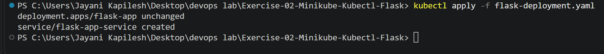

**Explanation:**

- **port (Service Port):** the port exposed by the Kubernetes Service (15000).
- **targetPort (Container Port):** the port the Flask application listens on inside the container (15000).

This creates the mapping: **External Request (port 15000) → Service (port 15000) → Container (port 15000)**.

### Access the Service

```powershell
minikube service flask-app-service --url
```

**Output:**

```text
http://127.0.0.1:50380
❗  Because you are using a Docker driver on windows, the terminal needs to be open to run it.
```

1. `minikube service` interacts with Kubernetes services running in Minikube.
2. `flask-app-service` is the name of the Service to access.
3. `--url` prints the URL for accessing the Service instead of opening a browser.

**Screenshot:**

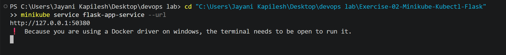

Keeping that terminal open, in a new terminal:

```powershell
curl.exe http://127.0.0.1:50380
```

**Output:**

```text
Hello from Flask on Kubernetes!
```

The Flask application is now accessible.

**Screenshot:**

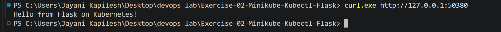

The application was also opened in the browser at `http://127.0.0.1:50380`.

**Screenshot:**

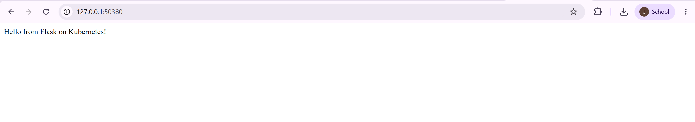

---

## Q&A Based on the Exercise

**Q1: What is the purpose of `minikube service flask-app-service --url`?**
A1: To provide the URL for accessing the `flask-app-service` running in Minikube.

**Q2: What happens when you run `minikube service flask-app-service --url`?**
A2: Minikube checks if the service is running, generates a URL, and displays it in the terminal.

**Q3: Why is `targetPort` used in Kubernetes Service configuration?**
A3: To specify the port number on which the container is listening.

**Q4: What is the difference between `port` and `targetPort` in Kubernetes Service configuration?**
A4: `port` is the exposed Service port, while `targetPort` is the container port.

**Q5: How do you access a Flask application running in Minikube?**
A5: Use `minikube service <service-name> --url` to get the access URL.

**Q6: Why does the terminal need to remain open when using the Docker driver with Minikube?**
A6: Because the Docker driver requires the terminal to stay open to maintain the Minikube connection (tunnel) to the service. In this exercise Minikube printed: *"Because you are using a Docker driver on windows, the terminal needs to be open to run it."*

**Q7: What is the benefit of using the `--url` flag with the `minikube service` command?**
A7: It provides a convenient way to access the service without manually constructing the URL.

**Q8: What command is used to expose a service in Kubernetes?**
A8: `kubectl expose` or `kubectl apply -f <service.yaml>` is used to expose a service in Kubernetes.

**Q9: How does Minikube help in local Kubernetes testing?**
A9: Minikube runs a single-node Kubernetes cluster locally, making it easier to test deployments without needing a full Kubernetes environment.

**Q10: What is the role of kubectl in this setup?**
A10: kubectl is the Kubernetes CLI tool used to interact with the Kubernetes cluster. It allows you to deploy applications, scale them, and manage resources.

---

## Result

A single-node Minikube cluster was started with the Docker runtime, the Flask image was built directly inside Minikube's Docker daemon, and the application was deployed with a Kubernetes Deployment. Access on port 15000 failed until a NodePort Service was added, after which `minikube service flask-app-service --url` provided a URL and the application returned **"Hello from Flask on Kubernetes!"**.