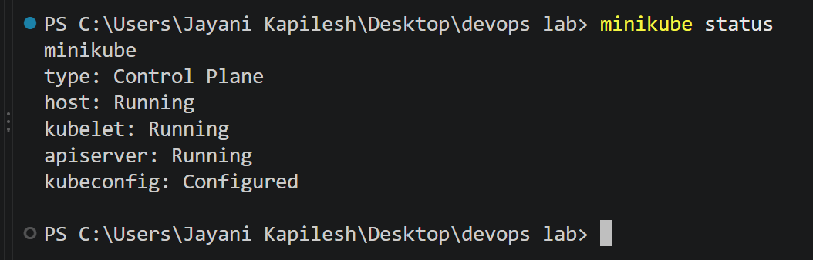
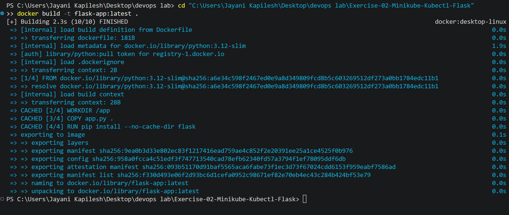
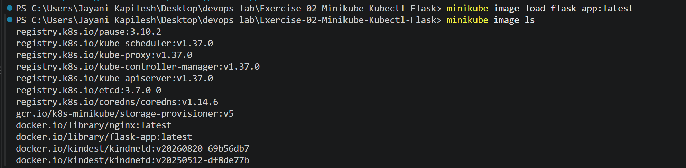
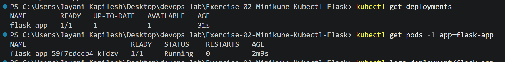
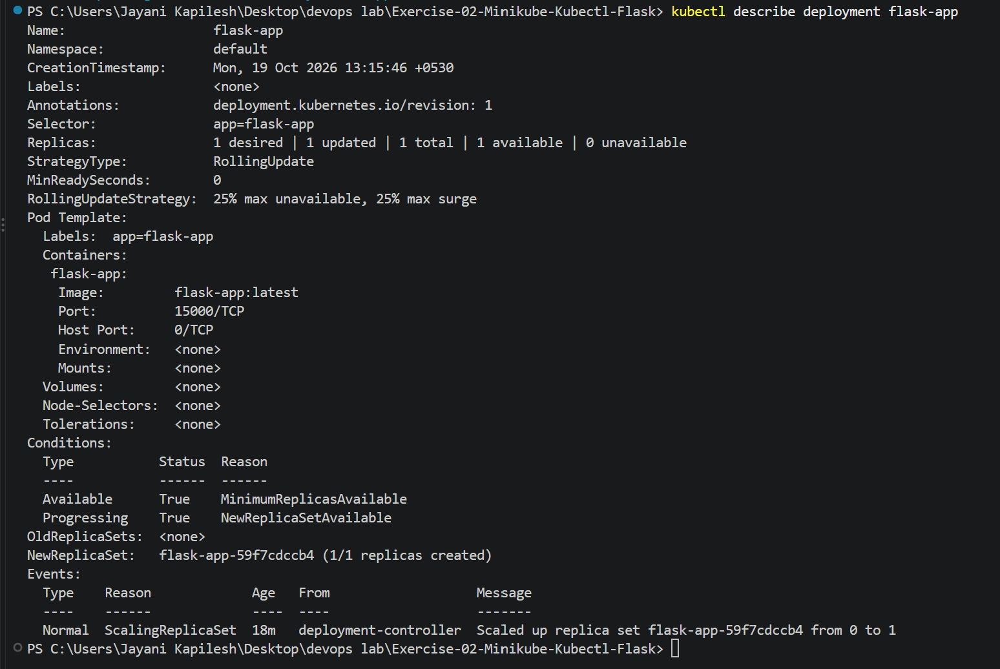
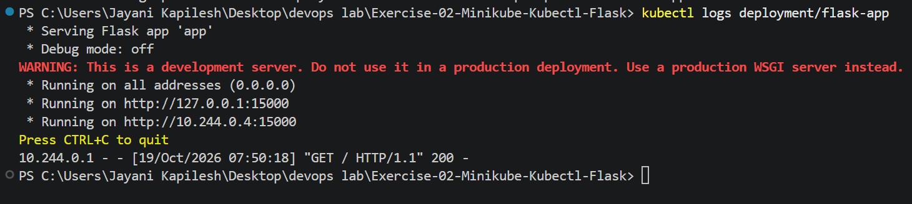
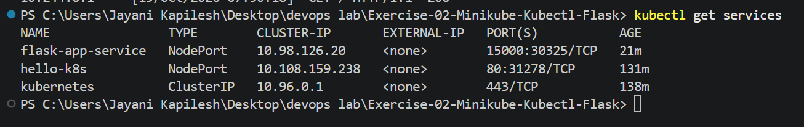
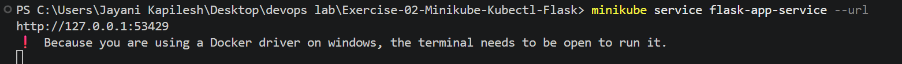
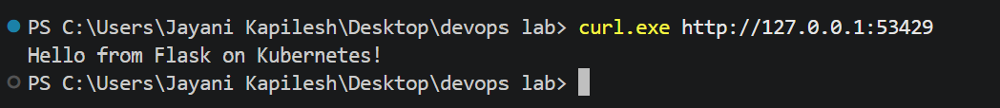
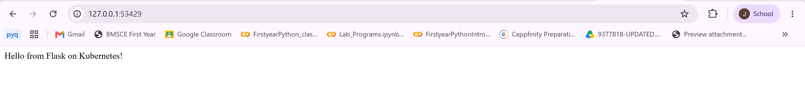

# Exercise 2: Deploy a Flask Application on Kubernetes Using Minikube

## 1. Overview

This exercise demonstrates how to containerize a Python Flask application using Docker and deploy it to a local Kubernetes cluster using Minikube. The application is exposed through a Kubernetes NodePort Service and verified using terminal commands and a web browser.

**Application response:**

```text
Hello from Flask on Kubernetes!
```

## 2. Objectives

- Create a simple web application using Python Flask.
- Build a Docker image for the application.
- Load the image into Minikube.
- Deploy the application using a Kubernetes Deployment.
- Expose the application using a NodePort Service.
- Verify the deployment and test the application response.

## 3. Technologies Used

| Technology | Purpose |
|---|---|
| Python | Application development |
| Flask | Web framework |
| Docker | Containerization |
| Kubernetes | Application orchestration |
| Minikube | Local Kubernetes cluster |
| kubectl | Kubernetes resource management |

## 4. Implementation

### Step 1: Verify Minikube

Check whether the Minikube cluster is running.

```powershell
minikube status
```

The host, kubelet, and API server should be running, with the kubeconfig configured.



### Step 2: Create the Flask Application

Create `app.py` with the following code:

```python
from flask import Flask

app = Flask(__name__)

@app.route('/')
def home():
    return "Hello from Flask on Kubernetes!"

if __name__ == '__main__':
    app.run(host='0.0.0.0', port=15000)
```

The application defines a route at `/` that returns a text message. It listens on port `15000` on all network interfaces.

### Step 3: Create the Dockerfile

Create a file named `Dockerfile`:

```dockerfile
FROM python:3.12-slim

WORKDIR /app

COPY app.py .

RUN pip install --no-cache-dir flask

EXPOSE 15000

CMD ["python", "app.py"]
```

The Dockerfile selects a Python base image, copies the application, installs Flask, documents port `15000`, and starts the application.

### Step 4: Build the Docker Image

Build the image from the Exercise 2 directory.

```powershell
docker build -t flask-app:latest .
```

The Docker image was built successfully.



### Step 5: Load the Image into Minikube

Load the locally built image into Minikube and verify that it is available.

```powershell
minikube image load flask-app:latest
minikube image ls
```

The image `docker.io/library/flask-app:latest` appears in the image list. Loading the image allows Kubernetes to use the local image without pulling it from a remote registry.



### Step 6: Configure the Kubernetes Deployment and Service

Create `flask-deployment.yaml`:

```yaml
apiVersion: apps/v1
kind: Deployment
metadata:
  name: flask-app
spec:
  replicas: 1
  selector:
    matchLabels:
      app: flask-app
  template:
    metadata:
      labels:
        app: flask-app
    spec:
      containers:
        - name: flask-app
          image: flask-app:latest
          imagePullPolicy: Never
          ports:
            - containerPort: 15000
---
apiVersion: v1
kind: Service
metadata:
  name: flask-app-service
spec:
  type: NodePort
  selector:
    app: flask-app
  ports:
    - port: 15000
      targetPort: 15000
```

The Deployment maintains one replica of the Flask application. The NodePort Service selects the application pod and forwards traffic to container port `15000`.

The `imagePullPolicy: Never` setting instructs Kubernetes not to pull the image from a registry.

Apply the configuration:

```powershell
kubectl apply -f flask-deployment.yaml
```

Both the Deployment and Service were created successfully.


### Step 7: Verify the Deployment and Pod

Check the Deployment and application pod:

```powershell
kubectl get deployments
kubectl get pods -l app=flask-app
```

**Observed results:**

- Deployment readiness: `1/1`
- Available replicas: `1`
- Pod status: `Running`
- Pod restarts: `0`



Inspect the Deployment details:

```powershell
kubectl describe deployment flask-app
```

The output confirms the image, container port, available replica, and successful deployment conditions.



### Step 8: Check the Application Logs

Run:

```powershell
kubectl logs deployment/flask-app
```

The logs show Flask running on port `15000`. A recorded HTTP request returned status code `200`, indicating a successful response.



### Step 9: Verify the Kubernetes Service

List the Kubernetes Services:

```powershell
kubectl get services
```

The `flask-app-service` Service appears with type `NodePort`. The observed port mapping was `15000:30325/TCP`.



### Step 10: Access the Application Through Minikube

Run:

```powershell
minikube service flask-app-service --url
```

Minikube generates a local URL for accessing the Service. In this environment, the final verification used:

```text
http://127.0.0.1:53429
```

On Windows with the Docker driver, keep the terminal running the service tunnel open while accessing the URL. The port may change when the tunnel is restarted.



### Step 11: Test the Application Using the Terminal

In a separate PowerShell terminal, run:

```powershell
curl.exe http://127.0.0.1:53429
```

**Observed response:**

```text
Hello from Flask on Kubernetes!
```



### Step 12: Verify the Application in a Browser

Open the active Minikube Service URL in a browser. The page displays the expected response.



## 5. Result

The Flask application was successfully containerized using Docker and deployed to a local Kubernetes cluster using Minikube. The Deployment reached the ready state, the pod ran successfully, and the application was exposed through a NodePort Service.

The application was verified through Kubernetes commands, application logs, a terminal HTTP request, and a web browser.

## 6. Conclusion

This exercise demonstrates the basic workflow for deploying a containerized web application on Kubernetes. It covers Docker image creation, loading a local image into Minikube, configuring Kubernetes resources, exposing the application through a Service, and verifying application accessibility.

The successful response, `Hello from Flask on Kubernetes!`, confirms that the application was deployed and accessed successfully.

## Q&A Based on the Exercise

**Q1: What is the purpose of `minikube service flask-app-service --url`?**
A1: It provides the URL for accessing the `flask-app-service` running in Minikube.

**Q2: What happens when you run `minikube service flask-app-service --url`?**
A2: Minikube checks that the service is running, creates a tunnel to it, and prints the URL in the terminal.

**Q3: Why is `targetPort` used in a Kubernetes Service configuration?**
A3: It specifies the port on which the container is listening, so the Service knows where to forward traffic.

**Q4: What is the difference between `port` and `targetPort` in a Kubernetes Service?**
A4: `port` is the port exposed by the Service, while `targetPort` is the port of the container that receives the traffic.

**Q5: How do you access a Flask application running in Minikube?**
A5: Use `minikube service <service-name> --url` to get the access URL, then open it in a browser or call it with curl.

**Q6: Why does the terminal need to remain open when using the Docker driver with Minikube?**
A6: With the Docker driver, Minikube runs a tunnel to reach the service, and the tunnel only works while that terminal stays open.

**Q7: What is the benefit of using the `--url` flag with the `minikube service` command?**
A7: It prints the access URL directly instead of opening a browser, which makes it easy to use with curl or copy into a browser.

**Q8: What command is used to expose a service in Kubernetes?**
A8: `kubectl expose` or `kubectl apply -f <service.yaml>`.

**Q9: How does Minikube help in local Kubernetes testing?**
A9: Minikube runs a single-node Kubernetes cluster locally, so deployments can be tested without a full Kubernetes environment.

**Q10: What is the role of kubectl in this setup?**
A10: kubectl is the Kubernetes command-line tool used to interact with the cluster: deploying applications, checking their status, viewing logs, scaling and managing resources.