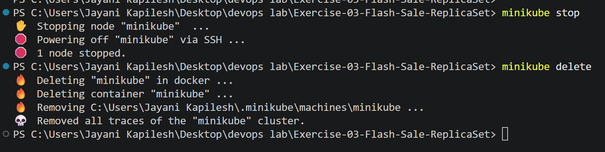
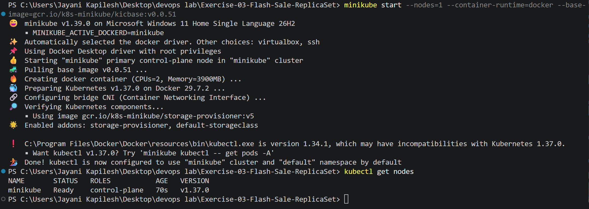
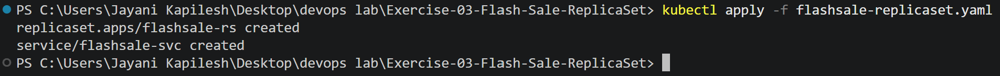
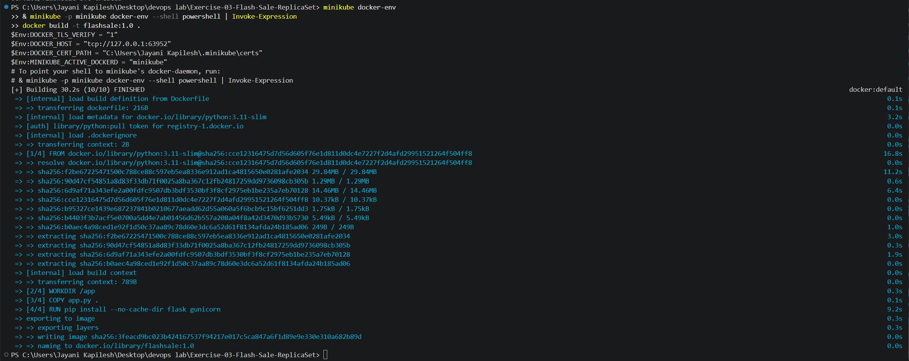
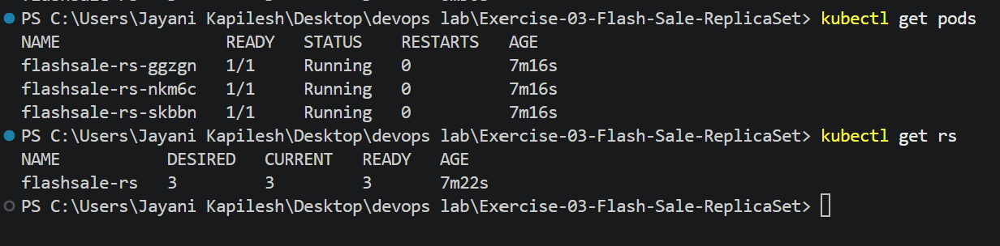
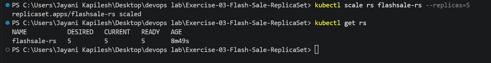
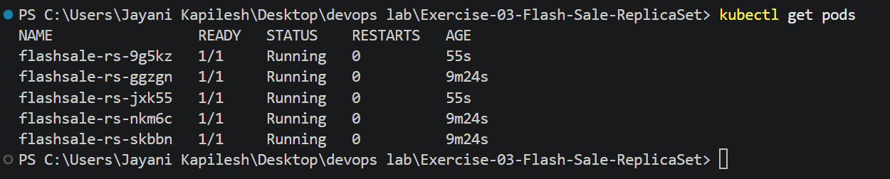
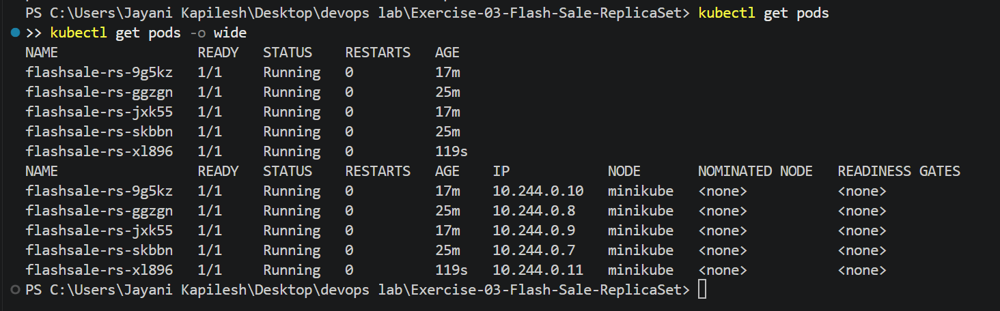

# Exercise 3: Scaling Flask App on Single Node using ReplicaSets

## Real-Life Tech Use Case: E-commerce Flash Sale

During a flash sale on an e-commerce site (like Flipkart's Big Billion Days or Amazon Prime Day), a simple Flask service that normally handles 100 requests per minute may suddenly receive 10,000 requests per minute. If the app runs on a single Pod, it will crash under the load. Using ReplicaSets, the system can scale out to many Pods running the same app and distribute requests among them. Once the sale ends and traffic returns to normal, Kubernetes can scale back down to save resources.

## Objective

- Understand ReplicaSets and Pods
- Scale Flask App deployment
- Observe pod distribution

## Key Observations and Learnings

- **Pod Distribution:** Each Pod is an identical worker. Scaling means creating clones of the app.
- **Resiliency:** If one Pod fails, the ReplicaSet automatically creates another, so users don't notice downtime.
- **Efficiency:** Instead of over-provisioning servers, Pods are added when demand spikes and removed when demand is low.
- **Scalability in the Real World:** This is how Netflix, YouTube or Swiggy scale their microservices to handle peak traffic.

## Environment

- Minikube v1.39.0 (Docker driver, Docker runtime), Kubernetes v1.37.0
- kubectl
- Docker Desktop
- Windows 11, PowerShell

## Files in this Folder

| File | Purpose |
|------|---------|
| `app.py` | Flash sale Flask application |
| `Dockerfile` | Containerizes the application |
| `flashsale-replicaset.yaml` | ReplicaSet and Service |
| `screenshots/` | Screenshots of each step |

---

## Create an App to take Buy orders for a !!Flash Sale!!

**File: app.py**

```python
# app.py
from flask import Flask, request
import socket, time, random

app = Flask(__name__)

@app.get("/")
def homepage():
    return {
        "message": "Welcome to Big Sale!",
        "pod": socket.gethostname(),
        "ts": time.time()
    }

@app.get("/buy")
def buy():
    # simulate a flash sale checkout
    item = random.choice(["Smartphone", "Shoes", "Headphones", "Laptop"])
    user = request.args.get("user", f"user{random.randint(1,1000)}")
    return {
        "status": "success",
        "item": item,
        "user": user,
        "served_by_pod": socket.gethostname(),
        "time": time.strftime("%H:%M:%S")
    }

@app.get("/health")
def health():
    return {"status": "healthy", "pod": socket.gethostname()}
```

### App details

- `/` → Welcomes users to the Big Sale.
- `/buy` → Simulates a checkout during a flash sale. Assigns a random product or uses the `?user=123` query parameter.
- Shows which Pod served the request, so load distribution across Pods can be seen.
- `/health` → Used for readiness/liveness probes.

## Build Docker Image

### Create Dockerfile

**File: Dockerfile**

```dockerfile
FROM python:3.11-slim
WORKDIR /app
COPY app.py .
RUN pip install --no-cache-dir flask gunicorn
CMD ["gunicorn","-b","0.0.0.0:5000","app:app","--workers","1","--threads","2"]
```

The lab's Dockerfile copies `ex3-flash-sale.py`, but the application is saved as `app.py` and gunicorn starts `app:app`, so `COPY app.py .` is used.

The image is built directly inside Minikube's Docker daemon in Step 5. Because the ReplicaSet uses the local image name `flashsale:1.0`, the image does not need to be pushed to Docker Hub.

---

## Step 1: Clean up previous minikube

**Commands:**

```powershell
minikube stop
minikube delete
```

**Output:**

```text
✋  Stopping node "minikube"  ...
🛑  Powering off "minikube" via SSH ...
🛑  1 node stopped.
🔥  Deleting "minikube" in docker ...
🔥  Deleting container "minikube" ...
🔥  Removing C:\Users\Jayani Kapilesh\.minikube\machines\minikube ...
💀  Removed all traces of the "minikube" cluster.
```

**Screenshot:**



## Step 2: Start minikube with a single node

**Command:**

```powershell
minikube start --nodes=1 --container-runtime=docker --base-image=gcr.io/k8s-minikube/kicbase:v0.0.51
```

`--container-runtime=docker` is needed for `minikube docker-env` (Step 5), because Minikube v1.39.0 uses containerd by default. `--base-image` points to the locally cached Minikube image (the start otherwise stopped at "Pulling base image").

**Output:**

```text
😄  minikube v1.39.0 on Microsoft Windows 11 Home Single Language 26H2
    ▪ MINIKUBE_ACTIVE_DOCKERD=minikube
✨  Automatically selected the docker driver. Other choices: virtualbox, ssh
📌  Using Docker Desktop driver with root privileges
👍  Starting "minikube" primary control-plane node in "minikube" cluster
🚜  Pulling base image v0.0.51 ...
🔥  Creating docker container (CPUs=2, Memory=3900MB) ...
🐳  Preparing Kubernetes v1.37.0 on Docker 29.7.2 ...
🔗  Configuring bridge CNI (Container Networking Interface) ...
🔎  Verifying Kubernetes components...
    ▪ Using image gcr.io/k8s-minikube/storage-provisioner:v5
🌟  Enabled addons: storage-provisioner, default-storageclass
🏄  Done! kubectl is now configured to use "minikube" cluster and "default" namespace by default
```

**Check nodes:**

```powershell
kubectl get nodes
```

```text
NAME       STATUS   ROLES           AGE   VERSION
minikube   Ready    control-plane   70s   v1.37.0
```

**Screenshot:**



## Step 3: Create a new file replicaset.yaml

**File: flashsale-replicaset.yaml**

```yaml
apiVersion: apps/v1
kind: ReplicaSet
metadata:
  name: flashsale-rs
  labels:
    app: flashsale
spec:
  replicas: 3  ## Number of replicas (copies of flashsale app) to run
  selector:
    matchLabels:
      app: flashsale
  template:
    metadata:
      labels:
        app: flashsale
    spec:
      containers:
      - name: flashsale-container
        image: flashsale:1.0
        ports:
        - containerPort: 5000
        readinessProbe:
          httpGet:
            path: /health
            port: 5000
          initialDelaySeconds: 2
          periodSeconds: 5
        livenessProbe:
          httpGet:
            path: /health
            port: 5000
          initialDelaySeconds: 10
          periodSeconds: 10
        resources:
          requests:
            cpu: "100m"
            memory: "128Mi"
          limits:
            cpu: "500m"
            memory: "256Mi"
---
apiVersion: v1
kind: Service
metadata:
  name: flashsale-svc
spec:
  selector:
    app: flashsale
  ports:
  - name: http
    port: 80
    targetPort: 5000
  type: ClusterIP
```

## Step 4: Apply the ReplicaSet configuration

**Command:**

```powershell
kubectl apply -f flashsale-replicaset.yaml
```

**Output:**

```text
replicaset.apps/flashsale-rs created
service/flashsale-svc created
```

**Screenshot:**



## Step 5: Initialize minikube, build Image and Verify the ReplicaSet

**Commands:**

```powershell
minikube docker-env
& minikube -p minikube docker-env --shell powershell | Invoke-Expression
docker build -t flashsale:1.0 .
```

The second command is the PowerShell equivalent of `eval $(minikube docker-env)`. The image is tagged `flashsale:1.0` because that is the image name used in `flashsale-replicaset.yaml`.

**Output:**

```text
$Env:DOCKER_TLS_VERIFY = "1"
$Env:DOCKER_HOST = "tcp://127.0.0.1:63952"
$Env:DOCKER_CERT_PATH = "C:\Users\Jayani Kapilesh\.minikube\certs"
$Env:MINIKUBE_ACTIVE_DOCKERD = "minikube"
# To point your shell to minikube's docker-daemon, run:
# & minikube -p minikube docker-env --shell powershell | Invoke-Expression
[+] Building 30.2s (10/10) FINISHED                                    docker:default
 => [internal] load build definition from Dockerfile                                0.1s
 => [internal] load metadata for docker.io/library/python:3.11-slim                 3.2s
 => [1/4] FROM docker.io/library/python:3.11-slim@sha256:cce12316475d...            16.8s
 => [2/4] WORKDIR /app                                                              0.3s
 => [3/4] COPY app.py .                                                             0.1s
 => [4/4] RUN pip install --no-cache-dir flask gunicorn                             9.2s
 => exporting to image                                                              0.3s
 => => naming to docker.io/library/flashsale:1.0                                    0.0s
```

The builder is `docker:default` (Minikube's Docker daemon). The Pods created in Step 4 were waiting for this image and started once it was available inside Minikube.

**Screenshot:**



## Step 6: Verify the pods

**Commands:**

```powershell
kubectl get pods
kubectl get rs
```

**Output:**

```text
NAME                 READY   STATUS    RESTARTS   AGE
flashsale-rs-ggzgn   1/1     Running   0          7m16s
flashsale-rs-nkm6c   1/1     Running   0          7m16s
flashsale-rs-skbbn   1/1     Running   0          7m16s

NAME           DESIRED   CURRENT   READY   AGE
flashsale-rs   3         3         3       7m22s
```

**Screenshot:**



## Step 7: Scale the ReplicaSet to 5 replicas

**Command:**

```powershell
kubectl scale rs flashsale-rs --replicas=5
```

**Output:**

```text
replicaset.apps/flashsale-rs scaled
```

## Step 8: Verify the updated ReplicaSet

**Command:**

```powershell
kubectl get rs
```

**Output:**

```text
NAME           DESIRED   CURRENT   READY   AGE
flashsale-rs   5         5         5       8m49s
```

**Screenshot:**



## Step 9: Verify the updated pods

**Command:**

```powershell
kubectl get pods
```

**Output:**

```text
NAME                 READY   STATUS    RESTARTS   AGE
flashsale-rs-9g5kz   1/1     Running   0          55s
flashsale-rs-ggzgn   1/1     Running   0          9m24s
flashsale-rs-jxk55   1/1     Running   0          55s
flashsale-rs-nkm6c   1/1     Running   0          9m24s
flashsale-rs-skbbn   1/1     Running   0          9m24s
```

Two new Pods (`9g5kz`, `jxk55`) were created to reach 5 replicas.

**Screenshot:**



## Step 10: Delete one pod

**Command:**

```powershell
kubectl delete pod flashsale-rs-nkm6c
```

**Output:**

```text
pod "flashsale-rs-nkm6c" deleted from default namespace
```

## Step 11: Verify the pods

**Command:**

```powershell
kubectl get pods
```

**Output:**

```text
NAME                 READY   STATUS    RESTARTS   AGE
flashsale-rs-9g5kz   1/1     Running   0          17m
flashsale-rs-ggzgn   1/1     Running   0          25m
flashsale-rs-jxk55   1/1     Running   0          17m
flashsale-rs-skbbn   1/1     Running   0          25m
flashsale-rs-xl896   1/1     Running   0          119s
```

The deleted Pod `flashsale-rs-nkm6c` was automatically replaced by a new Pod `flashsale-rs-xl896`, keeping the desired 5 replicas.

**View pod distribution across nodes:**

```powershell
kubectl get pods -o wide
```

```text
NAME                 READY   STATUS    RESTARTS   AGE    IP            NODE       NOMINATED NODE   READINESS GATES
flashsale-rs-9g5kz   1/1     Running   0          17m    10.244.0.10   minikube   <none>           <none>
flashsale-rs-ggzgn   1/1     Running   0          25m    10.244.0.8    minikube   <none>           <none>
flashsale-rs-jxk55   1/1     Running   0          17m    10.244.0.9    minikube   <none>           <none>
flashsale-rs-skbbn   1/1     Running   0          25m    10.244.0.7    minikube   <none>           <none>
flashsale-rs-xl896   1/1     Running   0          119s   10.244.0.11   minikube   <none>           <none>
```

All 5 Pods run on the single node `minikube`.

**Screenshot:**



---

## Q&A based on the exercise

**Q1. What is the initial number of replicas in the ReplicaSet?**

Answer: 3

**Q2. How many pods are running after applying the ReplicaSet configuration?**

Answer: 3 (`flashsale-rs-ggzgn`, `flashsale-rs-nkm6c`, `flashsale-rs-skbbn`)

**Q3. What happens when you scale the ReplicaSet to 5 replicas?**

Answer: Kubernetes creates 2 additional pods (`flashsale-rs-9g5kz`, `flashsale-rs-jxk55`) to meet the desired number of replicas (5). The ReplicaSet now has 5 running pods.

**Q4. What happens when you delete one pod?**

Answer: Kubernetes automatically creates a new pod (`flashsale-rs-xl896`) to replace the deleted one (`flashsale-rs-nkm6c`), maintaining the desired number of replicas (5).

**Q5. How does Kubernetes maintain the desired number of replicas?**

Answer: Kubernetes continuously monitors the number of running pods and compares it to the desired number of replicas. If there's a discrepancy, Kubernetes creates or deletes pods to maintain the desired state.

**Q6. How many nodes are running?**

Answer: 1 (`minikube`)

**Q7. Where are the pods running with respect to nodes?**

Answer:

Node 1 (`minikube`):

- Pod 1 (`flashsale-rs-9g5kz`)
- Pod 2 (`flashsale-rs-ggzgn`)
- Pod 3 (`flashsale-rs-jxk55`)
- Pod 4 (`flashsale-rs-skbbn`)
- Pod 5 (`flashsale-rs-xl896`)

All 5 pods are running on the single node.

---

## Result

A single-node Minikube cluster was created, the flash sale image was built inside Minikube's Docker daemon, and the `flashsale-rs` ReplicaSet was deployed with 3 replicas. It was scaled to 5 replicas, and when one Pod was deleted the ReplicaSet automatically created a replacement, keeping 5 Pods running on the single node.