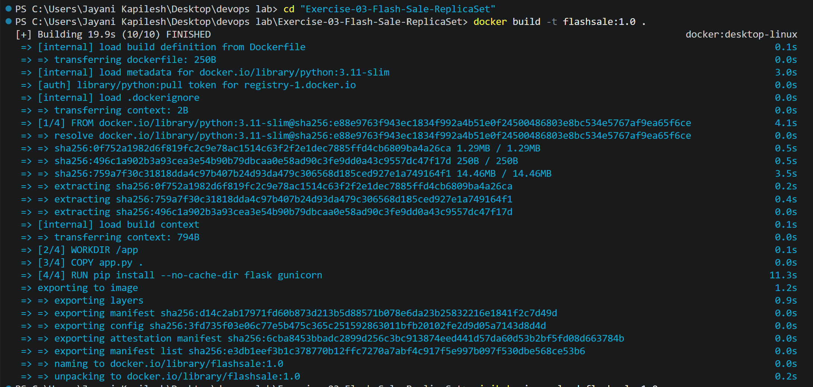
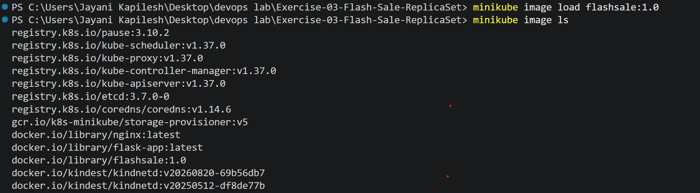
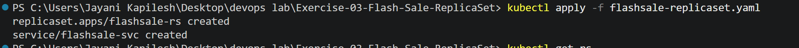
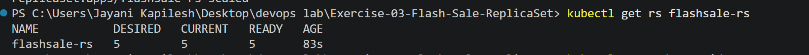
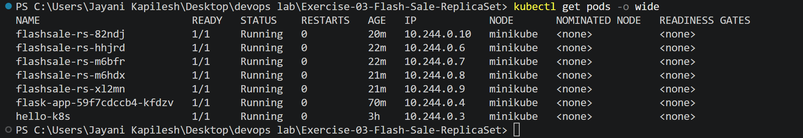
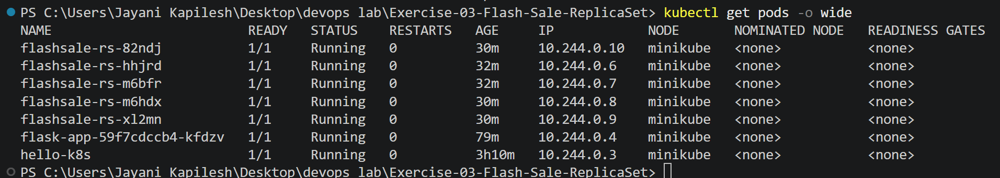
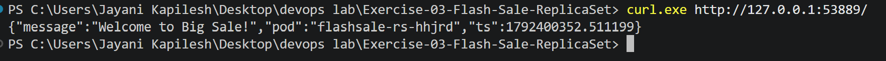
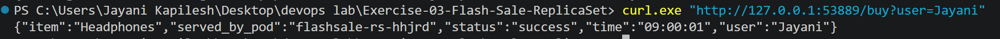
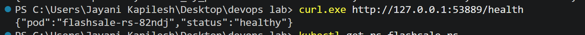
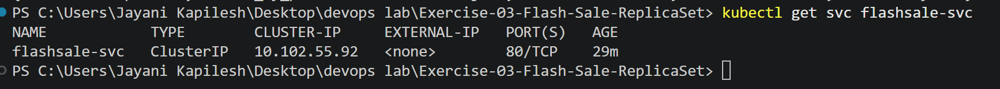

# Exercise 3: Scaling Flask App on a Single Node Using ReplicaSets

## Overview

This exercise demonstrates Kubernetes ReplicaSets, Pod scaling, and self-healing using a Flask-based e-commerce flash sale application. The application is deployed on a single Minikube node and scaled from three replicas to five replicas.

## Objectives

- Understand Kubernetes ReplicaSets and Pods.
- Deploy a Flask application using Docker and Minikube.
- Scale the application from three replicas to five replicas.
- Verify automatic Pod replacement.
- Test application endpoints through a Kubernetes Service.

## Technologies Used

- Python and Flask
- Docker
- Kubernetes
- Minikube
- kubectl
- Gunicorn

## Implementation

### Step 1: Develop the Flask Application

Created `app.py` with three endpoints:

- `/` – Displays the welcome message and serving Pod name.
- `/buy` – Simulates a purchase of a randomly selected product.
- `/health` – Checks the application's health status.

### Step 2: Build the Docker Image

Built the Docker image using the following command:

```powershell
docker build -t flashsale:1.0 .
```

The image was built successfully.



### Step 3: Load the Image into Minikube

Loaded the locally built image into Minikube:

```powershell
minikube image load flashsale:1.0
minikube image ls
```

The `flashsale:1.0` image was available in Minikube.



### Step 4: Deploy the ReplicaSet and Service

Applied the Kubernetes configuration:

```powershell
kubectl apply -f flashsale-replicaset.yaml
```

The command created the `flashsale-rs` ReplicaSet and the `flashsale-svc` Service.



### Step 5: Verify the Pods

Initially, the ReplicaSet maintained three ready Pods. The application was deployed on the single `minikube` node.

The Pods were checked using:

```powershell
kubectl get pods -o wide
```

### Step 6: Scale the Application

Scaled the ReplicaSet from three replicas to five replicas:

```powershell
kubectl scale rs flashsale-rs --replicas=5
kubectl get rs flashsale-rs
```

The ReplicaSet showed five desired replicas, five current replicas, and five ready replicas.



The following output confirmed that all five Flash Sale Pods were running on the same node.



### Step 7: Verify Self-Healing

Deleted one Flash Sale Pod to test Kubernetes self-healing:

```powershell
kubectl delete pod flashsale-rs-df642
kubectl get pods -o wide
```

The ReplicaSet automatically created a replacement Pod named `flashsale-rs-82ndj`, restoring the desired number of replicas to five.



### Step 8: Test the Homepage

Accessed the application through the URL provided by Minikube.

```powershell
minikube service flashsale-svc --url
```

The homepage returned the welcome message and the name of the Pod that handled the request.



### Step 9: Test the Purchase Endpoint

Tested the purchase endpoint using:

```powershell
curl.exe "http://127.0.0.1:53889/buy?user=Jayani"
```

The application returned a successful purchase response containing the selected product, username, and serving Pod.



### Step 10: Test the Health Endpoint

Checked the application's health using:

```powershell
curl.exe http://127.0.0.1:53889/health
```

The response confirmed that the application was healthy.



### Step 11: Verify the Kubernetes Service

Verified the Service configuration:

```powershell
kubectl get svc flashsale-svc
```

The Service was created successfully with type `ClusterIP` and port `80/TCP`.



## Results

- Successfully built and loaded the Flash Sale Docker image.
- Deployed the Flask application using a Kubernetes ReplicaSet.
- Scaled the application from three Pods to five Pods.
- Verified that all five Pods were running and ready on a single node.
- Confirmed automatic Pod replacement after deleting a Pod.
- Tested the homepage, purchase, and health endpoints successfully.
- Verified the Kubernetes ClusterIP Service.

## Conclusion

This exercise demonstrated Kubernetes ReplicaSet scaling and self-healing. The application successfully maintained five replicas after scaling and automatically replaced a deleted Pod. The Flask application and Kubernetes Service were also tested successfully on Minikube.

## Questions and Answers

**1. What is a ReplicaSet?**

A ReplicaSet is a Kubernetes resource that maintains a specified number of identical Pod replicas.

**2. How many Pods were initially created?**

Three Pods were initially created.

**3. What happened when the replicas were increased to five?**

Kubernetes created two additional Pods, resulting in five ready replicas.

**4. What happened when one Pod was deleted?**

The ReplicaSet automatically created a replacement Pod to maintain five replicas.

**5. What is self-healing in Kubernetes?**

Self-healing is Kubernetes' ability to restore the desired state by replacing missing or deleted Pods.

**6. How many nodes were used?**

One Minikube node was used.

**7. What is the purpose of the ClusterIP Service?**

It provides a stable internal access point for the application Pods.

**8. What is the purpose of the `/health` endpoint?**

It returns the application's health status and the serving Pod name.

**9. Which command was used to scale the ReplicaSet?**

`kubectl scale rs flashsale-rs --replicas=5`

**10. What is the main advantage of using a ReplicaSet?**

It maintains the desired number of Pods and helps ensure application availability when a Pod is deleted.
