# Exercise 4: Docker Networking with Multiple Containers

## Objective

Understand Docker networking concepts and configure a multi-container application.

## Scenario

Develop a web application with three containers:

- **Container 1:** Python Flask web server
- **Container 2:** MySQL database
- **Container 3:** Redis cache

## Technologies Used

- Docker Desktop
- Docker Bridge Networking
- Python 3.9
- Flask
- MySQL
- Redis
- PowerShell

## Task 1: Create a Bridge Network

Created a custom bridge network named `my-bridge-net`.

**Command:**

```powershell
docker network create --driver bridge my-bridge-net
```

The network was created successfully.

## Task 2: Verify the Network

**Command:**

```powershell
docker network ls
```

The output confirmed that `my-bridge-net` existed and used the `bridge` driver.

**Screenshot:**

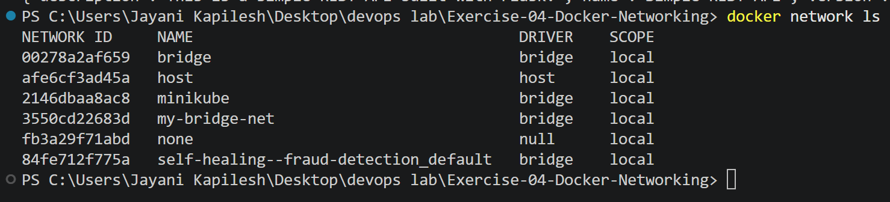

## Task 3: Inspect the Network

**Command:**

```powershell
docker network inspect my-bridge-net
```

The network inspection showed the following configuration:

- Network name: `my-bridge-net`
- Driver: `bridge`
- Subnet: `172.19.0.0/16`
- Gateway: `172.19.0.1`

The Flask, MySQL, and Redis containers were connected to this network during testing.

**Screenshot:**

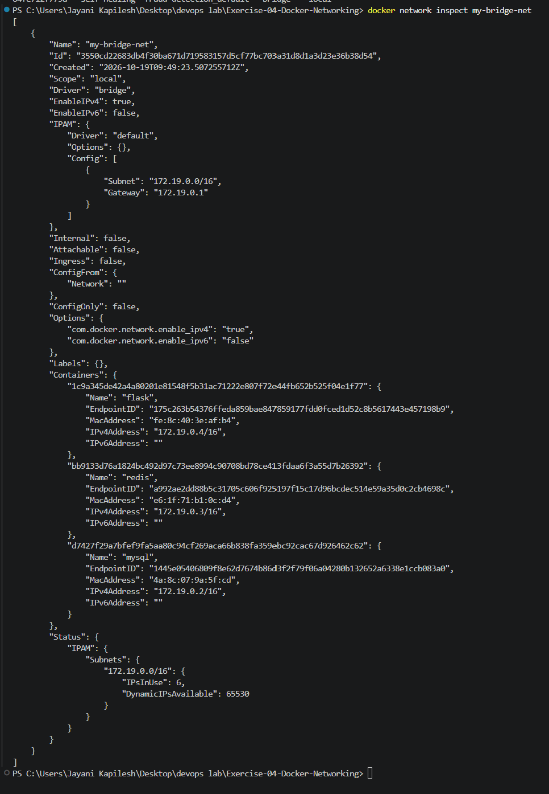

## Task 4: Launch Containers

### Step 1: Create the Flask Application

The Flask application was saved in `app.py`.

```python
from flask import Flask, jsonify

app = Flask(__name__)

@app.route('/about', methods=['GET'])
def about():
    return jsonify({
        "name": "Simple REST API",
        "version": "1.0",
        "description": "This is a simple REST API built with Flask."
    })

if __name__ == '__main__':
    app.run(host='0.0.0.0', port=5001)
```

The application provides a GET endpoint at `/about`.

### Step 2: Create requirements.txt

The required Python packages were listed in `requirements.txt`.

```text
Flask==2.0.1
Werkzeug==2.0.3
```

### Step 3: Create the Dockerfile

```dockerfile
FROM python:3.9-slim

WORKDIR /app

COPY requirements.txt .
COPY app.py .

RUN pip install --no-cache-dir -r requirements.txt

EXPOSE 5001

CMD ["python", "app.py"]
```

### Step 4: Build the Flask Docker Image

**Command:**

```powershell
docker build -t flask-api .
```

The Docker image was built successfully.

**Screenshot:**

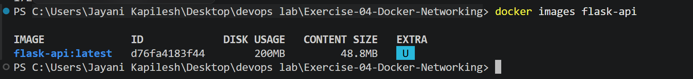

### Step 5: Launch the MySQL Container

**Command:**

```powershell
docker run -d --name mysql --network my-bridge-net -e MYSQL_ROOT_PASSWORD=rootpass -e MYSQL_DATABASE=devopsdb mysql:latest
```

This command starts the MySQL container on the custom bridge network, sets the root password, and creates the `devopsdb` database.

### Step 6: Launch the Redis Container

**Command:**

```powershell
docker run -d --name redis --network my-bridge-net redis:latest
```

This command starts Redis and connects it to `my-bridge-net`.

### Step 7: Launch the Flask Container

**Command:**

```powershell
docker run -d --name flask --network my-bridge-net -p 5001:5001 flask-api
```

The Flask container was connected to the same network. Port `5001` was published to the host machine.

### Step 8: Verify Running Containers

**Command:**

```powershell
docker ps
```

The output confirmed that Flask, MySQL, and Redis were running.

**Screenshot:**

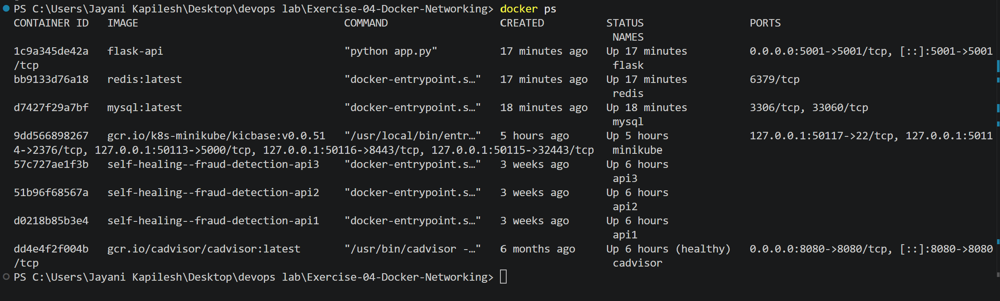

### Step 9: Test the Flask REST API

**Command:**

```powershell
curl.exe http://localhost:5001/about
```

The API returned the following JSON response:

```json
{
  "description": "This is a simple REST API built with Flask.",
  "name": "Simple REST API",
  "version": "1.0"
}
```

**Screenshot:**

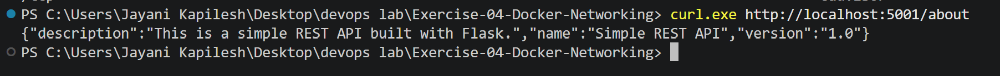

## Task 5: Test Connectivity

### Step 1: Exec into the Flask Container

**Command:**

```powershell
docker exec -it flask bash
```

The `python:3.9-slim` image does not include the `ping` command, so it was installed inside the container first:

```bash
apt-get update && apt-get install -y iputils-ping
```

### Step 2: Ping the MySQL Container

**Command:**

```bash
ping -c 4 mysql
```

**Output:**

```text
PING mysql (172.20.0.2) 56(84) bytes of data.
64 bytes from mysql.my-bridge-net (172.20.0.2): icmp_seq=1 ttl=64 time=2.84 ms
64 bytes from mysql.my-bridge-net (172.20.0.2): icmp_seq=2 ttl=64 time=0.209 ms
64 bytes from mysql.my-bridge-net (172.20.0.2): icmp_seq=3 ttl=64 time=0.216 ms
64 bytes from mysql.my-bridge-net (172.20.0.2): icmp_seq=4 ttl=64 time=0.190 ms

--- mysql ping statistics ---
4 packets transmitted, 4 received, 0% packet loss, time 3034ms
rtt min/avg/max/mdev = 0.190/0.863/2.840/1.141 ms
```

### Step 3: Ping the Redis Container

**Command:**

```bash
ping -c 4 redis
```

**Output:**

```text
PING redis (172.20.0.3) 56(84) bytes of data.
64 bytes from redis.my-bridge-net (172.20.0.3): icmp_seq=1 ttl=64 time=2.02 ms
64 bytes from redis.my-bridge-net (172.20.0.3): icmp_seq=2 ttl=64 time=0.186 ms
64 bytes from redis.my-bridge-net (172.20.0.3): icmp_seq=3 ttl=64 time=0.201 ms
64 bytes from redis.my-bridge-net (172.20.0.3): icmp_seq=4 ttl=64 time=0.268 ms

--- redis ping statistics ---
4 packets transmitted, 4 received, 0% packet loss, time 3028ms
rtt min/avg/max/mdev = 0.186/0.669/2.024/0.782 ms
```

The Flask container reached both `mysql` and `redis` by container name with 0% packet loss, confirming that containers on the same user-defined bridge network communicate using Docker's built-in DNS. The container shell was then closed with `exit`.

**Screenshot:**

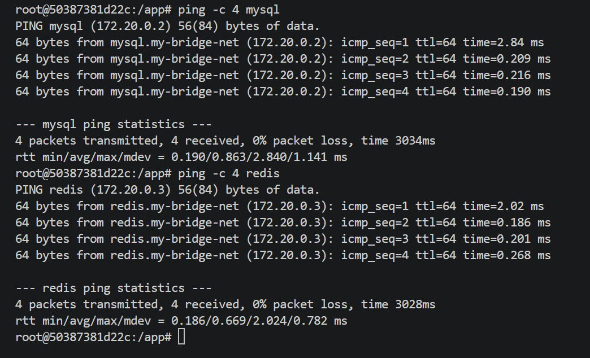

### Additional Connectivity Checks

These checks were done in an earlier run of this exercise (before the network was recreated for the ping test), so the container IP addresses are in the `172.19.0.0/16` subnet instead of `172.20.0.0/16`.

#### Verify MySQL

**Command:**

```powershell
docker exec -it mysql mysql -uroot -prootpass -e "SHOW DATABASES;"
```

The output confirmed that `devopsdb` existed, along with MySQL's default databases.

**Screenshot:**

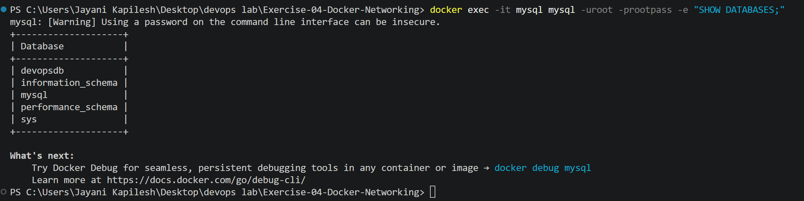

#### Verify Redis

**Command:**

```powershell
docker exec -it redis redis-cli ping
```

**Output:**

```text
PONG
```

The `PONG` response confirmed that the Redis server was responding.

**Screenshot:**

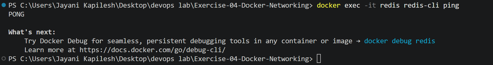

#### Test MySQL Name Resolution

**Command:**

```powershell
docker exec flask getent hosts mysql
```

**Output:**

```text
172.19.0.2    mysql
```

This confirmed that the Flask container could resolve the MySQL container using its name.

**Screenshot:**

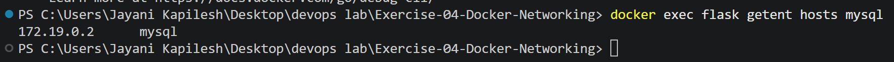

#### Test Redis Name Resolution

**Command:**

```powershell
docker exec flask getent hosts redis
```

**Output:**

```text
172.19.0.3    redis
```

This confirmed that the Flask container could resolve the Redis container using its name.

**Screenshot:**

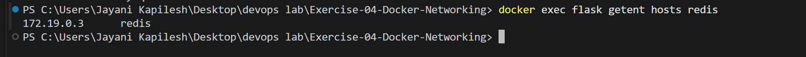

#### Inspect Network Connectivity

**Command:**

```powershell
docker network inspect my-bridge-net
```

The output showed that Flask, MySQL, and Redis were attached to the same custom bridge network and had assigned IP addresses.

**Screenshot:**

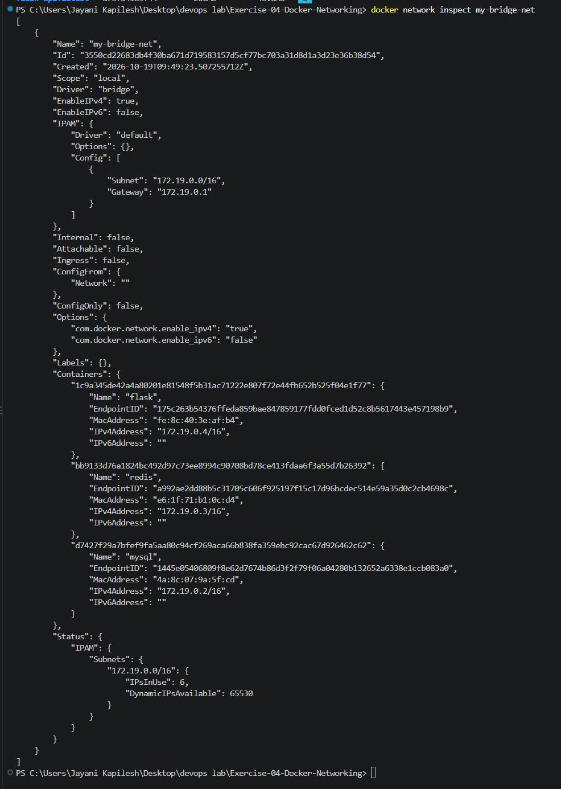

## Task 6: Clean Up

After completing the tests, the three Exercise 4 containers were stopped and removed.

### Step 1: Stop the Containers

**Command:**

```powershell
docker stop mysql redis flask
```

### Step 2: Remove the Containers

**Command:**

```powershell
docker rm mysql redis flask
```

### Step 3: Remove the Custom Network

**Command:**

```powershell
docker network rm my-bridge-net
```

The containers and custom network were removed successfully. A subsequent attempt to remove the same network returned a "network not found" error because it had already been deleted.

The final network listing confirmed that `my-bridge-net` was absent while the default Docker networks, Minikube network, and existing project network remained.

**Screenshot:**

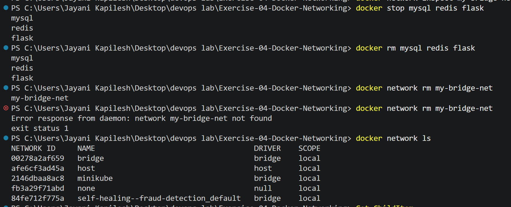

## Differences from the Lab Instructions

| Lab instruction | What was done | Reason |
|---|---|---|
| `app.run(debug=True, port=5001)` | `app.run(host='0.0.0.0', port=5001)` | Without `host='0.0.0.0'` Flask listens only on 127.0.0.1 inside the container, so `-p 5001:5001` cannot reach it from the host. |
| `requirements.txt`: `Flask==2.0.1` | `Flask==2.0.1` and `Werkzeug==2.0.3` | Flask 2.0.1 fails to start with newer Werkzeug versions, so the compatible version was pinned. |
| `docker run -d --name mysql --net=my-bridge-net mysql:latest` | Added `-e MYSQL_ROOT_PASSWORD=rootpass -e MYSQL_DATABASE=devopsdb` | The MySQL image exits immediately unless a root password is set. |
| `--net=my-bridge-net` | `--network my-bridge-net` | `--network` is the current name of the same option. |
| `ping mysql` / `ping redis` | `iputils-ping` installed in the Flask container first | `ping` is not included in `python:3.9-slim`. |
| `docker stop ... && docker rm ...` | Separate `docker stop` and `docker rm` commands | PowerShell 5.1 does not support `&&`. |

## Questions and Answers

### 1. What is the purpose of the `--net` flag in `docker run`?

The `--net` flag specifies the network to which a container should connect. The equivalent option used in this exercise is `--network`.

### 2. How do containers communicate with each other on the same network?

Containers on the same user-defined bridge network can communicate using their container names or IP addresses. Docker's built-in DNS resolves container names to their IP addresses.

### 3. What is the difference between a bridge network and a host network?

A **bridge network** provides network isolation for containers and allows containers connected to the same bridge network to communicate.

A **host network** shares the host machine's network stack, so the container does not use a separate isolated network stack.

Think of it this way:

- **Bridge network:** Containers are in a private room, communicating through a door.
- **Host network:** Containers share the host's room and network.

### 4. How can you expose a container's port to the host machine?

Use the `-p` flag to publish a container port to a host port.

Example:

```powershell
docker run -d --name flask --network my-bridge-net -p 5001:5001 flask-api
```

Here, `5001:5001` maps host port `5001` to container port `5001`.

## Result

Successfully created a custom Docker bridge network and connected Flask, MySQL, and Redis containers. Verified the Flask REST API, MySQL database initialization, Redis response, Docker DNS name resolution, and network connectivity. Finally, removed the containers and custom network while preserving unrelated Docker networks and previous project containers.