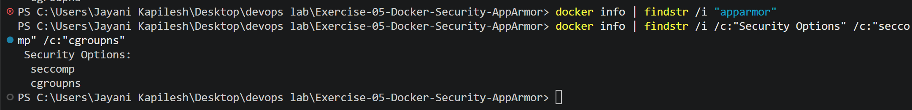
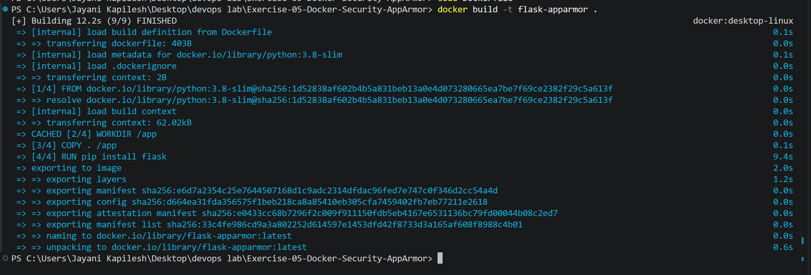
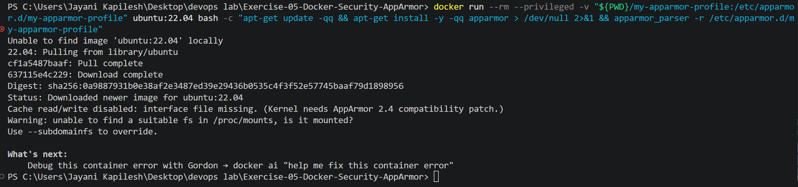
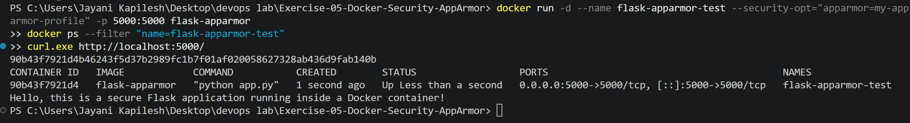
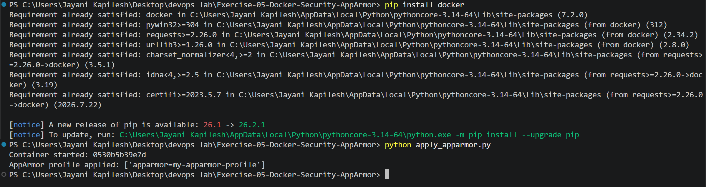
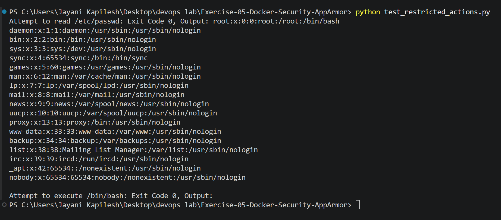

# Exercise 5: Docker Security with AppArmor and Python

## Objective

The goal of this exercise is to understand how to secure Docker containers using AppArmor profiles with Python for enforcement. It also covers applying AppArmor profiles using the Docker SDK for Python and testing restricted actions within the container.

## Scenario

A Python-based Flask web application is deployed using Docker and runs inside a Docker container. It must be secured to restrict access to sensitive directories and prevent unauthorized actions such as executing binaries or accessing restricted files.

The Flask application is containerized, and Docker's SDK is used to apply and verify the AppArmor profile. Finally, restricted actions are tested in the container using Python scripts.

## Files in this Folder

| File | Purpose |
|------|---------|
| `app.py` | Flask application |
| `Dockerfile` | Containerizes the Flask application |
| `my-apparmor-profile` | AppArmor profile |
| `apply_apparmor.py` | Applies the profile using the Docker SDK for Python |
| `test_restricted_actions.py` | Tests restricted actions inside the container |
| `screenshots/` | Screenshots of each step |

---

## Pre-requisites

The lab installs `apparmor-utils` (which provides `apparmor_parser`) on Ubuntu/Debian:

```bash
sudo apt-get update
sudo apt-get install apparmor-utils
```

This exercise was done on **Windows 11 with Docker Desktop** (PowerShell), where `apt-get` is not available on the host. Before starting, the Docker environment was checked for AppArmor support.

**Commands:**

```powershell
docker info | findstr /i "apparmor"
docker info | findstr /i /c:"Security Options" /c:"seccomp" /c:"cgroupns"
```

**Output:**

```text
 Security Options:
  seccomp
  cgroupns
```

The first command returned nothing. Docker Desktop reports only **seccomp** and **cgroupns** as security options; **AppArmor is not available**. AppArmor is a Linux kernel security module, and the Docker Desktop VM (kernel `6.6.87.2-microsoft-standard-WSL2`) does not enable it. All tasks below were still carried out, and the results show what happens when AppArmor is requested on a host that does not support it.



---

## Tasks

### Task 1: Write a Basic Python Flask Application

**File: app.py**

```python
from flask import Flask

app = Flask(__name__)

@app.route('/')
def home():
    return "Hello, this is a secure Flask application running inside a Docker container!"

if __name__ == '__main__':
    app.run(host='0.0.0.0', port=5000)
```

### Task 2: Containerize the Flask Application Using a Dockerfile

**File: Dockerfile**

```dockerfile
# Use an official Python runtime as a parent image
FROM python:3.8-slim

# Set the working directory in the container
WORKDIR /app

# Copy the current directory contents into the container at /app
COPY . /app

# Install Flask
RUN pip install flask

# Expose port 5000
EXPOSE 5000

# Run app.py when the container launches
CMD ["python", "app.py"]
```

#### Build a docker image

Image Name: `flask-apparmor`

```powershell
docker build -t flask-apparmor .
```

#### Output

```text
[+] Building 12.2s (9/9) FINISHED                                    docker:desktop-linux
 => [internal] load build definition from Dockerfile                                 0.1s
 => [internal] load metadata for docker.io/library/python:3.8-slim                   0.1s
 => [1/4] FROM docker.io/library/python:3.8-slim@sha256:1d52838af602...              0.0s
 => CACHED [2/4] WORKDIR /app                                                        0.0s
 => [3/4] COPY . /app                                                                0.1s
 => [4/4] RUN pip install flask                                                      9.4s
 => exporting to image                                                               2.0s
 => => naming to docker.io/library/flask-apparmor:latest                             0.0s
```



---

### Task 3: Create and Apply AppArmor Profile

**File: my-apparmor-profile**

On Linux this file is saved as `/etc/apparmor.d/my-apparmor-profile`. Here it was saved in the exercise folder.

```
#include <tunables/global>

/usr/bin/python3 {
    # Deny access to sensitive system files
    deny /etc/** r,
    deny /var/** rw,

    # Allow Flask app to bind to port 5000
    network inet stream,

    # Permissions to the application directory
    /app/** rwk,

    # Deny execution of any binaries in /bin or /usr/bin
    deny /bin/** rmix,
    deny /usr/bin/** rmix,

    # Capability restrictions
    capability net_bind_service,
    deny capability sys_admin,
}
```

##### Steps to Apply the Profile

**a. Create the AppArmor profile file:** created as `my-apparmor-profile`.

**b. Load the Profile:** `apparmor_parser` is not available on Windows, so the lab's command was run inside an Ubuntu container with the profile mounted at `/etc/apparmor.d/my-apparmor-profile`:

```powershell
docker run --rm --privileged -v "${PWD}/my-apparmor-profile:/etc/apparmor.d/my-apparmor-profile" ubuntu:22.04 bash -c "apt-get update -qq && apt-get install -y -qq apparmor > /dev/null 2>&1 && apparmor_parser -r /etc/apparmor.d/my-apparmor-profile"
```

**Output:**

```text
Cache read/write disabled: interface file missing. (Kernel needs AppArmor 2.4 compatibility patch.)
Warning: unable to find a suitable fs in /proc/mounts, is it mounted?
Use --subdomainfs to override.
```

The profile could not be loaded because the kernel has no AppArmor support (no AppArmor filesystem in `/proc/mounts`).



**c. Run the Docker Container with the Profile:**

```powershell
docker run -d --name flask-apparmor-test --security-opt="apparmor=my-apparmor-profile" -p 5000:5000 flask-apparmor
docker ps --filter "name=flask-apparmor-test"
curl.exe http://localhost:5000/
```

(`-d` and `--name` were added to run the container in the background and refer to it by name.)

**Output:**

```text
90b43f7921d4b46243f5d37b2989fc1b7f01af020058627328ab436d9fab140b
CONTAINER ID   IMAGE            COMMAND           CREATED        STATUS                  PORTS                                         NAMES
90b43f7921d4   flask-apparmor   "python app.py"   1 second ago   Up Less than a second   0.0.0.0:5000->5000/tcp, [::]:5000->5000/tcp   flask-apparmor-test
Hello, this is a secure Flask application running inside a Docker container!
```

The container started and the Flask application responded. Docker **accepted the `--security-opt` option without an error**, even though the profile was never loaded, because Docker only applies AppArmor options when the host supports AppArmor.



The test container was then removed to free port 5000:

```powershell
docker rm -f flask-apparmor-test
```

---

### Task 4: Use Docker SDK for Python to Apply AppArmor Profile

**Install the Docker SDK for Python:**

```powershell
pip install docker
```

```text
Requirement already satisfied: docker in c:\users\jayani kapilesh\appdata\local\python\pythoncore-3.14-64\lib\site-packages (7.2.0)
```

**File: apply_apparmor.py**

```python
import docker

# Create a Docker client
client = docker.from_env()

# Build the Docker image
client.images.build(path=".", tag="flask-apparmor")

# Run the container with the AppArmor profile
container = client.containers.run(
    "flask-apparmor",
    ports={'5000/tcp': 5000},
    security_opt=["apparmor=my-apparmor-profile"],
    detach=True
)

print(f"Container started: {container.short_id}")

# Verify AppArmor profile applied
container_info = client.api.inspect_container(container.id)
apparmor_profile = container_info['HostConfig']['SecurityOpt']

print(f"AppArmor profile applied: {apparmor_profile}")

# Stop the container
container.stop()
```

**Run:**

```powershell
python apply_apparmor.py
```

**Output:**

```text
Container started: 7a939b8e93b0
AppArmor profile applied: ['apparmor=my-apparmor-profile']
```

The output matches the expected output in the lab. The `HostConfig.SecurityOpt` field shows the requested profile.



---

### Task 5: Test Restricted Actions

**File: test_restricted_actions.py**

```python
import docker

# Create a Docker client
client = docker.from_env()

# Run the container with the AppArmor profile
container = client.containers.run(
    "flask-apparmor",
    ports={'5000/tcp': 5000},
    security_opt=["apparmor=my-apparmor-profile"],
    detach=True
)

# Test restricted actions
exit_code, output = container.exec_run("cat /etc/passwd")
print(f"Attempt to read /etc/passwd: Exit Code {exit_code}, Output: {output.decode()}")

exit_code, output = container.exec_run("/bin/bash")
print(f"Attempt to execute /bin/bash: Exit Code {exit_code}, Output: {output.decode()}")

# Stop the container
container.stop()
```

**Run:**

```powershell
python test_restricted_actions.py
```

**Output:**

```text
Attempt to read /etc/passwd: Exit Code 0, Output: root:x:0:0:root:/root:/bin/bash
daemon:x:1:1:daemon:/usr/sbin:/usr/sbin/nologin
bin:x:2:2:bin:/bin:/usr/sbin/nologin
sys:x:3:3:sys:/dev:/usr/sbin/nologin
sync:x:4:65534:sync:/bin:/bin/sync
games:x:5:60:games:/usr/games:/usr/sbin/nologin
man:x:6:12:man:/var/cache/man:/usr/sbin/nologin
lp:x:7:7:lp:/var/spool/lpd:/usr/sbin/nologin
mail:x:8:8:mail:/var/mail:/usr/sbin/nologin
news:x:9:9:news:/var/spool/news:/usr/sbin/nologin
uucp:x:10:10:uucp:/var/spool/uucp:/usr/sbin/nologin
proxy:x:13:13:proxy:/bin:/usr/sbin/nologin
www-data:x:33:33:www-data:/var/www:/usr/sbin/nologin
backup:x:34:34:backup:/var/backups:/usr/sbin/nologin
list:x:38:38:Mailing List Manager:/var/list:/usr/sbin/nologin
irc:x:39:39:ircd:/run/ircd:/usr/sbin/nologin
_apt:x:42:65534::/nonexistent:/usr/sbin/nologin
nobody:x:65534:65534:nobody:/nonexistent:/usr/sbin/nologin

Attempt to execute /bin/bash: Exit Code 0, Output:
```



#### Expected vs Actual Result

| Action | Expected (lab, AppArmor enforced) | Actual (Docker Desktop, no AppArmor) |
|--------|-----------------------------------|--------------------------------------|
| `cat /etc/passwd` | Exit Code 1 (denied by `deny /etc/** r`) | Exit Code 0, file contents printed |
| `/bin/bash` | Exit Code 126 (denied by `deny /bin/** rmix`) | Exit Code 0 (bash started and exited, no input) |

Both restricted actions succeeded because the profile was **requested but not enforced**. `HostConfig.SecurityOpt` (Task 4) shows what was requested, not what the kernel enforces. To see the expected results (exit codes 1 and 126), the exercise must run on a Linux host with AppArmor enabled and the profile loaded with `apparmor_parser`.

---

## Questions

1. What is the purpose of using AppArmor with Docker containers?
2. How do AppArmor profiles help secure a Docker container?
3. Why is it important to restrict access to sensitive directories such as /etc/ and /var/?
4. What other capabilities can you restrict using AppArmor profiles?
5. How can you verify if an AppArmor profile is successfully applied to a Docker container?

## Answers

**1. What is the purpose of using AppArmor with Docker containers?**

AppArmor enforces security policies that confine an application to a limited set of resources. With Docker containers, it limits access to system resources, files and networks, providing an additional layer of security on top of Docker's default isolation.

**2. How do AppArmor profiles help secure a Docker container?**

An AppArmor profile defines what a containerized application can or cannot do. It restricts access to sensitive directories, network capabilities, file execution and system calls, so the container behaves securely and cannot affect the host system even if the application is compromised.

**3. Why is it important to restrict access to sensitive directories such as /etc/ and /var/?**

`/etc/` contains configuration files and sensitive information such as user accounts and system settings, and `/var/` contains logs, caches and application data. Restricting access prevents the container from reading or modifying important system files, reducing the risk of security breaches. In Task 5, `cat /etc/passwd` succeeded because the profile was not enforced, which shows exactly the kind of access the `deny /etc/** r` rule is meant to block.

**4. What other capabilities can you restrict using AppArmor profiles?**

AppArmor can restrict a container's ability to access the network, bind to specific ports, execute binaries, write to specific directories, mount filesystems, and use Linux capabilities such as `cap_sys_admin` (system administration).

**5. How can you verify if an AppArmor profile is successfully applied to a Docker container?**

The profile can be checked by inspecting the container with the Docker SDK (`client.api.inspect_container()`) or `docker inspect`; the `HostConfig.SecurityOpt` field shows the applied security options, including the AppArmor profile name. However, this exercise showed that this field only shows the **requested** profile. To confirm that it is **enforced**, also check that the host supports AppArmor (`docker info` lists `apparmor` under Security Options), that the profile is loaded (`apparmor_parser` succeeds), and that restricted actions actually fail (as tested in Task 5).

---

## Result

The Flask application was containerized as `flask-apparmor`, the AppArmor profile was created, and the profile was applied both with `docker run --security-opt` and with the Docker SDK for Python. `apply_apparmor.py` produced the expected output (`AppArmor profile applied: ['apparmor=my-apparmor-profile']`). However, the profile could not be loaded (`apparmor_parser`: *Kernel needs AppArmor 2.4 compatibility patch*) because Docker Desktop on Windows does not support AppArmor, so the restricted actions in Task 5 were not blocked. This demonstrates that a security option can be accepted and shown in the container configuration without being enforced, and that enforcement must be verified by testing.