# Exercise 6: Real-Time Operations Monitoring and Alerting

## Objective

You are a DevOps engineer in ZAPPTTO managing a fast-paced delivery service that needs real-time insights into operational efficiency and delivery performance. The task is to create a monitoring application to provide insights on the performance of the delivery service.

## Approach

Using Python, Prometheus, Grafana and Jenkins, create a pipeline that simulates delivery metrics, visualizes them on dashboards and sets up automated alerts to ensure smooth operations and quick problem detection.

> **Platform note:** This exercise was done on **Windows 11 with Docker Desktop** (PowerShell). The lab instructions use Linux networking (`--network=host` and the bridge IP `172.17.0.1`), which does not work on Docker Desktop for Windows. As the lab's own note suggests for Windows, **`host.docker.internal`** was used instead, and ports were published with `-p`.

---

## 1. Prerequisites

- **Docker:** Docker Desktop (Docker Engine 29.4.0)
- **Python:** 3.14.3
- **Jenkins:** `jenkins/jenkins:lts` (Docker)
- **Prometheus:** `prom/prometheus` (Docker)
- **Grafana:** `grafana/grafana` (Docker)

## 2a. Install Packages

**Command:**

```powershell
pip install prometheus-client
```

**Output:**

```text
Requirement already satisfied: prometheus-client in c:\users\jayani kapilesh\appdata\local\python\pythoncore-3.14-64\lib\site-packages (0.26.0)
```

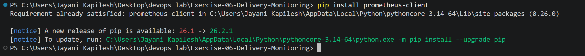

## 2. Code Directory Structure

```text
Exercise-06-Delivery-Monitoring/
├── delivery_metrics.py   # Python script to simulate metrics
├── prometheus.yml        # Prometheus configuration
├── alert_rules.yml       # Alerts configuration
├── Jenkinsfile           # Jenkins pipeline script
├── Dockerfile            # Image for delivery_metrics (used by the Jenkins pipeline)
└── screenshots/
```

**Commands:**

```powershell
mkdir Exercise-06-Delivery-Monitoring
cd Exercise-06-Delivery-Monitoring
New-Item delivery_metrics.py, prometheus.yml, alert_rules.yml, Jenkinsfile
```

---

## 3. Steps to Set Up and Simulate

### Step 1: Write the Python Application

**File: delivery_metrics.py**

```python
from prometheus_client import start_http_server, Summary, Gauge
import random
import time

# Metrics
total_deliveries = Gauge("total_deliveries", "Total number of deliveries")
pending_deliveries = Gauge("pending_deliveries", "Number of pending deliveries")
on_the_way_deliveries = Gauge("on_the_way_deliveries", "Number of deliveries on the way")
average_delivery_time = Summary("average_delivery_time", "Average delivery time in seconds")

# Simulate delivery statuses
def simulate_delivery():
    #pending = random.randint(10, 50)
    pending = random.randint(10, 20)  # Ensure values exceed the threshold
    on_the_way = random.randint(5, 20)
    delivered = random.randint(30, 70)
    avg_time = random.uniform(15, 45)

    total = pending + on_the_way + delivered

    print(f"[DEBUG] Total deliveries: {total}")
    print(f"[DEBUG] Pending deliveries: {pending}")
    print(f"[DEBUG] On-the-way deliveries: {on_the_way}")
    print(f"[DEBUG] Average delivery time: {avg_time:.2f} seconds")

    total_deliveries.set(total)
    pending_deliveries.set(pending)
    on_the_way_deliveries.set(on_the_way)
    average_delivery_time.observe(avg_time)

if __name__ == "__main__":
    print("[INFO] Starting the HTTP server on port 8000...")
    start_http_server(8000, addr="0.0.0.0")
    print("[INFO] HTTP server started. Simulating deliveries...")
    while True:
        simulate_delivery()
        print("[INFO] Sleeping for 1 seconds...")
        time.sleep(1)
```

**Run the script:**

```powershell
python delivery_metrics.py
```

**Output:**

```text
[INFO] Starting the HTTP server on port 8000...
[INFO] HTTP server started. Simulating deliveries...
[DEBUG] Total deliveries: 79
[DEBUG] Pending deliveries: 19
[DEBUG] On-the-way deliveries: 10
[DEBUG] Average delivery time: 27.37 seconds
[INFO] Sleeping for 1 seconds...
[DEBUG] Total deliveries: 59
[DEBUG] Pending deliveries: 11
[DEBUG] On-the-way deliveries: 8
[DEBUG] Average delivery time: 26.20 seconds
[INFO] Sleeping for 1 seconds...
```

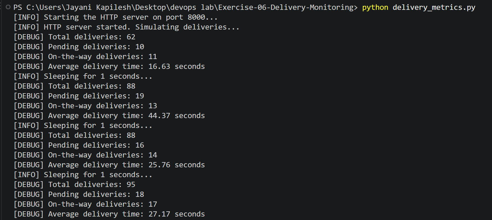

**Access metrics at** http://localhost:8000/metrics

```powershell
curl.exe http://localhost:8000/metrics
```

**Output (custom metrics):**

```text
# HELP python_info Python platform information
# TYPE python_info gauge
python_info{implementation="CPython",major="3",minor="14",patchlevel="3",version="3.14.3"} 1.0
# HELP total_deliveries Total number of deliveries
# TYPE total_deliveries gauge
total_deliveries 66.0
# HELP pending_deliveries Number of pending deliveries
# TYPE pending_deliveries gauge
pending_deliveries 14.0
# HELP on_the_way_deliveries Number of deliveries on the way
# TYPE on_the_way_deliveries gauge
on_the_way_deliveries 19.0
# HELP average_delivery_time Average delivery time in seconds
# TYPE average_delivery_time summary
average_delivery_time_count 133.0
average_delivery_time_sum 3981.8964669868033
```

`curl.exe` is used because `curl` in PowerShell is an alias for `Invoke-WebRequest`. The `process_*` metrics shown in the lab output are not present because `prometheus_client` only collects process metrics on Linux.

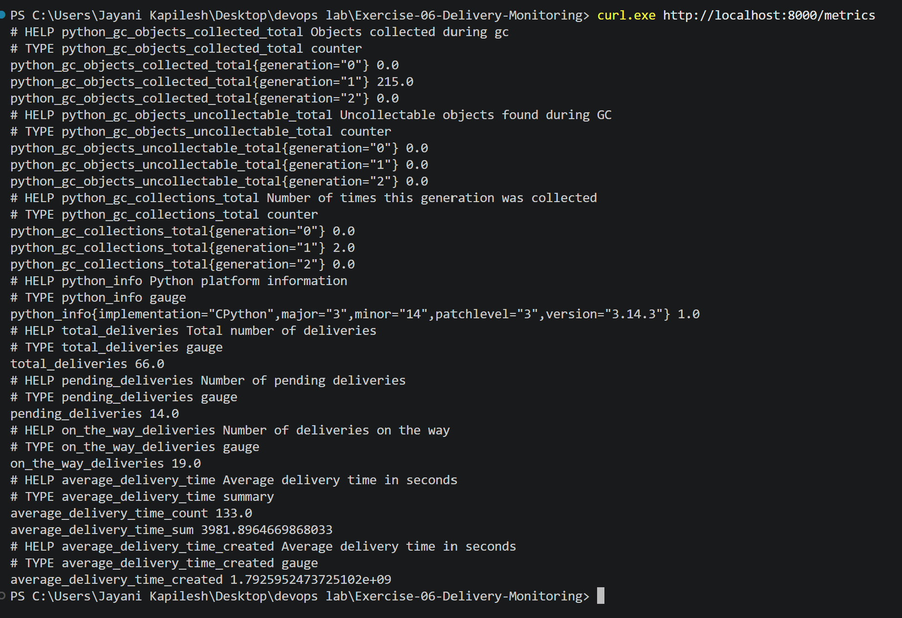

**Note about /metrics:**

1. The `/metrics` endpoint is created automatically by `prometheus_client` when `start_http_server` is called.
2. `start_http_server(8000)` starts an HTTP server on port **8000**.
3. Each metric has a name (e.g. `total_deliveries`), a description (e.g. "Total number of deliveries") and a type.
4. Types used: **Gauge** (values that go up and down) and **Summary** (exposes `_count` and `_sum`, used to calculate the average).

---

### Step 2a: Configure Prometheus

**File: prometheus.yml**

```yaml
scrape_configs:
  - job_name: "prometheus"
    static_configs:
      - targets: ["localhost:9090"]

  - job_name: "delivery_service"
    static_configs:
      - targets: ["host.docker.internal:8000"]

rule_files:
  - /etc/prometheus/alert_rules.yml
```

The target `172.17.0.1:8000` was changed to `host.docker.internal:8000`, which lets the Prometheus container reach the Python script running on the Windows host.

### Step 2b: Configure Alerts

**File: alert_rules.yml**

```yaml
groups:
  - name: delivery_alerts
    rules:
      - alert: HighPendingDeliveries
        expr: pending_deliveries > 10
        for: 15s
        labels:
          severity: warning
        annotations:
          summary: "High pending deliveries"
          description: "Pending deliveries are above 10 for the last 15 second."

      - alert: HighAverageDeliveryTime
        expr:  (average_delivery_time_sum / average_delivery_time_count) > 30
        labels:
          severity: critical
        annotations:
          summary: "High average delivery time"
          description: "Average delivery time is above 30 seconds for the last 15 seconds."
```

**Note about prometheus.yml:**

1. `scrape_configs` defines the scraping (metric reading) jobs.
2. `job_name` names each scraping job.
3. `targets` lists the endpoints Prometheus reads metrics from.
4. `host.docker.internal` resolves to the host machine from inside a Docker container on Windows/macOS.
5. Prometheus sends HTTP GET requests to `http://host.docker.internal:8000/metrics` every **15s** (default interval).

### Run Prometheus

`--network=host` is not supported on Docker Desktop for Windows, so the port was published with `-p 9090:9090` and `host.docker.internal` was mapped with `--add-host`.

**Command:**

```powershell
docker run -d --name prometheus -p 9090:9090 --add-host=host.docker.internal:host-gateway -v "${PWD}/prometheus.yml:/etc/prometheus/prometheus.yml" -v "${PWD}/alert_rules.yml:/etc/prometheus/alert_rules.yml" prom/prometheus
```

**Verify:**

```powershell
docker ps --filter "name=prometheus"
```

**Output:**

```text
a453bd3f28d13638229ca14f29f7bb6b62c33fefc9349863ca38e2936cdb944d
CONTAINER ID   IMAGE             COMMAND                  CREATED        STATUS                  PORTS                                         NAMES
a453bd3f28d1   prom/prometheus   "/bin/prometheus --c…"   1 second ago   Up Less than a second   0.0.0.0:9090->9090/tcp, [::]:9090->9090/tcp   prometheus
```

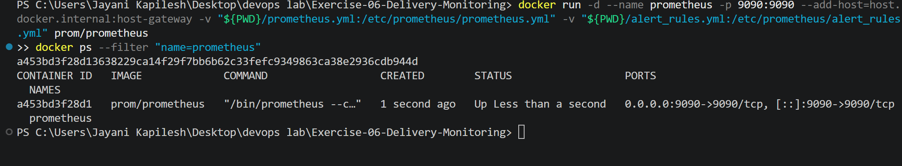

**Access Prometheus at** http://localhost:9090

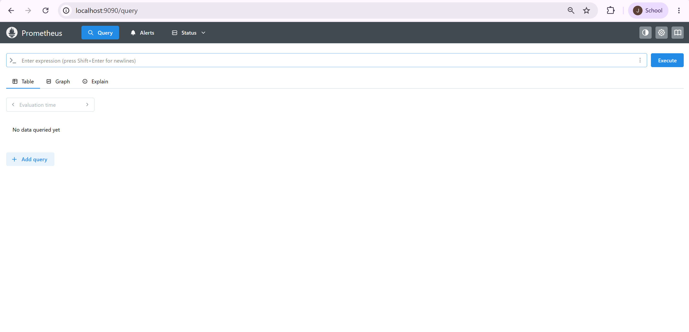

**Verify Targets via Prometheus → Status → Targets**

Both `prometheus` and `delivery_service` are **UP**.

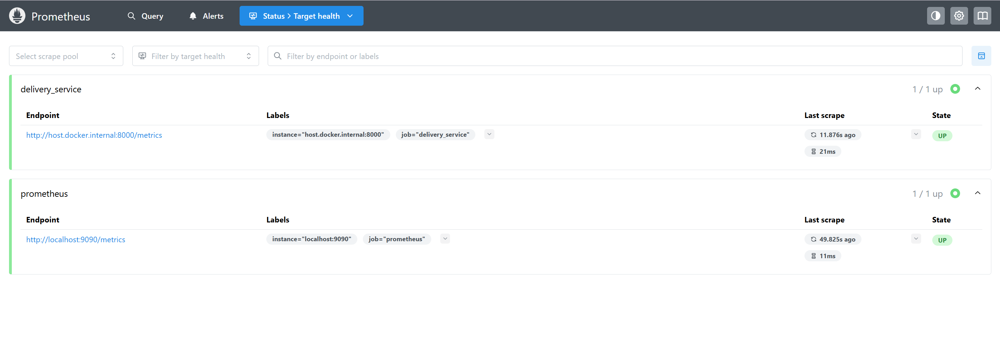

---

### Step 3: Set Up Grafana

**Command:**

```powershell
docker run -d --name grafana -p 3000:3000 --add-host=host.docker.internal:host-gateway grafana/grafana
docker ps --filter "name=grafana"
```

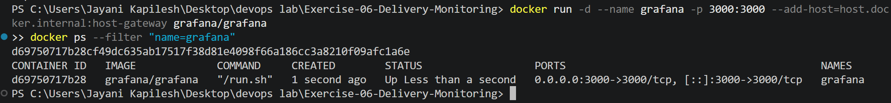

#### Step 3a: Access Grafana

Opened Grafana at http://localhost:3000

#### Step 3b: Log in with the default credentials and skip update password

- Username: `admin`
- Password: `admin`

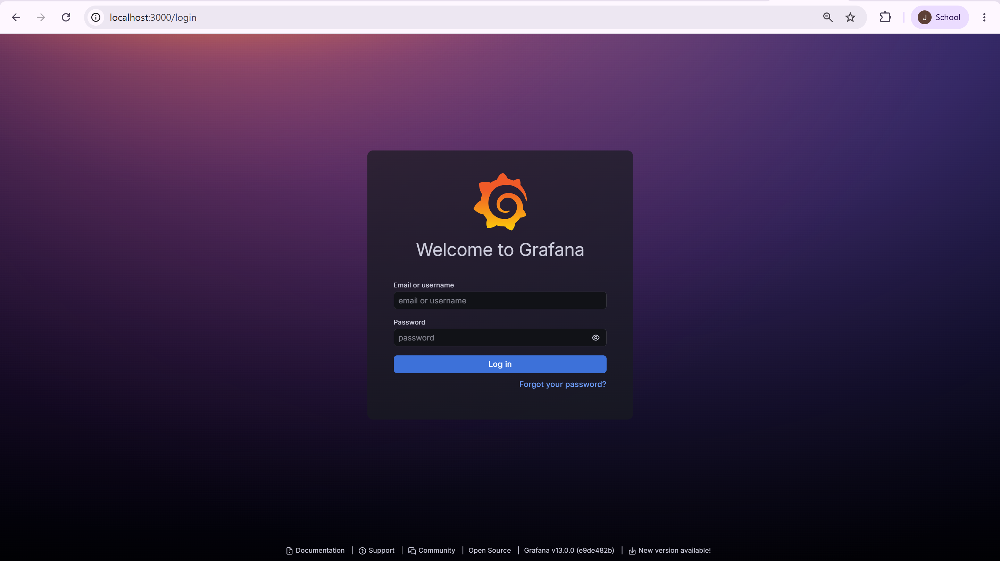

#### Step 3c: Add Prometheus as a Data Source

**Path:** Home → Connections → Data sources → Add data source → Prometheus

- **URL:** `http://host.docker.internal:9090` (Windows equivalent of `http://172.17.0.1:9090`)
- Other fields left as default
- Clicked **Save & test**: *"Successfully queried the Prometheus API."*

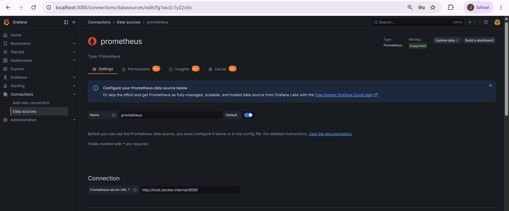

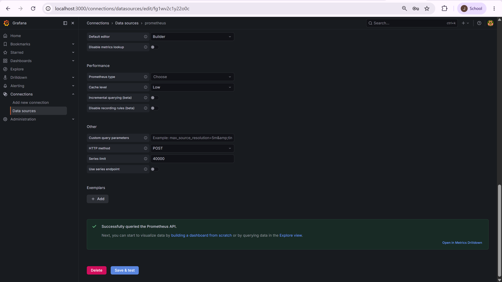

#### Step 3d: Verify Targets and Alerts

**Prometheus → Alerts:** both alert rules were loaded from `/etc/prometheus/alert_rules.yml`.

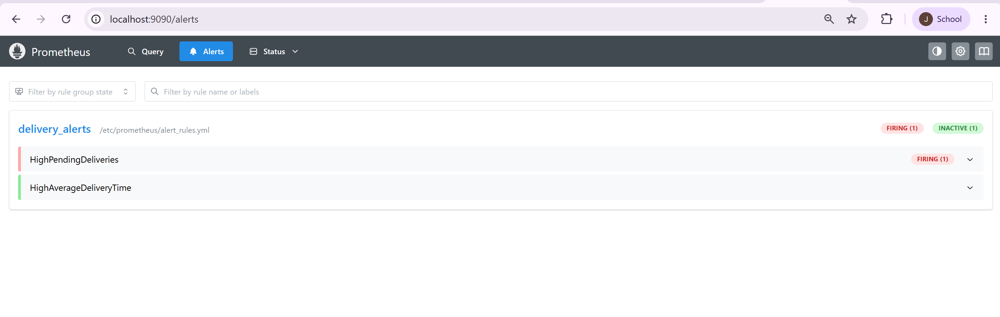

After a few minutes both alerts were **FIRING**:

| Alert | Severity | Value | State |
|-------|----------|-------|-------|
| HighPendingDeliveries | warning | 17 | FIRING |
| HighAverageDeliveryTime | critical | 30.088 | FIRING |

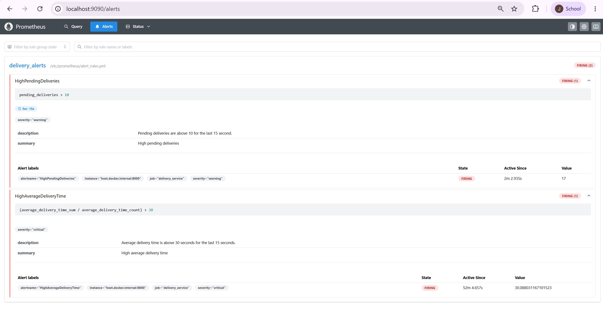

#### Create a New Dashboard

Created a dashboard named **Delivery Monitoring** with the following panels:

| Panel | Query |
|-------|-------|
| Panel 1: Total Deliveries | `total_deliveries` |
| Panel 2: Pending Deliveries | `pending_deliveries` |
| Panel 3: On-the-Way Deliveries | `on_the_way_deliveries` |
| Panel 4: Average Delivery Time | `average_delivery_time_sum / average_delivery_time_count` |

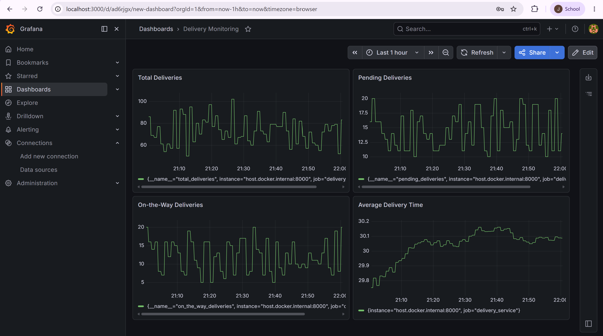

---

### Step 5: Create the Jenkins Pipeline

#### Step 5a: Check Jenkins Docker Status

**Command:**

```powershell
docker ps -a --filter "name=jenkins"
```

**Output:**

```text
CONTAINER ID   IMAGE                 COMMAND                  CREATED        STATUS                     PORTS                                                                                          NAMES
3a1bc12f93da   jenkins/jenkins:lts   "/usr/bin/tini -- /u…"   33 hours ago   Up 33 hours                0.0.0.0:8080->8080/tcp, [::]:8080->8080/tcp, 0.0.0.0:50000->50000/tcp, [::]:50000->50000/tcp   jenkins
4290c6d91eea   jenkins/jenkins:lts   "/usr/bin/tini -- /u…"   47 hours ago   Exited (137) 3 hours ago                                                                                                  delivery-jenkins
```

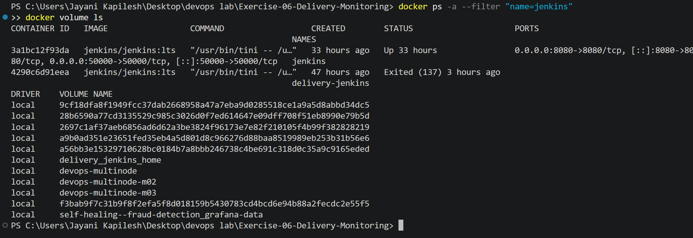

To start a fresh instance, the existing `jenkins` container (from Exercises 7–9) was stopped and renamed instead of removed, so its jobs are kept:

```powershell
docker stop jenkins
docker rename jenkins jenkins-ex7-9
```

#### Step 5b: Start Jenkins with Docker

**Command:**

```powershell
docker run -d -p 8080:8080 -p 50000:50000 --name jenkins -v jenkins_home:/var/jenkins_home -v /var/run/docker.sock:/var/run/docker.sock -v "${PWD}:/delivery_monitoring" jenkins/jenkins:lts
```

Two volume mounts were added to the lab's command:

- `-v /var/run/docker.sock:/var/run/docker.sock` – lets Jenkins run Docker commands on Docker Desktop (needed by every stage of the Jenkinsfile).
- `-v "${PWD}:/delivery_monitoring"` – makes the exercise files available inside Jenkins for the **Setup Workspace** stage (`localSourcePath`).

**Verify:**

```powershell
docker ps -a --filter "name=jenkins"
```

```text
CONTAINER ID   IMAGE                 COMMAND                  CREATED        STATUS                            PORTS                                                                                          NAMES
f8ccb8d171d5   jenkins/jenkins:lts   "/usr/bin/tini -- /u…"   1 second ago   Up Less than a second             0.0.0.0:8080->8080/tcp, [::]:8080->8080/tcp, 0.0.0.0:50000->50000/tcp, [::]:50000->50000/tcp   jenkins
3a1bc12f93da   jenkins/jenkins:lts   "/usr/bin/tini -- /u…"   34 hours ago   Exited (137) About a minute ago                                                                                                  jenkins-ex7-9
4290c6d91eea   jenkins/jenkins:lts   "/usr/bin/tini -- /u…"   47 hours ago   Exited (137) 3 hours ago                                                                                                         delivery-jenkins
```

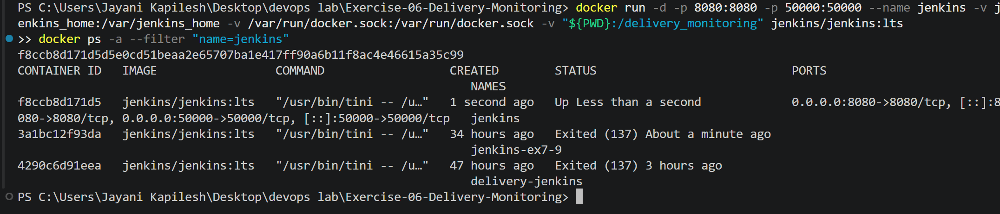

**Finding the Initial Admin Password:**

```powershell
docker exec -it jenkins bash
```

```bash
cat /var/jenkins_home/secrets/initialAdminPassword
exit
```

The password (not shown for security reasons) was used to unlock Jenkins at http://localhost:8080. The suggested plugins were installed and an admin user was created.

**Docker CLI inside Jenkins:** The `jenkins/jenkins:lts` image does not include the Docker CLI, so the **Pre-check Docker** stage would fail. It was installed inside the container as root:

```powershell
docker exec -it -u root jenkins bash
```

```bash
apt-get update
apt-get install -y docker.io
chmod 666 /var/run/docker.sock
exit
```

**Verify:**

```powershell
docker exec jenkins docker --version
docker exec jenkins docker ps
```

```text
Docker version 26.1.5+dfsg1, build a72d7cd
CONTAINER ID   IMAGE                 COMMAND                  CREATED          STATUS          PORTS                    NAMES
f8ccb8d171d5   jenkins/jenkins:lts   "/usr/bin/tini -- /u…"   12 minutes ago   Up 12 minutes   0.0.0.0:8080->8080/tcp   jenkins
d69750717b28   grafana/grafana       "/run.sh"                49 minutes ago   Up 49 minutes   0.0.0.0:3000->3000/tcp   grafana
a453bd3f28d1   prom/prometheus       "/bin/prometheus --c…"   2 hours ago      Up 24 minutes   0.0.0.0:9090->9090/tcp   prometheus
```

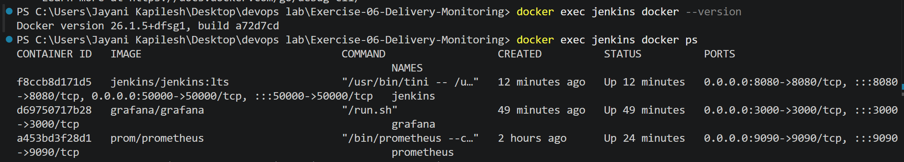

#### Step 5c: Create a file named Jenkinsfile

**File: Dockerfile** (required by the **Build Docker Image** stage; not provided in the lab)

```dockerfile
FROM python:3.10-slim
WORKDIR /app
COPY delivery_metrics.py .
RUN pip install prometheus-client
EXPOSE 8000
CMD ["python", "-u", "delivery_metrics.py"]
```

**File: Jenkinsfile** (lab Jenkinsfile; changes are marked with `// CHANGED`)

```groovy
pipeline {
    agent any
    stages {
        stage('Pre-check Docker') {
            steps {
                script {
                    try {
                        // Check if Docker is installed
                        def dockerVersion = sh(script: 'docker --version', returnStdout: true).trim()
                        if (!dockerVersion) {
                            error "Docker is not installed or not in the PATH. Please install Docker."
                        }

                        // Check if Docker daemon is running
                        def dockerInfo = sh(script: 'docker info', returnStatus: true)
                        if (dockerInfo != 0) {
                            error "Docker daemon is not running. Please start the Docker service."
                        }

                        echo "Docker is available and running: ${dockerVersion}"
                    } catch (Exception e) {
                        error "Pre-check failed: ${e.message}"
                    }
                }
            }
        }
        stage('Setup Workspace') {
            steps {
                script {
                    // CHANGED: exercise folder is mounted into Jenkins at /delivery_monitoring
                    def localSourcePath = '/delivery_monitoring'
                    def workspacePath = env.WORKSPACE

                    // Copy necessary files into the Jenkins workspace
                    // CHANGED: also copy the Dockerfile needed by 'Build Docker Image'
                    sh """
                    cp ${localSourcePath}/delivery_metrics.py ${workspacePath}/
                    cp ${localSourcePath}/prometheus.yml ${workspacePath}/
                    cp ${localSourcePath}/alert_rules.yml ${workspacePath}/
                    cp ${localSourcePath}/Dockerfile ${workspacePath}/
                    """
                }
            }
        }
        stage('Cleanup Old Containers') {
            steps {
                // CHANGED: remove containers from a previous run so the pipeline can be re-run
                sh 'docker rm -f delivery_metrics prometheus grafana || true'
            }
        }
        stage('Build Docker Image') {
            steps {
                sh 'docker build -t delivery_metrics .'
            }
        }
        stage('Run Application') {
            steps {
                sh 'docker run -d -p 8000:8000 --name delivery_metrics delivery_metrics'
            }
        }
        stage('Run Prometheus & Grafana') {
            steps {
                // CHANGED: Docker runs on the host, so $WORKSPACE paths cannot be bind-mounted.
                // The config files are copied into the container with 'docker cp' instead.
                sh '''
                docker create --name prometheus -p 9090:9090 \
                  --add-host=host.docker.internal:host-gateway \
                  prom/prometheus
                docker cp $WORKSPACE/prometheus.yml prometheus:/etc/prometheus/prometheus.yml
                docker cp $WORKSPACE/alert_rules.yml prometheus:/etc/prometheus/alert_rules.yml
                docker start prometheus
                docker run -d --name grafana -p 3000:3000 grafana/grafana
                '''
            }
        }
    }
}
```

**Why the changes were needed:**

| Change | Reason |
|--------|--------|
| `localSourcePath = '/delivery_monitoring'` | The lab uses a placeholder path; the exercise folder is mounted at this path in Step 5b. |
| Copy `Dockerfile` + new `Dockerfile` file | `docker build -t delivery_metrics .` needs a Dockerfile, which the lab does not provide. |
| `Cleanup Old Containers` stage | `docker run --name ...` fails if a container with the same name already exists, so the pipeline could only run once. |
| `docker create` + `docker cp` for Prometheus | The `docker` commands run on Docker Desktop, not inside Jenkins, so `-v $WORKSPACE/...` would point to a path that does not exist on the host. `docker cp` copies the files from the Jenkins workspace into the container instead. |

Before running the pipeline, the manually started containers were stopped and renamed so the pipeline could use the same names and ports, and the Python script was stopped (Ctrl+C) to free port 8000:

```powershell
docker stop prometheus grafana
docker rename prometheus prometheus-manual
docker rename grafana grafana-manual
docker rename delivery_metrics delivery_metrics-old
```

#### Use the Jenkinsfile Directly in the Jenkins Web Interface

1. Jenkins → **New Item** → name `delivery-monitoring-pipeline` → **Pipeline** → **OK**
2. **Pipeline → Definition:** **Pipeline script**
3. Pasted the Jenkinsfile into the **Script** section
4. **Save** → **Build Now**

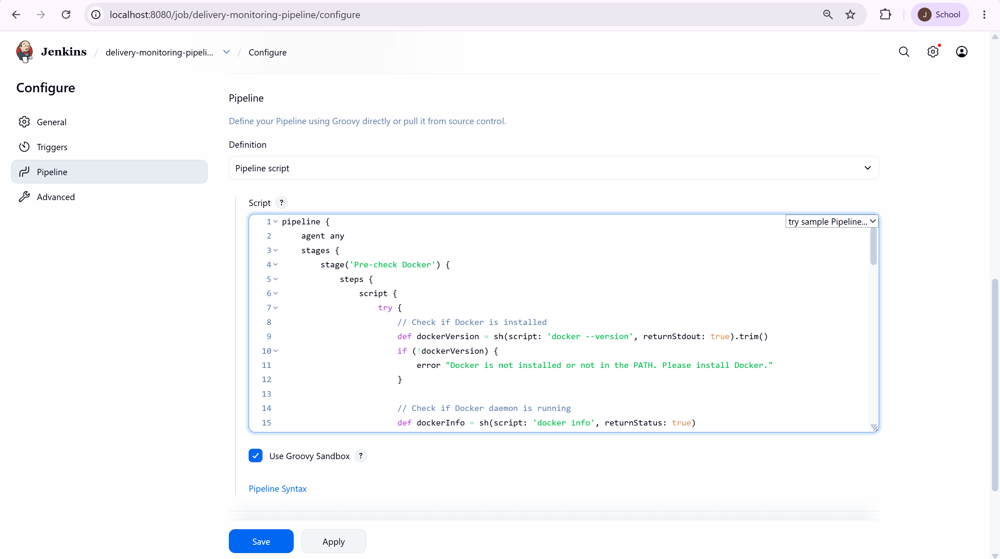

**Result:** All stages completed successfully.

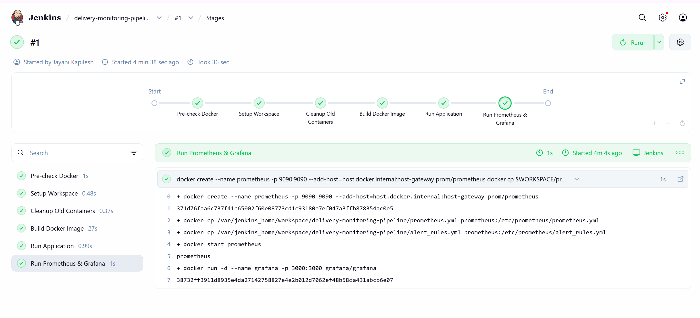

**Console Output (Build #1, Docker commands):**

```text
Started by user Jayani Kapilesh
[Pipeline] Start of Pipeline
[Pipeline] node
Running on Jenkins in /var/jenkins_home/workspace/delivery-monitoring-pipeline
[Pipeline] { (Pre-check Docker)
+ docker --version
+ docker info
Client:
 Version:    26.1.5+dfsg1
 ...
Server:
 Containers: 25
  Running: 9
 Server Version: 29.4.0
 Kernel Version: 6.6.87.2-microsoft-standard-WSL2
 Operating System: Docker Desktop
 ...
[Pipeline] echo
Docker is available and running: Docker version 26.1.5+dfsg1, build a72d7cd
[Pipeline] { (Setup Workspace)
+ cp /delivery_monitoring/delivery_metrics.py /var/jenkins_home/workspace/delivery-monitoring-pipeline/
+ cp /delivery_monitoring/prometheus.yml /var/jenkins_home/workspace/delivery-monitoring-pipeline/
+ cp /delivery_monitoring/alert_rules.yml /var/jenkins_home/workspace/delivery-monitoring-pipeline/
+ cp /delivery_monitoring/Dockerfile /var/jenkins_home/workspace/delivery-monitoring-pipeline/
[Pipeline] { (Cleanup Old Containers)
+ docker rm -f delivery_metrics prometheus grafana
Error response from daemon: No such container: delivery_metrics
Error response from daemon: No such container: prometheus
Error response from daemon: No such container: grafana
[Pipeline] { (Build Docker Image)
+ docker build -t delivery_metrics .
#5 [1/4] FROM docker.io/library/python:3.10-slim
#6 [2/4] WORKDIR /app
#7 [3/4] COPY delivery_metrics.py .
#8 [4/4] RUN pip install prometheus-client
#8 9.139 Successfully installed prometheus-client-0.26.0
#9 naming to docker.io/library/delivery_metrics:latest done
[Pipeline] { (Run Application)
+ docker run -d -p 8000:8000 --name delivery_metrics delivery_metrics
5c122cb80eae6caa1abafd7dcfa42891e21a8c35c4c32d55b6dbd4b032ac7d00
[Pipeline] { (Run Prometheus & Grafana)
+ docker create --name prometheus -p 9090:9090 --add-host=host.docker.internal:host-gateway prom/prometheus
371d76faa6c737f41c65002f60e08773cd1c93180e7ef047a3ffb878354ac0e5
+ docker cp /var/jenkins_home/workspace/delivery-monitoring-pipeline/prometheus.yml prometheus:/etc/prometheus/prometheus.yml
+ docker cp /var/jenkins_home/workspace/delivery-monitoring-pipeline/alert_rules.yml prometheus:/etc/prometheus/alert_rules.yml
+ docker start prometheus
prometheus
+ docker run -d --name grafana -p 3000:3000 grafana/grafana
38732ff3911d8935e4da27142758827e4e2b012d7062ef48b58da431abcb6e07
[Pipeline] End of Pipeline
Finished: SUCCESS
```

The "No such container" messages in **Cleanup Old Containers** are expected on the first run (`|| true` lets the stage continue).

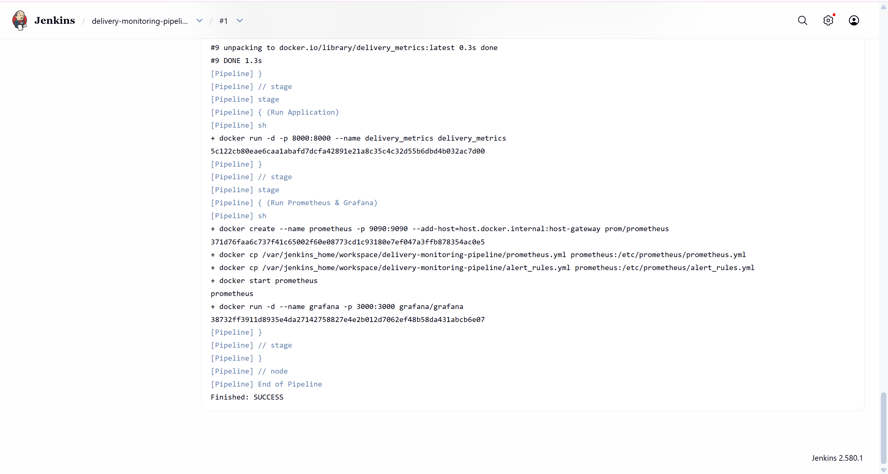

---

### Step 6: Simulate Alerts

Modified `delivery_metrics.py` to increase `pending_deliveries` values:

```python
    pending = random.randint(50, 100)  # Increase range to exceed alert threshold
```

Restarted the Python script and Prometheus:

```powershell
python delivery_metrics.py
docker restart prometheus
```

The script now prints pending deliveries between 50 and 100.

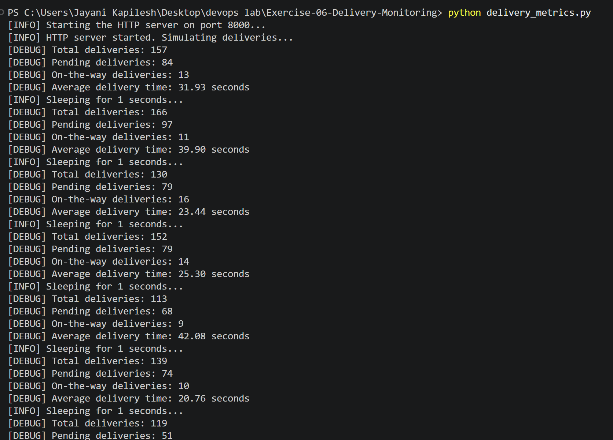

**Prometheus UI:** **HighPendingDeliveries** is FIRING with value **73** (previously 17).

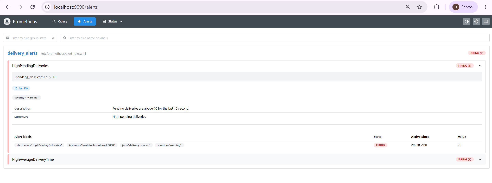

**Grafana:** the **Pending Deliveries** panel jumps from 10–20 to 55–80 after the change. The short gap is the time the script was restarted, and the **Average Delivery Time** panel restarts because the Summary metric resets when the script restarts.

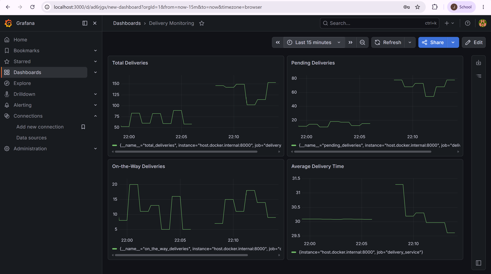

---

## Expected Outputs

| Expected Output | Result |
|-----------------|--------|
| **Metrics Endpoint:** http://localhost:8000/metrics | ✅ `total_deliveries`, `pending_deliveries`, `on_the_way_deliveries`, `average_delivery_time` exposed |
| **Prometheus Query:** graphs for the delivery metrics | ✅ `pending_deliveries` graph below |
| **Grafana Dashboard:** visualizations for delivery metrics and trends | ✅ Delivery Monitoring dashboard with 4 panels |
| **Jenkins Logs:** successful pipeline build with logs for Docker commands | ✅ Build #1 `Finished: SUCCESS` |
| **Prometheus Alerts:** critical alerts for high pending deliveries | ✅ HighPendingDeliveries and HighAverageDeliveryTime FIRING |

**Prometheus Query graph (`pending_deliveries`, last 1 hour):** values stay between 10 and 20, then rise to 55–83 after Step 6. (Times are shown in UTC.)

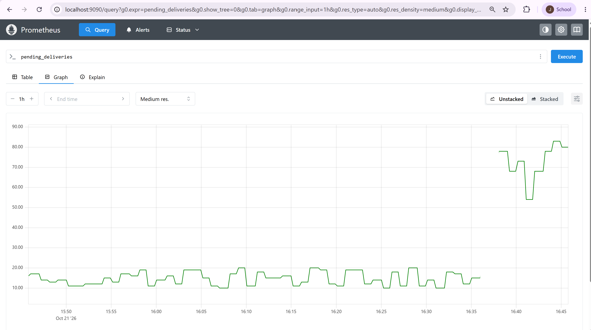