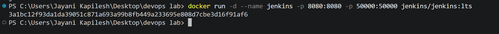
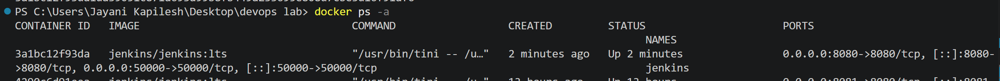
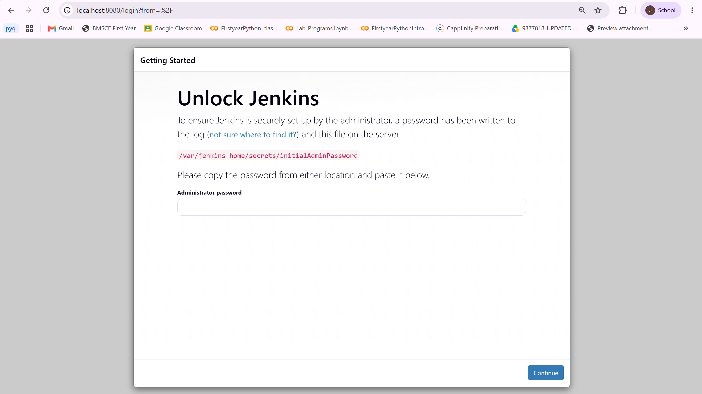
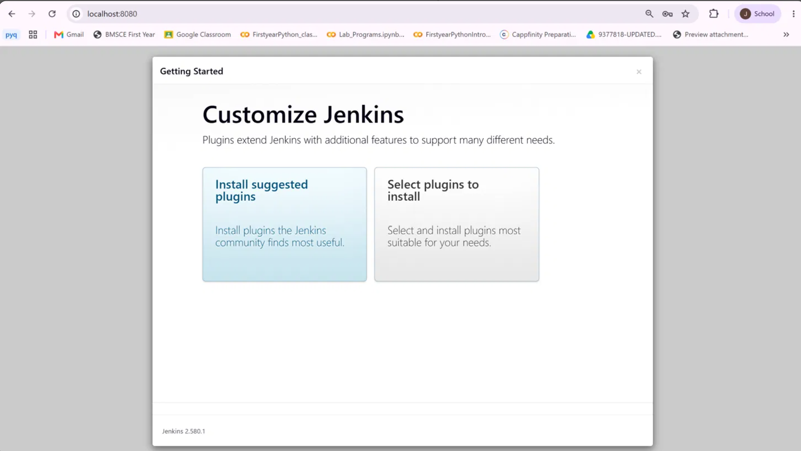
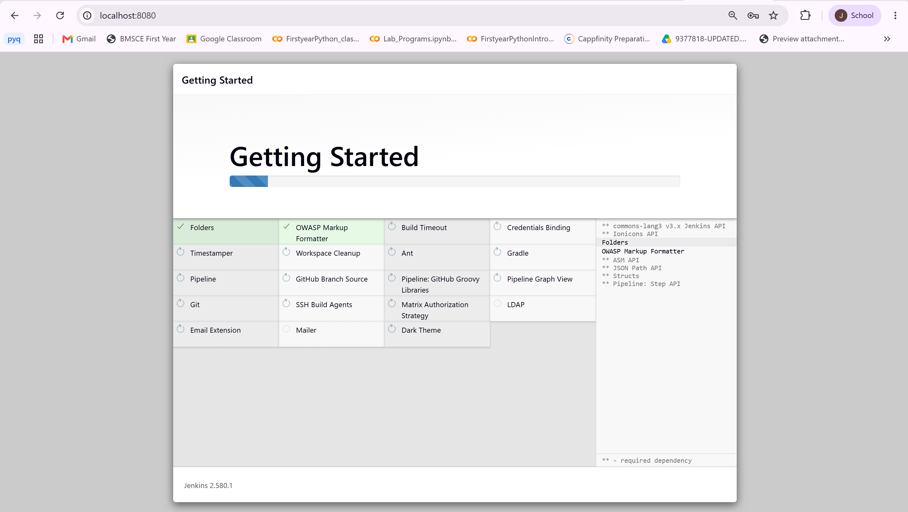
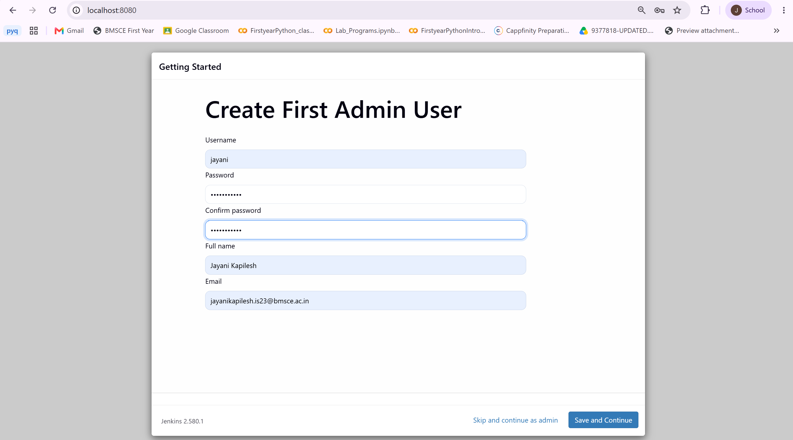
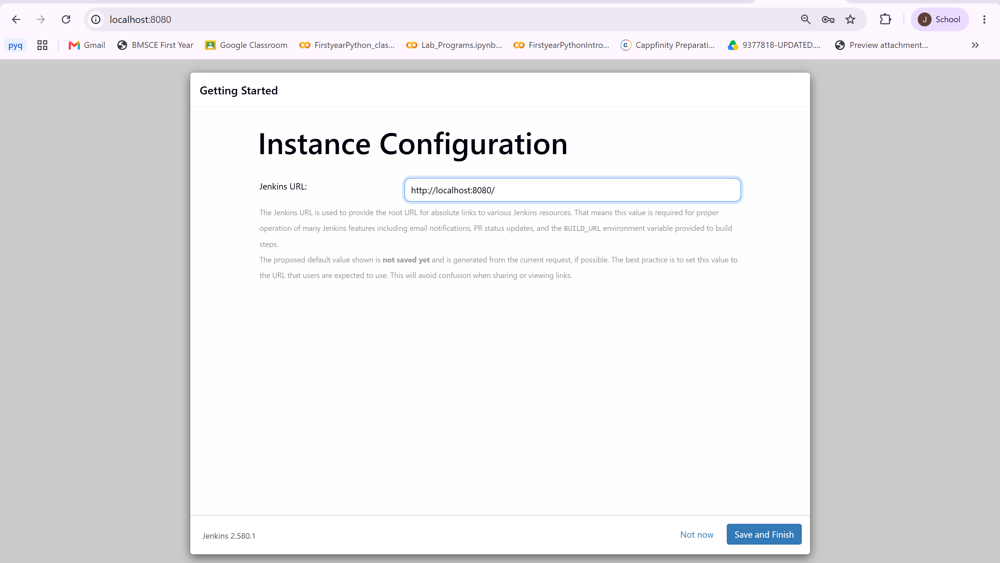
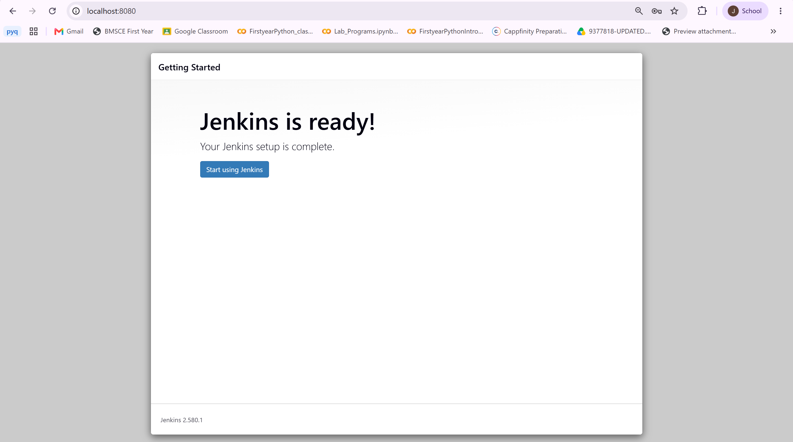
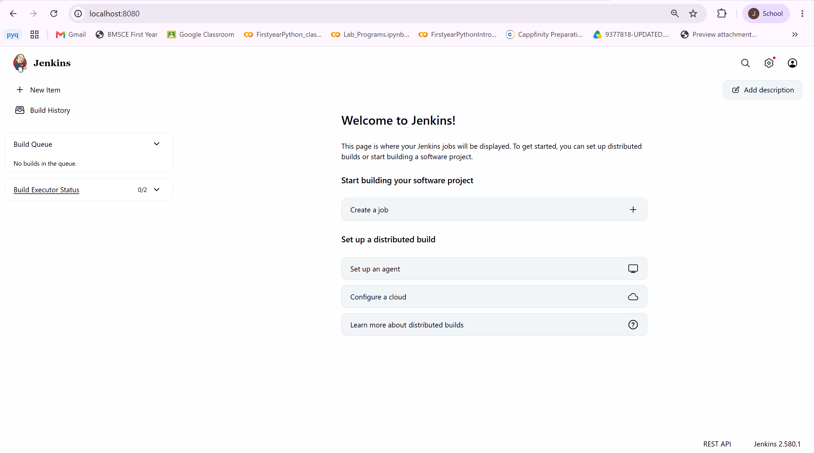

# Exercise 7: Introduction to Continuous Integration (CI) and Jenkins Installation

## Objective

Understand the concept of Continuous Integration (CI), explore popular CI tools, and install Jenkins using Docker.

## Technologies Used

- Docker Desktop
- Jenkins (LTS) Docker image
- PowerShell
- Web browser

---

## Part A: Continuous Integration (CI)

### What is Continuous Integration?

Continuous Integration is a software development practice in which developers merge their code changes into a shared repository frequently. Every merge is automatically built and tested, so integration problems are found early instead of piling up until release. This improves software quality and speeds up delivery.

### Key Features of CI

1. **Frequent Code Integration:** Developers commit small changes to the shared repository several times a day.
2. **Automated Builds:** Each commit triggers an automatic build that checks whether the code still compiles and packages correctly.
3. **Automated Testing:** Automated tests run as part of every build to confirm existing functionality has not broken.
4. **Immediate Feedback:** Developers are notified of build and test results quickly, so they can fix issues while the change is still fresh.

### Benefits of CI

- **Early Bug Detection:** Integration issues are caught soon after they are introduced, when they are cheapest to fix.
- **Improved Collaboration:** Everyone works on the same up-to-date codebase, which reduces merge conflicts.
- **Faster Development Cycles:** Automation removes repetitive manual build and test work.
- **High-Quality Code:** Continuous testing prevents regressions from reaching later stages.

### How CI Works

1. **Developer Workflow:** A developer writes code and pushes it to a version control system such as Git.
2. **CI Server Workflow:** The CI server (for example Jenkins or GitLab CI) detects the change and starts a build.
3. **Automated Build:** Dependencies are resolved and the application is compiled and packaged.
4. **Automated Testing:** Unit, integration and other automated tests verify the application.
5. **Feedback:** The success or failure result is reported back to the developer.

### Examples of CI Tools

| # | Tool | Overview | Key Features | Ideal For |
|---|------|----------|--------------|-----------|
| 1 | [GitLab CI/CD](https://gitlab.com) | CI/CD built into the GitLab platform | Built into GitLab, YAML pipelines, Auto DevOps | Teams using GitLab |
| 2 | [CircleCI](https://circleci.com) | Cloud-based CI/CD service | Container-based execution, parallelism and caching, native Docker support | Container-heavy workflows |
| 3 | [Travis CI](https://travis-ci.org) | Hosted CI service popular with open source | YAML configuration, many languages supported, GitHub integration | Open-source projects and small teams |
| 4 | [Bamboo](https://www.atlassian.com/software/bamboo) | Atlassian's CI/CD server | Build and deployment pipelines, JIRA/Confluence/Bitbucket integration | Teams in the Atlassian ecosystem |
| 5 | [TeamCity](https://www.jetbrains.com/teamcity) | JetBrains CI/CD server | Detailed build history, pre-built runners, Docker and Kubernetes plugins | Complex enterprise setups |
| 6 | [Azure DevOps Pipelines](https://azure.microsoft.com/en-us/services/devops/) | Microsoft's CI/CD service | Azure and Visual Studio integration, YAML or classic editor, multi-platform | Teams on Azure |
| 7 | [GitHub Actions](https://github.com/features/actions) | CI/CD built into GitHub | YAML workflows, Actions marketplace, deep GitHub integration | Teams using GitHub |
| 8 | [Spinnaker](https://spinnaker.io) | Open-source continuous delivery platform | Multi-cloud deployment, Kubernetes/AWS/GCP support, canary and blue-green releases | Cloud-native deployments |
| 9 | [Buildkite](https://buildkite.com) | Hybrid CI/CD platform | Cloud management with self-hosted agents, parallel builds | Teams with strict security needs |
| 10 | [Drone](https://www.drone.io) | Lightweight container-based CI/CD | Each pipeline step runs in a Docker container, open source, Git provider integration | Container-first teams |

### CI Workflow Example

1. **Code Change:** A developer pushes code to a Git repository.
2. **Trigger Build:** The CI server detects the push and starts a build.
3. **Run Tests:** Automated tests validate the new code.
4. **Feedback:** The developer receives the build and test results.

---

## Part B: Introduction to Jenkins

### What is Jenkins?

Jenkins is an open-source automation server used to build, test and deploy software. It automates the repetitive parts of the development process and supports both Continuous Integration (CI) and Continuous Delivery (CD).

### Why Use Jenkins?

- **Automation:** Removes repetitive manual tasks from the build and release process.
- **Continuous Integration:** Verifies that code changes integrate smoothly.
- **Extensibility:** Thousands of plugins connect Jenkins to other tools and services.
- **Scalability:** Builds can be distributed across multiple machines.

### Key Jenkins Concepts

1. **Job/Project:** A task or process that Jenkins runs.
2. **Build:** One run of a job, such as compiling and packaging code.
3. **Pipeline:** A series of stages to build, test and deploy an application.
4. **Plugins:** Add-ons that extend Jenkins (for example the Git or Docker plugin).
5. **Nodes:** Machines on which Jenkins runs jobs (controller/agent setup).

---

## Part C: Getting Started with Jenkins

### Task 1: Install Jenkins Using Docker

**Command:**

```powershell
docker run -d --name jenkins -p 8080:8080 -p 50000:50000 jenkins/jenkins:lts
```

- `-d` runs the container in the background.
- `--name jenkins` names the container `jenkins`.
- `-p 8080:8080` exposes the Jenkins web interface on host port `8080`.
- `-p 50000:50000` exposes the port used for agent communication.

The `jenkins/jenkins:lts` image was already available locally, so Docker started the container directly and printed the container ID.

**Issue faced:** The first attempt failed with `Bind for 0.0.0.0:8080 failed: port is already allocated`. Checking with `docker ps --filter "publish=8080"` showed that an old `cadvisor` container was using port `8080`. It was stopped with `docker stop cadvisor`, the failed container was removed with `docker rm -f jenkins`, and the `docker run` command was run again successfully.



### Task 2: Verify the Jenkins Container

**Command:**

```powershell
docker ps -a
```

The output confirmed that the `jenkins` container was running from the `jenkins/jenkins:lts` image, with ports `8080` and `50000` mapped to the host.



### Task 3: Get the Jenkins Initial Admin Password

Opened a shell inside the Jenkins container:

**Command:**

```powershell
docker exec -it jenkins bash
```

Displayed the initial admin password:

**Command:**

```bash
cat /var/jenkins_home/secrets/initialAdminPassword
```

The password was copied for the unlock step and then the container shell was closed with `exit`. The password is not included in this documentation for security reasons.

### Task 4: Access Jenkins on Port 8080

Opened Jenkins in the browser:

```text
http://localhost:8080/
```

The **Unlock Jenkins** screen appeared, and the initial admin password was entered.



### Task 5: Customize Jenkins

The **Customize Jenkins** screen offered two options. **Install suggested plugins** was selected.



### Task 6: Install Suggested Plugins

Jenkins installed the commonly used plugins such as Folders, Pipeline, Git, Credentials Binding and Workspace Cleanup. The progress bar and plugin status were shown on the **Getting Started** screen.



### Task 7: Create the First Admin User

Created an administrator account to log in to Jenkins. Login credentials are not included in this documentation.



### Task 8: Instance Configuration

The default Jenkins URL `http://localhost:8080/` was kept, since Jenkins is accessed from the same machine.



### Task 9: Jenkins is Ready

Jenkins showed the setup completion screen. **Start using Jenkins** was selected.



### Task 10: Jenkins Landing Page

The Jenkins dashboard opened with the **Welcome to Jenkins!** page, confirming that Jenkins 2.580.1 was installed and ready to use.



---

## Result

Studied the concepts, features, benefits and workflow of Continuous Integration and compared ten popular CI tools. Installed Jenkins LTS (version 2.580.1) in a Docker container, resolved a port `8080` conflict, verified the container and its port mappings, unlocked Jenkins with the initial admin password, installed the suggested plugins, created an admin user and reached the Jenkins dashboard at `http://localhost:8080/`. The Jenkins container was kept running for use in later exercises.