# Exercise 8: Creating "Hello World" Jenkins Job

## Objective

Create a GitHub repository containing a simple shell script, then configure a Jenkins Freestyle job to fetch the script from GitHub and execute it, demonstrating a basic Continuous Integration (CI) workflow.

## Technologies Used

- GitHub
- Git
- Visual Studio Code
- PowerShell
- Jenkins (running in Docker, from Exercise 7)

## Files in this Folder

- `hello-world.sh` – copy of the script pushed to the `devops-sample-code` repository
- `screenshots/` – screenshots of each step
- `README.md` – this documentation

---

## Step 1: Create a file (hello-world.sh) in your GitHub account

### (1a) Create a New GitHub Repository

Created a new public GitHub repository with the following details:

- **Repository Name:** `devops-sample-code`
- **Description:** A demo repository for Jenkins scripting.
- **Visibility:** Public

**Repository URL:** https://github.com/jayanikapilesh/devops-sample-code

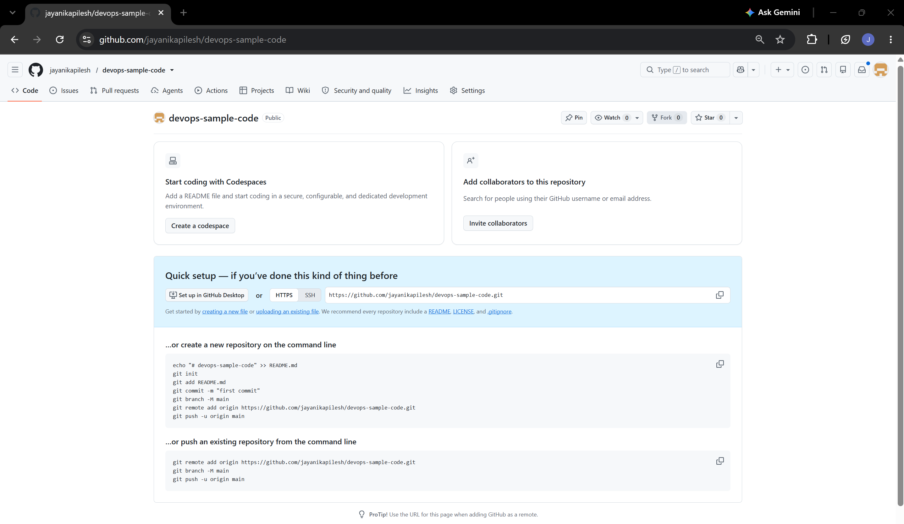

### (1b) Create a Fine-Grained Personal Access Token

Created a fine-grained Personal Access Token (PAT) for committing code to GitHub.

**Path:** GitHub → Settings → Developer settings → Personal access tokens → Fine-grained tokens → Generate new token

- **Token name:** `devops-lab`
- **Resource owner:** `jayanikapilesh`
- **Expiration:** 30 days
- **Repository access:** Only select repositories → `jayanikapilesh/devops-sample-code`
- **Permissions:** Contents – Read and write, Metadata – Read-only (required)

The token value is private and is not included in this documentation.

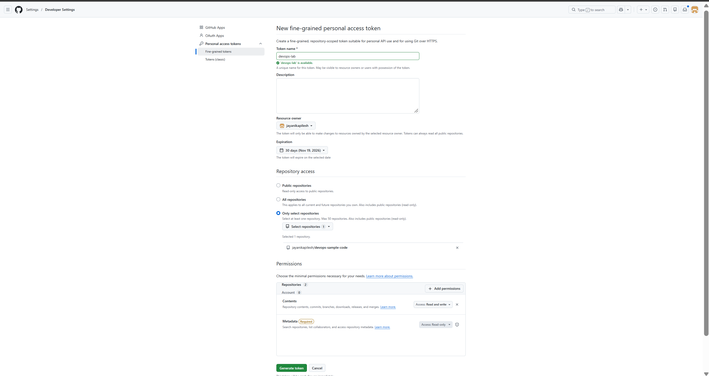

### (2) Create the Script Locally

Created a new folder `devops-sample-code` on the Desktop and created the script `hello-world.sh` inside it.

**Commands:**

```powershell
mkdir devops-sample-code
cd devops-sample-code
New-Item hello-world.sh
code hello-world.sh
```

`New-Item` is the PowerShell equivalent of `touch`. The following content was added to the file:

```bash
#!/bin/bash
echo "Hello, Jenkins!"
```

The file's line endings were set to **LF** in VS Code so the script runs correctly inside the Linux-based Jenkins container.

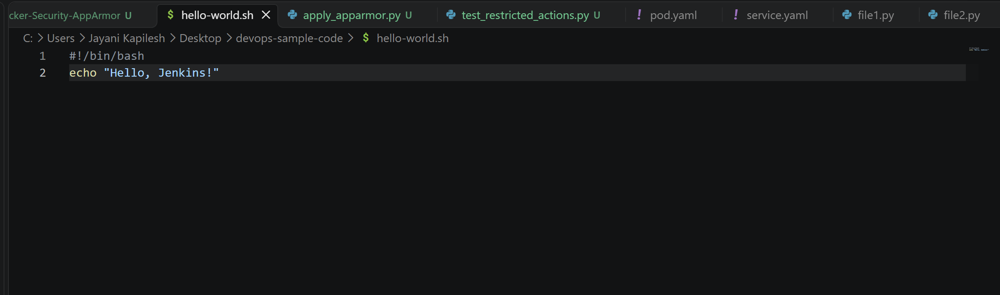

### (3) Initialize a Local Git Repository

**Commands:**

```powershell
git config --global user.name
git config --global user.email
git init
```

The Git username and email were already configured, so the commands displayed the existing values. `git init` created a new local repository.

### (4) Add the Script to the Repository

#### Add the Script and Make It Executable

**Commands:**

```powershell
git add hello-world.sh
git update-index --chmod=+x hello-world.sh
git status
```

`git update-index --chmod=+x` is the Windows equivalent of `chmod +x`. It marks the script as executable in Git.

**Output:**

```text
On branch master

No commits yet

Changes to be committed:
  (use "git rm --cached <file>..." to unstage)
        new file:   hello-world.sh
```

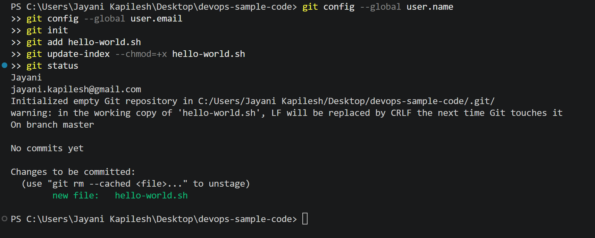

#### Commit the Changes

**Commands:**

```powershell
git commit -m "Add hello-world.sh"
git branch -M main
```

**Output:**

```text
[master (root-commit) bc40817] Add hello-world.sh
 1 file changed, 2 insertions(+)
 create mode 100755 hello-world.sh
```

The mode `100755` confirms that the script was committed as executable. The branch was then renamed from `master` to `main`.

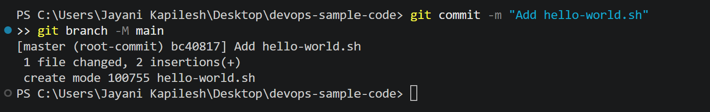

### (5) Link the Local Repository to GitHub

Copied the remote URL of the GitHub repository created in Step 1:

```text
https://github.com/jayanikapilesh/devops-sample-code.git
```

Linked the local repository to the GitHub repository by adding it as the remote named `origin`.

**Command:**

```powershell
git remote add origin https://github.com/jayanikapilesh/devops-sample-code.git
```

### (6) Push the Script to GitHub

Pushed the committed script to the `main` branch of the remote repository.

**Command:**

```powershell
git push -u origin main
```

**Output:**

```text
Enumerating objects: 3, done.
Counting objects: 100% (3/3), done.
Writing objects: 100% (3/3), 261 bytes | 261.00 KiB/s, done.
Total 3 (delta 0), reused 0 (delta 0), pack-reused 0 (from 0)
To https://github.com/jayanikapilesh/devops-sample-code.git
 * [new branch]      main -> main
branch 'main' set up to track 'origin/main'.
```

The `-u` option sets `origin/main` as the upstream branch, so future pushes only need `git push`. GitHub authentication was handled by Git Credential Manager on Windows, which already had a saved login, so the push completed without a username/PAT prompt. The PAT created in Step 1b can be used for authentication when prompted.

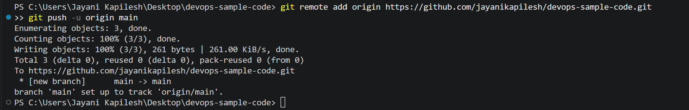

### (7) Verify the Script on GitHub

Opened the repository on GitHub and confirmed that `hello-world.sh` was uploaded with the correct content.

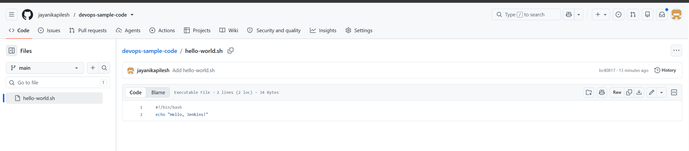

---

## Pre-requisite: Ensure Jenkins is running

Jenkins was already running in Docker at http://localhost:8080 from Exercise 7 (container `jenkins`, image `jenkins/jenkins:lts`).

---

## Step 1: Access Jenkins

Opened http://localhost:8080 in the browser and logged in with the admin credentials created in Exercise 7.

## Step 2: Create a New Job

1. On the Jenkins dashboard, clicked **New Item**.
2. Entered the job name `HelloWorld`.
3. Selected **Freestyle project**.
4. Clicked **OK**.

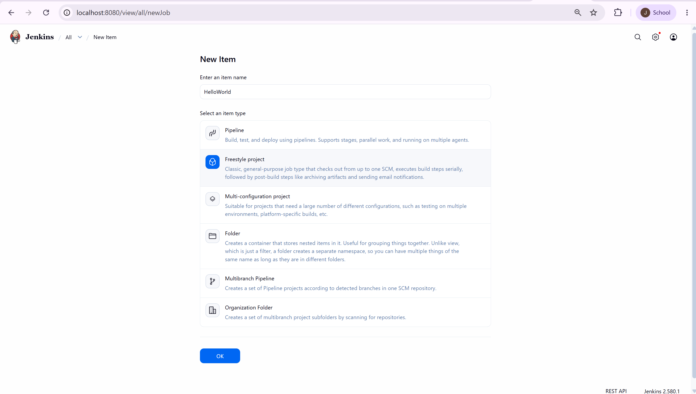

## Step 3: Configure the Job

### General Settings

Added the description:

```text
Hello World! Jenkins job.
```

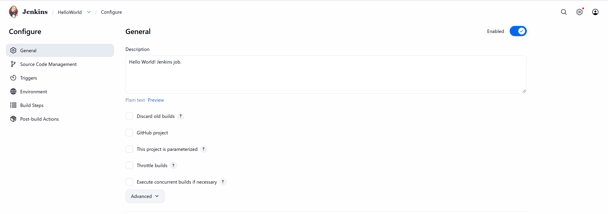

### Source Code Management

Selected **Git** and entered the repository URL:

```text
https://github.com/jayanikapilesh/devops-sample-code.git
```

Changed the **Branch Specifier** from the default `*/master` to:

```text
*/main
```

This ensures Jenkins checks out the correct branch, since the script was pushed to `main`. No credentials were needed because the repository is public.

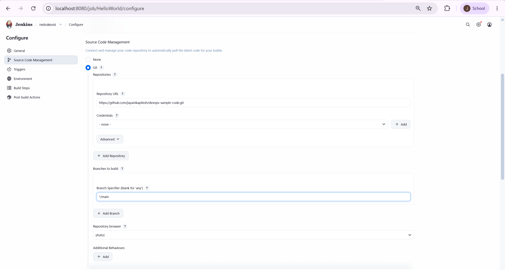

### Build Steps

Under **Build**, selected **Add build step → Execute shell** and entered:

```bash
sh hello-world.sh
```

This runs the shell script that Jenkins retrieves from GitHub.

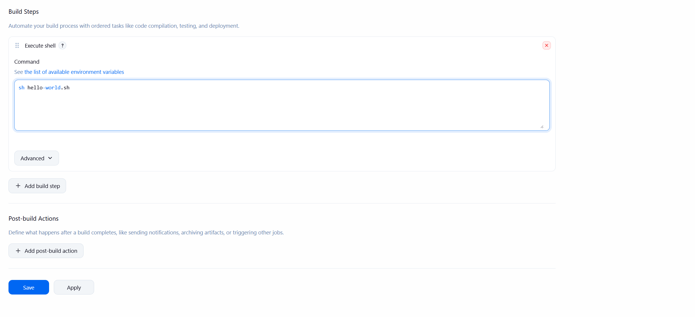

## Step 4: Save and Run the Job

Clicked **Save** to save the job configuration, then clicked **Build Now** on the job page.

### Build Triggers

The build was triggered manually from **Jenkins Dashboard → HelloWorld → Build Now**. Build **#1** appeared in the build history with a green tick, indicating success.

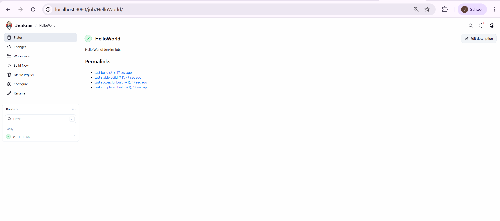

## Step 5: View the Build Output

Navigated to the **Build History** section on the left-hand side of the job page, clicked build **#1**, then clicked **Console Output** to view the build logs.

**Output:**

```text
Started by user Jayani Kapilesh
Running as SYSTEM
Building in workspace /var/jenkins_home/workspace/HelloWorld
The recommended git tool is: NONE
No credentials specified
Cloning the remote Git repository
Cloning repository https://github.com/jayanikapilesh/devops-sample-code.git
 > git init /var/jenkins_home/workspace/HelloWorld # timeout=10
Fetching upstream changes from https://github.com/jayanikapilesh/devops-sample-code.git
 > git --version # timeout=10
 > git --version # 'git version 2.47.3'
 > git fetch --tags --force --progress -- https://github.com/jayanikapilesh/devops-sample-code.git +refs/heads/*:refs/remotes/origin/* # timeout=10
 > git config remote.origin.url https://github.com/jayanikapilesh/devops-sample-code.git # timeout=10
 > git config --add remote.origin.fetch +refs/heads/*:refs/remotes/origin/* # timeout=10
Avoid second fetch
 > git rev-parse refs/remotes/origin/main^{commit} # timeout=10
Checking out Revision bc4081736ed2f3938ca5ff9988d39fed3961950f (refs/remotes/origin/main)
 > git config core.sparsecheckout # timeout=10
 > git checkout -f bc4081736ed2f3938ca5ff9988d39fed3961950f # timeout=10
Commit message: "Add hello-world.sh"
First time build. Skipping changelog.
[HelloWorld] $ /bin/sh -xe /tmp/jenkins8181052099076800209.sh
+ sh hello-world.sh
Hello, Jenkins!
Finished: SUCCESS
```

Jenkins cloned the repository, checked out the latest commit on `main`, executed `hello-world.sh` and printed **Hello, Jenkins!**. The build finished with status **SUCCESS**.

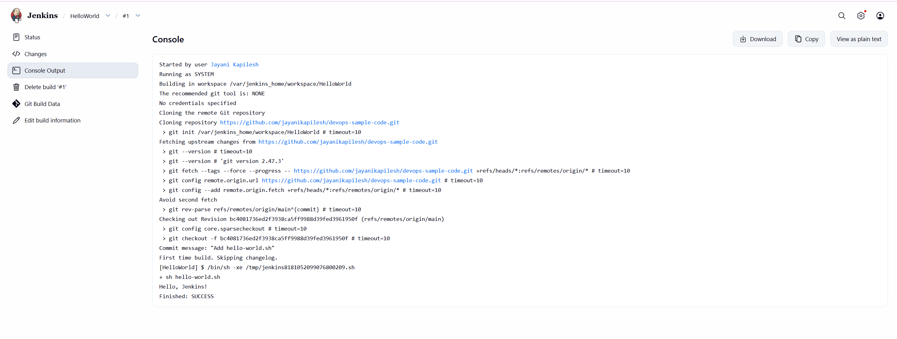

---

## Key Takeaways

- Created a GitHub repository and pushed a shell script to it using Git.
- Created a fine-grained Personal Access Token scoped to a single repository.
- Learned the Windows equivalents of `touch` and `chmod +x`.
- Created and configured a Jenkins Freestyle job.
- Connected Jenkins to a GitHub repository using Source Code Management.
- Learned that the Jenkins branch specifier must match the repository's branch (`*/main`).
- Executed a shell script through a Jenkins build step and verified the result in the console output.

## Conclusion

This exercise demonstrated a basic Continuous Integration workflow. A shell script was stored in a GitHub repository, Jenkins retrieved it automatically from the `main` branch, and a Freestyle job executed it. The successful build and the `Hello, Jenkins!` output confirmed that source code management and automated build execution were working correctly.