# Exercise 9: Jenkins Multi-Stage Pipeline Exercise: Deploying a Python Application

## Objective

Create and execute a **Jenkins Pipeline** that performs multiple stages – **Build**, **Test** and **Deploy** – for a sample Python Flask application, to understand how multi-stage CI/CD pipelines are implemented and managed in Jenkins.

## Scenario

Automate the CI/CD pipeline for a Python Flask application. The pipeline performs the following stages:

1. **Build:** Install dependencies.
2. **Test:** Run unit tests to ensure the application works as expected.
3. **Deploy:** Deploy the application by copying it to a mock deployment directory.

## Technologies Used

- Jenkins 2.580.1 (running in Docker, from Exercise 7)
- Jenkins Pipeline plugin
- Python 3.13 and Flask
- Git and GitHub
- Visual Studio Code
- PowerShell
- Docker Desktop

## Files in this Folder

- `app.py`, `requirements.txt`, `test_app.py`, `Jenkinsfile` – copies of the files pushed to the `devops-sample-code` repository
- `screenshots/` – screenshots of each step
- `README.md` – this documentation

**Source repository used by Jenkins:** https://github.com/jayanikapilesh/devops-sample-code

---

## Steps to Complete the Exercise

### Step 1: Set Up Jenkins

Jenkins was already installed and running in Docker at http://localhost:8080 from Exercise 7.

Verified that the **Pipeline** plugin is installed and enabled:

**Path:** Manage Jenkins → Plugins → Installed plugins → search `pipeline`

The **Pipeline** plugin (version `608.v67378e9d3db_1`) was already installed and enabled, since it is part of the suggested plugins installed during Jenkins setup.

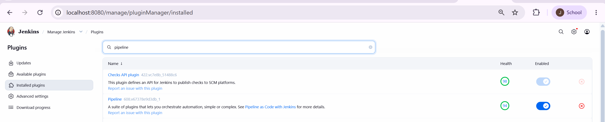

---

### Step 2: Create a Sample Python Application

The lab instructions create a `python-flask-app` directory. However, the Jenkinsfile in Step 5 copies `${WORKSPACE}/app.py` and runs the tests from the workspace root, so the application files must be at the root of the repository. Therefore the files were created directly inside the existing `devops-sample-code` repository folder (created in Exercise 8), next to `hello-world.sh`, which also matches the paths in the expected console output.

**Commands:**

```powershell
cd "C:\Users\Jayani Kapilesh\Desktop\devops-sample-code"
New-Item app.py, requirements.txt, test_app.py
code .
```

#### File: app.py

```python
from flask import Flask

app = Flask(__name__)

@app.route("/")
def home():
    return "Hello, Jenkins Multi-Stage Pipeline!"

if __name__ == "__main__":
    app.run(debug=True)
```

#### File: requirements.txt

```text
flask==2.1.2
```

#### File: test_app.py

```python
import unittest
from app import app

class TestApp(unittest.TestCase):
    def test_home(self):
        tester = app.test_client()
        response = tester.get("/")
        print(response.data.decode("utf-8"))
        self.assertEqual(response.status_code, 200)
        self.assertEqual(response.data.decode("utf-8"), "Hello, Jenkins Multi-Stage Pipeline!")

if __name__ == "__main__":
    unittest.main()
```

All files were saved with **LF** line endings so they run correctly inside the Linux-based Jenkins container.

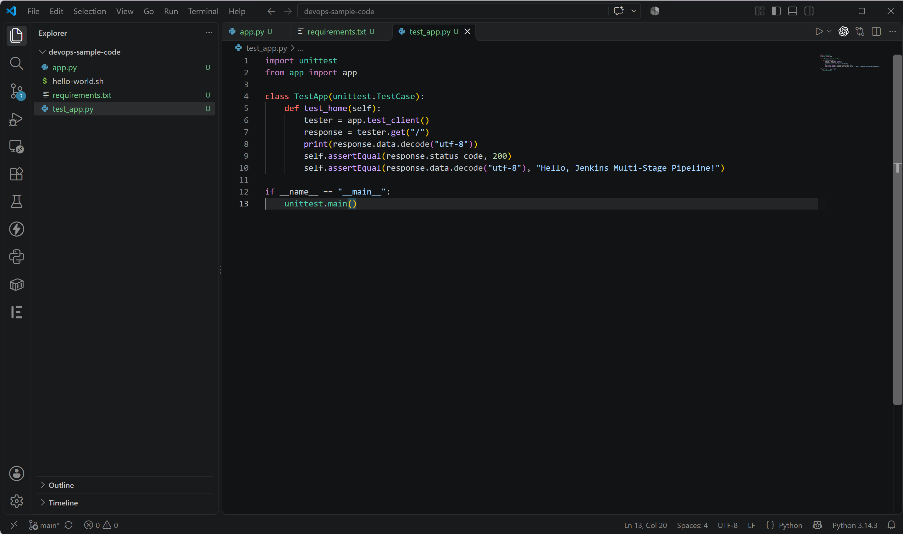

---

### Step 3: Push the Application to a Git Repository

The local repository was already initialised and linked to GitHub (`git init` and `git remote add origin https://github.com/jayanikapilesh/devops-sample-code.git`) in Exercise 8, so the application files were added, committed and pushed directly.

**Commands:**

```powershell
git add .
git status
git commit -m "Initial commit"
git push
```

**Output:**

```text
On branch main
Your branch is up to date with 'origin/main'.

Changes to be committed:
  (use "git restore --staged <file>..." to unstage)
        new file:   app.py
        new file:   requirements.txt
        new file:   test_app.py

[main 1332dc8] Initial commit
 3 files changed, 24 insertions(+)
 create mode 100644 app.py
 create mode 100644 requirements.txt
 create mode 100644 test_app.py
Enumerating objects: 6, done.
Counting objects: 100% (6/6), done.
Delta compression using up to 14 threads
Compressing objects: 100% (4/4), done.
Writing objects: 100% (5/5), 752 bytes | 125.00 KiB/s, done.
Total 5 (delta 0), reused 0 (delta 0), pack-reused 0 (from 0)
To https://github.com/jayanikapilesh/devops-sample-code.git
   bc40817..1332dc8  main -> main
```

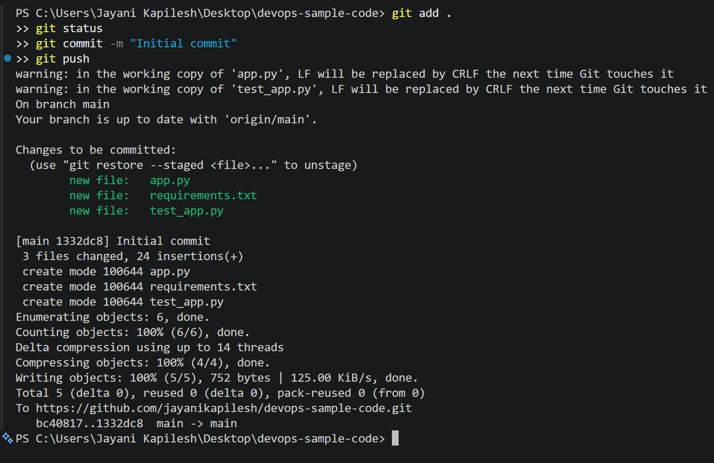

---

### Step 4: Create a Multistage Jenkins Pipeline

1. Opened the Jenkins dashboard and clicked **New Item**.
2. Entered the name `Python-MultiStage-Pipeline`.
3. Selected **Pipeline** and clicked **OK**.

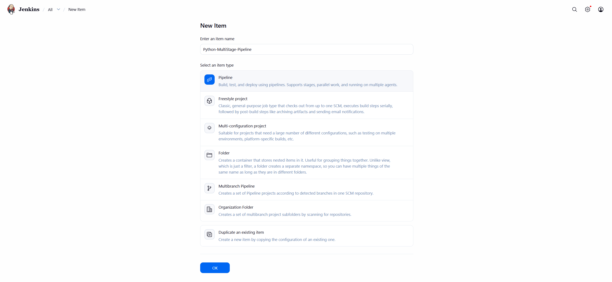

---

### Step 5: Define the Jenkinsfile

Created a file named `Jenkinsfile` (no extension) in the project directory.

**Commands:**

```powershell
New-Item Jenkinsfile
code Jenkinsfile
```

**File: Jenkinsfile**

```groovy
pipeline {
    agent any

    stages {
        stage('Build') {
            steps {
                echo 'Creating virtual environment and installing dependencies...'
            }
        }
        stage('Test') {
            steps {
                echo 'Running tests...'
                sh 'python3 -m unittest discover -s .'
            }
        }
        stage('Deploy') {
            steps {
                echo 'Deploying application...'
                sh '''
                mkdir -p ${WORKSPACE}/python-app-deploy
                cp ${WORKSPACE}/app.py ${WORKSPACE}/python-app-deploy/
                '''
            }
        }
        stage('Run Application') {
            steps {
                echo 'Running application...'
                sh '''
                nohup python3 ${WORKSPACE}/python-app-deploy/app.py > ${WORKSPACE}/python-app-deploy/app.log 2>&1 &
                echo $! > ${WORKSPACE}/python-app-deploy/app.pid
                '''
            }
        }
        stage('Test Application') {
            steps {
                echo 'Testing application...'
                sh '''
                python3 ${WORKSPACE}/test_app.py
                '''
            }
        }
    }

    post {
        success {
            echo 'Pipeline completed successfully!'
        }
        failure {
            echo 'Pipeline failed. Check the logs for more details.'
        }
    }
}
```

#### Push the Jenkinsfile to the Git Repository

**Commands:**

```powershell
git add Jenkinsfile
git commit -m "Added Jenkinsfile"
git push
```

**Output:**

```text
[main 3bde6a3] Added Jenkinsfile
 1 file changed, 52 insertions(+)
 create mode 100644 Jenkinsfile
Enumerating objects: 4, done.
Counting objects: 100% (4/4), done.
Delta compression using up to 14 threads
Compressing objects: 100% (3/3), done.
Writing objects: 100% (3/3), 654 bytes | 218.00 KiB/s, done.
Total 3 (delta 1), reused 0 (delta 0), pack-reused 0 (from 0)
remote: Resolving deltas: 100% (1/1), completed with 1 local object.
To https://github.com/jayanikapilesh/devops-sample-code.git
   1332dc8..3bde6a3  main -> main
```

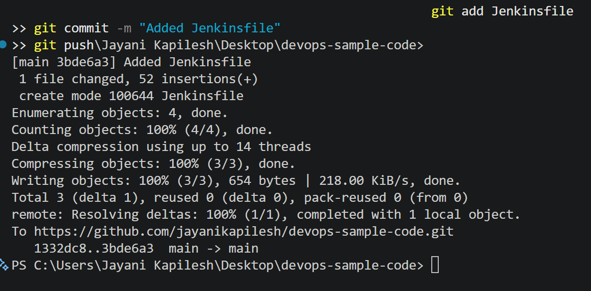

---

### Step 6: Configure the Jenkins Job

In the `Python-MultiStage-Pipeline` configuration page, under the **Pipeline** section:

| Setting | Value |
|---------|-------|
| Definition | **Pipeline script from SCM** |
| SCM | **Git** |
| Repository URL | `https://github.com/jayanikapilesh/devops-sample-code.git` |
| Credentials | `- none -` (public repository, so no credentials were necessary) |
| Branch Specifier | `*/main` (changed from the default `*/master`) |
| Script Path | `Jenkinsfile` |

The configuration was then saved.

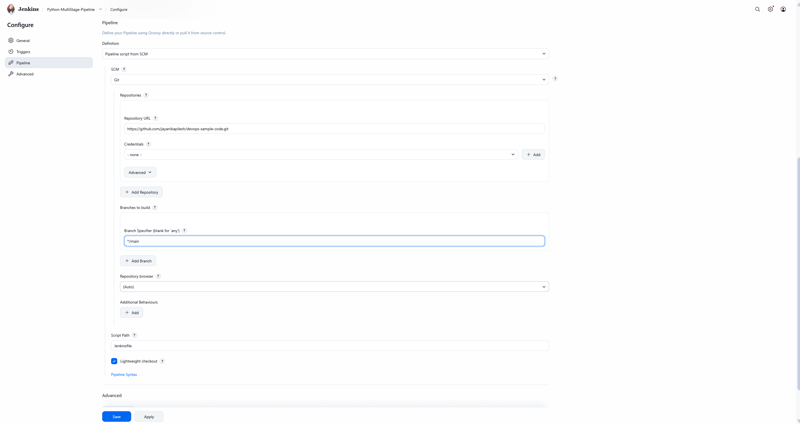

---

### Step 7: Run the Pipeline

Clicked **Build Now** to start the pipeline and observed the stages as they executed.

#### First Run (Build #1) – Failed

The first build failed in the **Test** stage because Python was not installed in the Jenkins Docker container.

**Console Output (relevant part):**

```text
[Pipeline] { (Test)
[Pipeline] echo
Running tests...
[Pipeline] sh
+ python3 -m unittest discover -s .
/var/jenkins_home/workspace/Python-MultiStage-Pipeline@tmp/durable-53cd038f/script.sh.copy: 1: python3: not found
[Pipeline] }
[Pipeline] // stage
[Pipeline] stage
[Pipeline] { (Deploy)
Stage "Deploy" skipped due to earlier failure(s)
[Pipeline] { (Run Application)
Stage "Run Application" skipped due to earlier failure(s)
[Pipeline] { (Test Application)
Stage "Test Application" skipped due to earlier failure(s)
[Pipeline] { (Declarative: Post Actions)
[Pipeline] echo
Pipeline failed. Check the logs for more details.
[Pipeline] End of Pipeline
ERROR: script returned exit code 127
Finished: FAILURE
```

The **Build** stage and Git checkout succeeded, the **Test** stage failed with `python3: not found` (exit code 127), the remaining stages were skipped, and the `post { failure }` block printed its message.

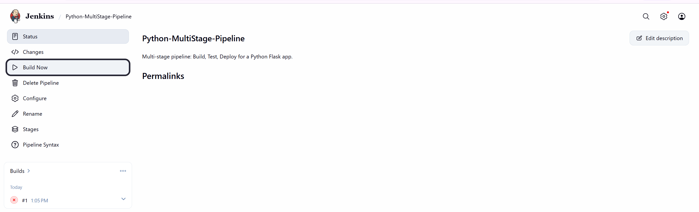

---

### Step 8: Handling build errors

To resolve the missing `python3`, `pip` and other dependencies, logged into the Jenkins Docker container as the root user.

**Command (list containers):**

```powershell
docker ps -a
```

The Jenkins container was named `jenkins` (container ID `3a1bc12f93da`), running from the `jenkins/jenkins:lts` image.

**Command (connect into the container as root):**

```powershell
docker exec -it -u root jenkins bash
```

**Commands run inside the container shell (`root@3a1bc12f93da:/#`):**

```bash
apt-get update
apt install -y python3 python3-pip python3-venv python3-flask
```

The Jenkins image is based on **Debian 13 (trixie)**, which provides **Python 3.13**. Therefore the current package names were used:

| Package in lab instructions | Package used | Reason |
|---|---|---|
| `python3` | `python3` | Same |
| `pip` | `python3-pip` | Debian package name for pip |
| `python3.11-venv` | `python3-venv` | Image ships Python 3.13, not 3.11; `python3-venv` installed `python3.13-venv` |
| `python3-flask` | `python3-flask` | Same (Flask 3.1.1) |

The lab's package names were also tested in a temporary container from the same image:

```text
root@9ce6ee6c7572:/# apt install pip
Note, selecting 'python3-pip' instead of 'pip'
...
Continue? [Y/n] n
Abort.
root@9ce6ee6c7572:/# apt install python3.11-venv
Error: Unable to locate package python3.11-venv
```

`pip` resolves to `python3-pip`, and `python3.11-venv` does not exist on this Python 3.13 image, so `python3-venv` was used.

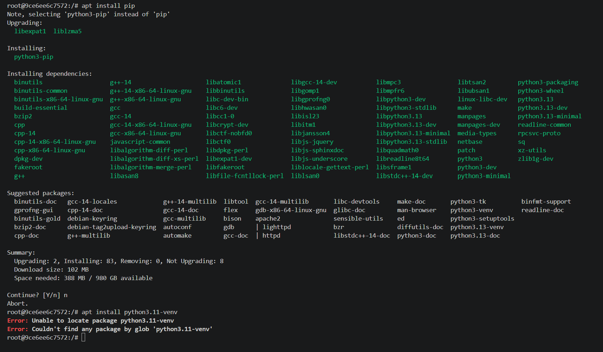

**Verification inside the container:**

```bash
python3 --version
cd /var/jenkins_home/workspace/Python-MultiStage-Pipeline
python3 -m unittest discover -s .
```

**Output:**

```text
Python 3.13.5
Hello, Jenkins Multi-Stage Pipeline!
.
----------------------------------------------------------------------
Ran 1 test in 0.026s

OK
```

The unit test passed inside the Jenkins container. The container shell was then closed with `exit`.

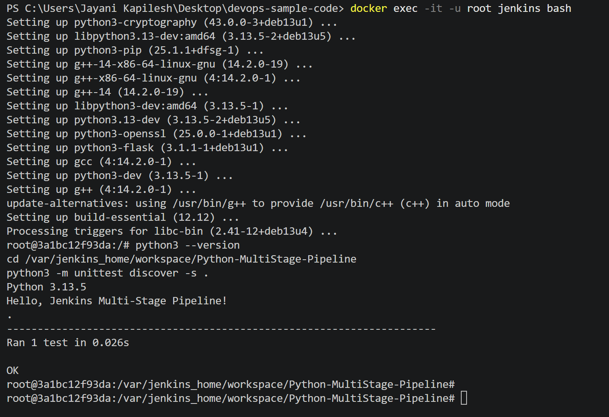

---

#### Re-run the Pipeline (Build #2) – Success

Clicked **Build Now** again. All stages completed successfully:

| Stage | Result | Time |
|-------|--------|------|
| Checkout SCM | ✅ Success | 2s |
| Build | ✅ Success | 0.18s |
| Test | ✅ Success | 0.79s |
| Deploy | ✅ Success | 0.52s |
| Run Application | ✅ Success | 0.51s |
| Test Application | ✅ Success | 0.82s |
| Post Actions | ✅ Success | 0.18s |

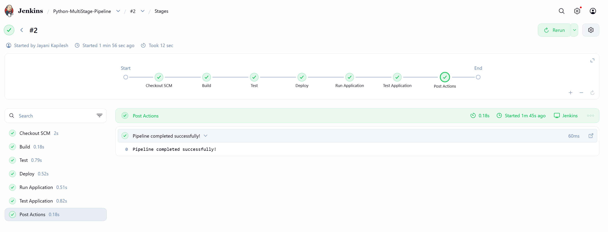

#### Console Output (Build #2)

```text
Started by user Jayani Kapilesh
Obtained Jenkinsfile from git https://github.com/jayanikapilesh/devops-sample-code.git
[Pipeline] Start of Pipeline
[Pipeline] node
Running on Jenkins in /var/jenkins_home/workspace/Python-MultiStage-Pipeline
[Pipeline] {
[Pipeline] stage
[Pipeline] { (Declarative: Checkout SCM)
[Pipeline] checkout
Selected Git installation does not exist. Using Default
The recommended git tool is: NONE
No credentials specified
 > git rev-parse --resolve-git-dir /var/jenkins_home/workspace/Python-MultiStage-Pipeline/.git # timeout=10
Fetching changes from the remote Git repository
 > git config remote.origin.url https://github.com/jayanikapilesh/devops-sample-code.git # timeout=10
Fetching upstream changes from https://github.com/jayanikapilesh/devops-sample-code.git
 > git --version # timeout=10
 > git --version # 'git version 2.47.3'
 > git fetch --tags --force --progress -- https://github.com/jayanikapilesh/devops-sample-code.git +refs/heads/*:refs/remotes/origin/* # timeout=10
 > git rev-parse refs/remotes/origin/main^{commit} # timeout=10
Checking out Revision 3bde6a38b45a05a28e2f7218e4f30c2d791df3f4 (refs/remotes/origin/main)
 > git config core.sparsecheckout # timeout=10
 > git checkout -f 3bde6a38b45a05a28e2f7218e4f30c2d791df3f4 # timeout=10
Commit message: "Added Jenkinsfile"
 > git rev-list --no-walk 3bde6a38b45a05a28e2f7218e4f30c2d791df3f4 # timeout=10
[Pipeline] }
[Pipeline] // stage
[Pipeline] withEnv
[Pipeline] {
[Pipeline] stage
[Pipeline] { (Build)
[Pipeline] echo
Creating virtual environment and installing dependencies...
[Pipeline] }
[Pipeline] // stage
[Pipeline] stage
[Pipeline] { (Test)
[Pipeline] echo
Running tests...
[Pipeline] sh
+ python3 -m unittest discover -s .
.
----------------------------------------------------------------------
Ran 1 test in 0.013s

OK
Hello, Jenkins Multi-Stage Pipeline!
[Pipeline] }
[Pipeline] // stage
[Pipeline] stage
[Pipeline] { (Deploy)
[Pipeline] echo
Deploying application...
[Pipeline] sh
+ mkdir -p /var/jenkins_home/workspace/Python-MultiStage-Pipeline/python-app-deploy
+ cp /var/jenkins_home/workspace/Python-MultiStage-Pipeline/app.py /var/jenkins_home/workspace/Python-MultiStage-Pipeline/python-app-deploy/
[Pipeline] }
[Pipeline] // stage
[Pipeline] stage
[Pipeline] { (Run Application)
[Pipeline] echo
Running application...
[Pipeline] sh
+ echo 2372
+ nohup python3 /var/jenkins_home/workspace/Python-MultiStage-Pipeline/python-app-deploy/app.py
[Pipeline] }
[Pipeline] // stage
[Pipeline] stage
[Pipeline] { (Test Application)
[Pipeline] echo
Testing application...
[Pipeline] sh
+ python3 /var/jenkins_home/workspace/Python-MultiStage-Pipeline/test_app.py
.
----------------------------------------------------------------------
Ran 1 test in 0.012s

OK
Hello, Jenkins Multi-Stage Pipeline!
[Pipeline] }
[Pipeline] // stage
[Pipeline] stage
[Pipeline] { (Declarative: Post Actions)
[Pipeline] echo
Pipeline completed successfully!
[Pipeline] }
[Pipeline] // stage
[Pipeline] }
[Pipeline] // withEnv
[Pipeline] }
[Pipeline] // node
[Pipeline] End of Pipeline
Finished: SUCCESS
```

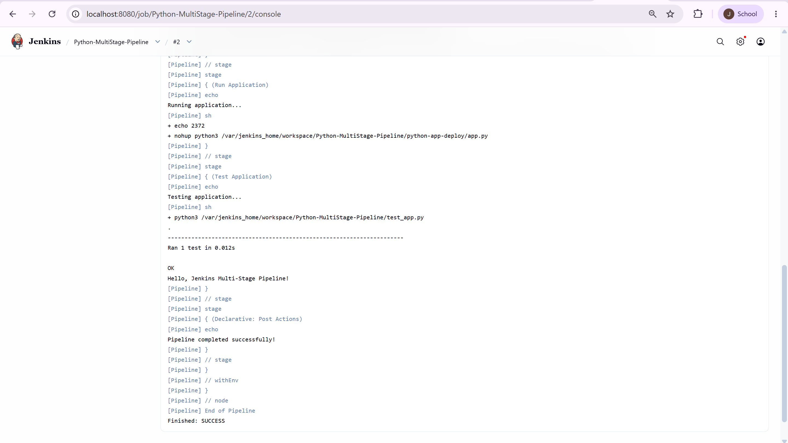

---

## Expected Outcome

| Stage | Expected | Actual |
|-------|----------|--------|
| Build | Dependencies are prepared | The Build stage printed `Creating virtual environment and installing dependencies...`. Flask was provided by the `python3-flask` package installed in Step 8. |
| Test | `unittest` runs the test cases and they pass | `Ran 1 test ... OK` and `Hello, Jenkins Multi-Stage Pipeline!` |
| Deploy | `app.py` is copied to the mock deployment directory | `app.py` copied to `${WORKSPACE}/python-app-deploy/` |
| Run Application | The app starts in the background | Started with `nohup` (process ID `2372` saved to `app.pid`) |
| Test Application | The deployed app is tested again | `Ran 1 test ... OK` |
| Post Actions | Success message on completion | `Pipeline completed successfully!` |

The multi-stage pipeline ran successfully and finished with **`Finished: SUCCESS`**.

---

## Additional Enhancements

- Add a **Code Quality** stage using `flake8` or `pylint`:

  ```groovy
  stage('Code Quality') {
      steps {
          echo 'Running code quality checks...'
          sh 'flake8 .'
      }
  }
  ```

- Deploy the application to a Docker container as part of the pipeline.
- Integrate notifications (for example email or Slack) for pipeline success or failure.

---

## Key Takeaways

- A **Jenkins Pipeline** defines the whole CI/CD process as code in a `Jenkinsfile` stored in the Git repository.
- **Pipeline script from SCM** lets Jenkins fetch the `Jenkinsfile` directly from GitHub.
- Each **stage** (Build, Test, Deploy, Run Application, Test Application) is shown separately, making failures easy to locate.
- When a stage fails, later stages are skipped and the `post { failure }` block runs.
- Build tools such as Python must be installed on the Jenkins agent; here they were installed inside the Jenkins Docker container with `docker exec -u root`.
- The Branch Specifier must match the repository branch (`*/main`).

## Conclusion

A multi-stage Jenkins pipeline was created for a Python Flask application. The `Jenkinsfile` and application code were stored in GitHub, and Jenkins fetched them using Pipeline script from SCM. The first build failed because Python was missing in the Jenkins container; after installing Python, pip, venv and Flask inside the container, the second build passed all stages – Build, Test, Deploy, Run Application and Test Application – and finished with **SUCCESS**.