# Exercise 10: Multi-Node Kubernetes Cluster with Multiple Applications and ReplicaSets

## Storyboard

An e-commerce platform is developed with the following product requirements:

- **Product Catalog (AppA)** – Provides information about available products.
- **Shopping Cart (AppB)** – Manages user shopping carts.

To ensure availability and fault tolerance, the Product Catalog runs **2 replicas** and the Shopping Cart runs **3 replicas**. Each replica of both services is distributed across multiple nodes to handle traffic and provide redundancy.

## Use Case

An online store needs high availability for critical services like product browsing and cart management. To avoid service disruptions, each service is deployed with replicas distributed across multiple nodes. This setup ensures that even if one node fails, the services remain available for customers.

## Technologies Used

- Minikube v1.39.0 (Docker driver) with Kubernetes v1.37.0
- kubectl
- Docker Desktop
- Python 3.9 and Flask
- PowerShell (Windows 11)
- Visual Studio Code

## Files in this Folder

| File | Purpose |
|------|---------|
| `product_catalog.py` | Product Catalog Flask application |
| `shopping_cart.py` | Shopping Cart Flask application |
| `Dockerfile.product` | Dockerfile for the Product Catalog image |
| `Dockerfile.shopping` | Dockerfile for the Shopping Cart image |
| `product_catalog_deployment.yaml` | Deployment for Product Catalog (2 replicas) |
| `shopping_cart_deployment.yaml` | Deployment for Shopping Cart (3 replicas) |
| `product_catalog_service.yaml` | NodePort Service for Product Catalog |
| `shopping_cart_service.yaml` | NodePort Service for Shopping Cart |
| `item.json` | JSON body used to test the POST request |
| `screenshots/` | Screenshots of each step |

---

## Step 0: Clean Up Any Existing Minikube Running

Stopped and deleted the existing single-node Minikube cluster.

**Commands:**

```powershell
minikube stop
minikube delete
```

**Output:**

```text
✋  Stopping node "minikube"  ...
🛑  Powering off "minikube" via SSH ...
🛑  1 node stopped.
🔥  Deleting "minikube" in docker ...
🔥  Deleting container "minikube" ...
🔥  Removing C:\Users\Jayani Kapilesh\.minikube\machines\minikube ...
💀  Removed all traces of the "minikube" cluster.
```

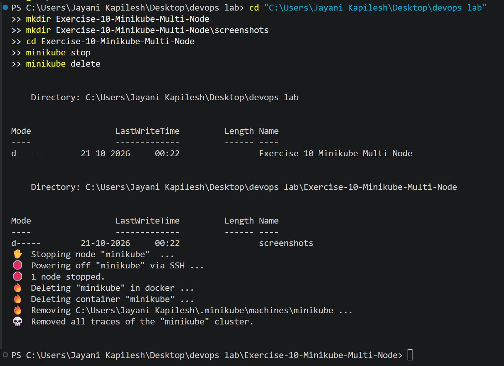

---

## Step 1a: Set Up Minikube with Multiple Nodes

Created a three-node Minikube cluster in a profile named `devops-multinode`. The `--force` option is used because the Docker driver is not recommended with root privileges.

**Command:**

```powershell
minikube start --nodes 3 -p devops-multinode --force
```

**Output (summary):**

```text
😄  [devops-multinode] minikube v1.39.0 on Microsoft Windows 11 Home Single Language 26H2
❗  minikube skips various validations when --force is supplied; this may lead to unexpected behavior
✨  Automatically selected the docker driver. Other choices: virtualbox, ssh
👍  Starting "devops-multinode" primary control-plane node in "devops-multinode" cluster
🔥  Creating docker container (CPUs=2, Memory=3072MB) ...
📦  Preparing Kubernetes v1.37.0 on containerd 2.3.4 ...
👍  Starting "devops-multinode-m02" worker node in "devops-multinode" cluster
👍  Starting "devops-multinode-m03" worker node in "devops-multinode" cluster
🏄  Done! kubectl is now configured to use "devops-multinode" cluster and "default" namespace by default
```

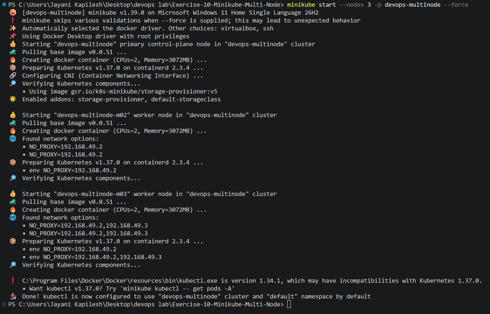

### Verify the Nodes

**Command:**

```powershell
kubectl get nodes
```

**Output:**

```text
NAME                   STATUS   ROLES           AGE     VERSION
devops-multinode       Ready    control-plane   4m33s   v1.37.0
devops-multinode-m02   Ready    <none>          3m14s   v1.37.0
devops-multinode-m03   Ready    <none>          2m1s    v1.37.0
```

All three nodes (one control-plane and two worker nodes) are in the **Ready** state.

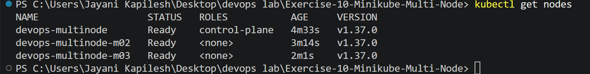

---

## Step 1b: Set Up Minikube with Multiple Nodes – Enable the Registry Add-on

For a multi-node cluster, `eval $(minikube -p devops-multinode docker-env)` cannot be used directly, so the Minikube registry add-on is enabled to share images between nodes.

**Command:**

```powershell
minikube -p devops-multinode addons enable registry
```

**Output:**

```text
💡  registry is an addon maintained by minikube. For any concerns contact minikube on GitHub.
You can view the list of minikube maintainers at: https://github.com/kubernetes/minikube/blob/master/OWNERS

    Registry addon with docker driver uses port 51512 please use that instead of default port 5000

📘  For more information see: https://minikube.sigs.k8s.io/docs/drivers/docker
    ▪ Using image registry.k8s.io/minikube/kube-registry-proxy:v0.0.11
    ▪ Using image docker.io/registry:3
🔎  Verifying registry addon...
🌟  The 'registry' addon is enabled
```

The registry port on this machine is **51512** (the port is assigned per machine).

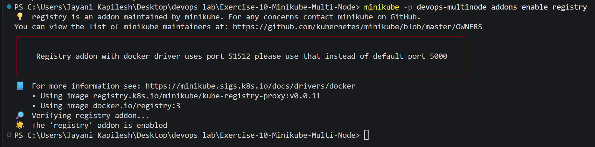

---

## Step 2: Product Catalog (AppA) – Python Code

**File: product_catalog.py**

```python
# product_catalog.py
from flask import Flask, jsonify

app = Flask(__name__)

products = [
    {"id": 1, "name": "Laptop", "price": 1200},
    {"id": 2, "name": "Phone", "price": 800},
    {"id": 3, "name": "Headphones", "price": 150},
]

@app.route("/products", methods=["GET"])
def get_products():
    return jsonify(products)

if __name__ == "__main__":
    app.run(host="0.0.0.0", port=80)
```

This application provides a `GET /products` endpoint that returns the list of available products.

---

## Step 3: Shopping Cart (AppB) – Python Code

**File: shopping_cart.py**

```python
# shopping_cart.py
from flask import Flask, jsonify, request

app = Flask(__name__)

cart = []

@app.route("/cart", methods=["GET"])
def get_cart():
    return jsonify(cart)

@app.route("/cart", methods=["POST"])
def add_to_cart():
    item = request.json
    cart.append(item)
    return jsonify(cart), 201

if __name__ == "__main__":
    app.run(host="0.0.0.0", port=80)
```

This application provides `GET /cart` to view the cart and `POST /cart` to add an item.

---

## Step 4: Dockerize Applications

**File: Dockerfile.product**

```dockerfile
# Dockerfile for Product Catalog
FROM python:3.9-slim
WORKDIR /app
COPY product_catalog.py /app/
RUN pip install flask
CMD ["python", "product_catalog.py"]
```

**File: Dockerfile.shopping**

```dockerfile
# Dockerfile for Shopping Cart
FROM python:3.9-slim
WORKDIR /app
COPY shopping_cart.py /app/
RUN pip install flask
CMD ["python", "shopping_cart.py"]
```

### Build the Docker Images

**Commands:**

```powershell
docker build -t product-catalog:latest -f Dockerfile.product .
docker build -t shopping-cart:latest -f Dockerfile.shopping .
```

**Note:** The first attempt to build `shopping-cart` failed during `RUN pip install flask` with `ReadTimeoutError: HTTPSConnectionPool(host='files.pythonhosted.org', port=443): Read timed out.` This was caused by a slow internet connection, not by the Dockerfile. Re-running the same build command completed successfully.

### Verify the Images

**Commands:**

```powershell
docker images product-catalog
docker images shopping-cart
```

**Output:**

```text
IMAGE                    ID             DISK USAGE   CONTENT SIZE
product-catalog:latest   e86f32530aef   203MB        49.7MB

IMAGE                    ID             DISK USAGE   CONTENT SIZE
shopping-cart:latest     86e67d93abcc   203MB        49.7MB
```

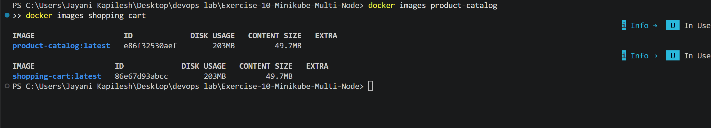

---

## Step 5: Load Images into Registry

Loaded both locally built images into the `devops-multinode` cluster so that Kubernetes can access them.

**Commands:**

```powershell
minikube -p devops-multinode image load product-catalog:latest
minikube -p devops-multinode image load shopping-cart:latest
```

### Verify the Images

**Command (from the lab instructions):**

```powershell
minikube -p devops-multinode ssh -- docker images
```

**Output:**

```text
Cannot connect to the Docker daemon at unix:///var/run/docker.sock. Is the docker daemon running?
ssh: Process exited with status 1
```

This error is expected on this setup. The cluster was created with **Kubernetes v1.37.0 on containerd** (see Step 1a), so the Minikube nodes use **containerd** as the container runtime and there is no Docker daemon inside the nodes. Therefore the images were verified with the Minikube command that works for any container runtime:

**Command:**

```powershell
minikube -p devops-multinode image ls
```

**Output:**

```text
registry.k8s.io/pause:3.10.2
registry.k8s.io/kube-scheduler:v1.37.0
registry.k8s.io/kube-proxy:v1.37.0
registry.k8s.io/kube-controller-manager:v1.37.0
registry.k8s.io/kube-apiserver:v1.37.0
registry.k8s.io/etcd:3.7.0-0
registry.k8s.io/coredns/coredns:v1.14.6
gcr.io/k8s-minikube/storage-provisioner:v5
docker.io/library/shopping-cart:latest
docker.io/library/product-catalog:latest
docker.io/kindest/kindnetd:v20260820-69b56db7
docker.io/kindest/kindnetd:v20250512-df8de77b
```

Both `product-catalog:latest` and `shopping-cart:latest` are loaded into the cluster.

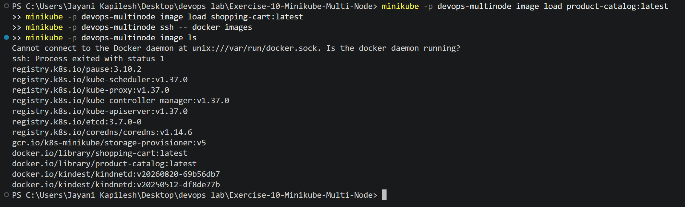

---

## Step 6: Deploy Applications on Minikube

### Product Catalog Deployment (ReplicaSet of 2)

**File: product_catalog_deployment.yaml**

```yaml
# product_catalog_deployment.yaml
apiVersion: apps/v1
kind: Deployment
metadata:
  name: product-catalog
  namespace: default
spec:
  replicas: 2
  selector:
    matchLabels:
      app: product-catalog
  template:
    metadata:
      labels:
        app: product-catalog
    spec:
      affinity:
        podAntiAffinity:
          requiredDuringSchedulingIgnoredDuringExecution:
          - labelSelector:
              matchLabels:
                app: product-catalog
            topologyKey: "kubernetes.io/hostname"
      containers:
      - name: product-catalog-container
        image: product-catalog:latest
        imagePullPolicy: Never
        ports:
        - containerPort: 80
```

### Shopping Cart Deployment (ReplicaSet of 3)

**File: shopping_cart_deployment.yaml**

```yaml
# shopping_cart_deployment.yaml
apiVersion: apps/v1
kind: Deployment
metadata:
  name: shopping-cart
  namespace: default
spec:
  replicas: 3
  selector:
    matchLabels:
      app: shopping-cart
  template:
    metadata:
      labels:
        app: shopping-cart
    spec:
      affinity:
        podAntiAffinity:
          requiredDuringSchedulingIgnoredDuringExecution:
          - labelSelector:
              matchLabels:
                app: shopping-cart
            topologyKey: "kubernetes.io/hostname"
      containers:
      - name: shopping-cart-container
        image: shopping-cart:latest
        imagePullPolicy: Never
        ports:
        - containerPort: 80
```

**Change from the lab file – namespace:** The lab file sets `namespace: devops-exercise` for the Shopping Cart Deployment. This was changed to `namespace: default` because:

1. The `devops-exercise` namespace is never created in the exercise, so `kubectl apply` would fail with `namespaces "devops-exercise" not found`.
2. The `shopping-cart-service` (Step 7) is in the `default` namespace, and a Service can only select pods in its own namespace.
3. The expected `kubectl get pods -o wide` output in the lab shows the shopping-cart pods in the `default` namespace.

### Pod Anti-Affinity

Both Deployments use `podAntiAffinity` with `requiredDuringSchedulingIgnoredDuringExecution` and `topologyKey: "kubernetes.io/hostname"`. This is a hard scheduling rule that prevents two pods with the same `app` label from being placed on the same node, so replicas of each application are spread across different nodes. `imagePullPolicy: Never` makes Kubernetes use the images loaded into the cluster in Step 5 instead of pulling from Docker Hub.

### Apply the Deployments

**Commands:**

```powershell
kubectl apply -f product_catalog_deployment.yaml
kubectl apply -f shopping_cart_deployment.yaml
```

**Output:**

```text
deployment.apps/product-catalog created
deployment.apps/shopping-cart created
```

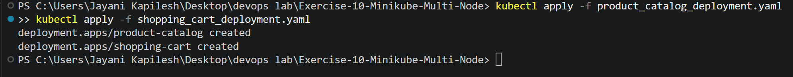

---

## Step 7: Expose the Services

**File: product_catalog_service.yaml**

```yaml
# product_catalog_service.yaml
apiVersion: v1
kind: Service
metadata:
  name: product-catalog-service
  namespace: default
spec:
  selector:
    app: product-catalog
  ports:
    - protocol: TCP
      port: 80
      targetPort: 80
  type: NodePort
```

**File: shopping_cart_service.yaml**

```yaml
# shopping_cart_service.yaml
apiVersion: v1
kind: Service
metadata:
  name: shopping-cart-service
  namespace: default
spec:
  selector:
    app: shopping-cart
  ports:
    - protocol: TCP
      port: 80
      targetPort: 80
  type: NodePort
```

**Commands:**

```powershell
kubectl apply -f product_catalog_service.yaml
kubectl apply -f shopping_cart_service.yaml
```

**Output:**

```text
service/product-catalog-service created
service/shopping-cart-service created
```

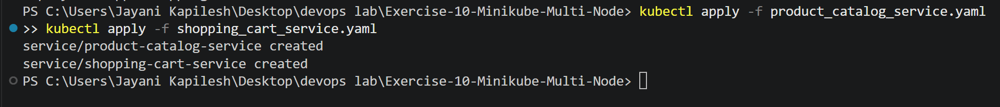

---

## Step 8: Verify Deployment and Distribution

**Command:**

```powershell
kubectl get pods -o wide
```

**Output:**

```text
NAME                              READY   STATUS    RESTARTS   AGE    IP           NODE                   NOMINATED NODE   READINESS GATES
product-catalog-7cb85d4f-kg8w2    1/1     Running   0          110s   10.244.1.3   devops-multinode-m02   <none>           <none>
product-catalog-7cb85d4f-lt6nk    1/1     Running   0          110s   10.244.2.4   devops-multinode-m03   <none>           <none>
shopping-cart-6858b5f797-7cv69    1/1     Running   0          110s   10.244.0.4   devops-multinode       <none>           <none>
shopping-cart-6858b5f797-gcxts    1/1     Running   0          110s   10.244.1.4   devops-multinode-m02   <none>           <none>
shopping-cart-6858b5f797-r22rg    1/1     Running   0          110s   10.244.2.5   devops-multinode-m03   <none>           <none>
```

| Application | Replicas | Nodes |
|-------------|----------|-------|
| Product Catalog | 2 | `devops-multinode-m02`, `devops-multinode-m03` |
| Shopping Cart | 3 | `devops-multinode`, `devops-multinode-m02`, `devops-multinode-m03` |

All 5 pods are **Running**, and each pod of the same application is on a **different node**, confirming that the pod anti-affinity rules worked.

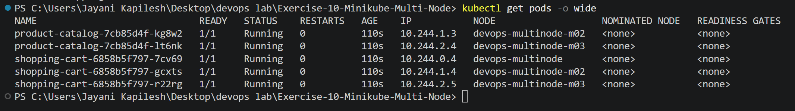

---

## Step 9: Access the Services

Used Minikube's service forwarding to access the applications. Each command was run in a separate terminal, which had to stay open because the Docker driver on Windows runs a tunnel.

### Step 9a: Access Product-Catalog Service

**Command:**

```powershell
minikube -p devops-multinode service product-catalog-service
```

**Output:**

```text
|-----------|-------------------------|-------------|---------------------------|
| NAMESPACE |          NAME           | TARGET PORT |            URL            |
|-----------|-------------------------|-------------|---------------------------|
| default   | product-catalog-service |          80 | http://192.168.49.2:30821 |
|-----------|-------------------------|-------------|---------------------------|
🔗  Starting tunnel for service product-catalog-service.
|-----------|-------------------------|-------------|------------------------|
| NAMESPACE |          NAME           | TARGET PORT |          URL           |
|-----------|-------------------------|-------------|------------------------|
| default   | product-catalog-service |             | http://127.0.0.1:53383 |
|-----------|-------------------------|-------------|------------------------|
🎉  Opening service default/product-catalog-service in default browser...
❗  Because you are using a Docker driver on windows, the terminal needs to be open to run it.
```

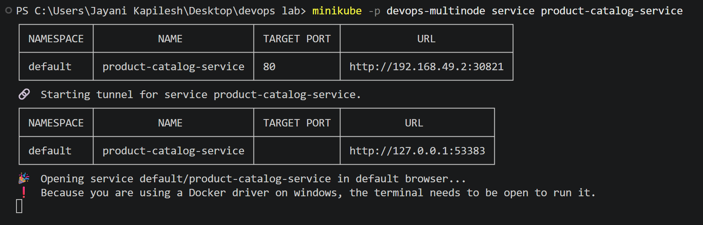

### Step 9b: Access Shopping-Cart Service

**Command:**

```powershell
minikube -p devops-multinode service shopping-cart-service
```

**Output:**

```text
|-----------|-----------------------|-------------|---------------------------|
| NAMESPACE |         NAME          | TARGET PORT |            URL            |
|-----------|-----------------------|-------------|---------------------------|
| default   | shopping-cart-service |          80 | http://192.168.49.2:31653 |
|-----------|-----------------------|-------------|---------------------------|
🔗  Starting tunnel for service shopping-cart-service.
|-----------|-----------------------|-------------|------------------------|
| NAMESPACE |         NAME          | TARGET PORT |          URL           |
|-----------|-----------------------|-------------|------------------------|
| default   | shopping-cart-service |             | http://127.0.0.1:55010 |
|-----------|-----------------------|-------------|------------------------|
🎉  Opening service default/shopping-cart-service in default browser...
❗  Because you are using a Docker driver on windows, the terminal needs to be open to run it.
```

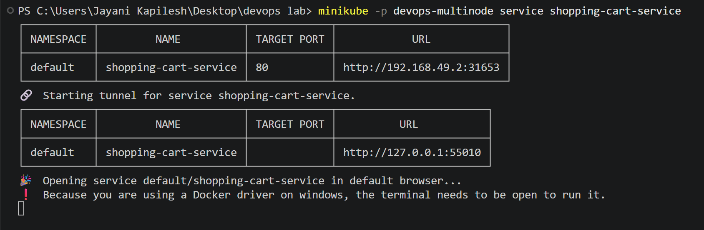

**URLs:**

- Product Catalog service: http://127.0.0.1:53383
- Shopping Cart service: http://127.0.0.1:55010

---

## Step 10: Testing with curl

In PowerShell, `curl` is an alias for `Invoke-WebRequest`, so **`curl.exe`** (the real curl) was used.

### Test Product Catalog Service

Retrieve the product list:

**Command:**

```powershell
curl.exe http://127.0.0.1:53383/products
```

**Response:**

```json
[{"id":1,"name":"Laptop","price":1200},{"id":2,"name":"Phone","price":800},{"id":3,"name":"Headphones","price":150}]
```

### Test Shopping Cart Service

**Retrieve the cart (initially empty):**

```powershell
curl.exe http://127.0.0.1:55010/cart
```

**Response:**

```json
[]
```

**Add an item to the cart:**

PowerShell removes the inner double quotes from inline JSON passed to native programs, so the request body from the lab (`{"id": 1, "name": "Laptop", "quantity": 1}`) was saved to `item.json` and sent with `-d "@item.json"`. The request is otherwise identical.

```powershell
Set-Content item.json '{"id": 1, "name": "Laptop", "quantity": 1}'
Get-Content item.json
```

**Output:**

```json
{"id": 1, "name": "Laptop", "quantity": 1}
```

```powershell
curl.exe -X POST http://127.0.0.1:55010/cart -H "Content-Type: application/json" -d "@item.json"
```

**Response:**

```json
[{"id":1,"name":"Laptop","quantity":1}]
```

All three responses match the expected responses in the lab.

**Observation (additional check):** During an earlier test run, a `GET /cart` sent right after the POST sometimes returned `[]` again. This is because the cart is stored **in memory inside each pod**, and there are 3 shopping-cart replicas. The Service load-balances requests across the pods, so the POST and the following GET can be served by different pods, each with its own separate cart. Before taking the final screenshot, the shopping-cart pods were recreated with `kubectl delete pods -l app=shopping-cart` to start with empty carts; the ReplicaSet automatically created 3 new pods to keep the desired replica count. In a production system the cart would be stored in a shared database or cache (for example Redis) so that all replicas see the same data.

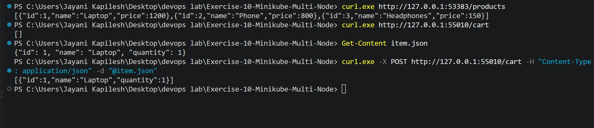

---

## Expected vs Actual Results

| Test | Expected | Actual |
|------|----------|--------|
| 3 nodes Ready | `devops-multinode`, `-m02`, `-m03` | ✅ All Ready |
| Product Catalog replicas | 2 pods on different nodes | ✅ m02, m03 |
| Shopping Cart replicas | 3 pods on different nodes | ✅ devops-multinode, m02, m03 |
| `GET /products` | 3 products | ✅ Laptop, Phone, Headphones |
| `GET /cart` | `[]` | ✅ `[]` |
| `POST /cart` | `[{"id": 1, "name": "Laptop", "quantity": 1}]` | ✅ Same |

---

## Summary

Two Python applications, **Product Catalog** and **Shopping Cart**, were containerized with Docker and deployed on a **three-node Minikube cluster** using Kubernetes Deployments. The Product Catalog ran **2 replicas** and the Shopping Cart ran **3 replicas**, and the required pod anti-affinity rule ensured that each pod of the same application ran on a **different node**. Both applications were exposed through NodePort Services, accessed through Minikube service tunnels, and tested successfully with curl. This setup maximizes availability and fault tolerance, because the failure of a single node does not take down all replicas of either application.

## Key Takeaways

- A multi-node Minikube cluster is created with `minikube start --nodes 3 -p <profile>`.
- Deployments create ReplicaSets that keep the required number of pods running.
- `podAntiAffinity` with `topologyKey: kubernetes.io/hostname` spreads replicas across nodes.
- Locally built images are loaded into a multi-node cluster with `minikube image load` and used with `imagePullPolicy: Never`.
- On a containerd-based cluster, images are verified with `minikube image ls` instead of `docker images`.
- A Deployment and the Service that selects its pods must be in the same namespace.
- Applications that keep state in memory give inconsistent results across replicas; shared storage is needed for stateful data.