# Online Examination Platform with Fault Recovery-Question 5(CIE)

**Coverage:** Exercises 1, 2, 3 and 6

## 1. Objective

To develop and deploy a Flask-based Online Examination Platform using Docker and Kubernetes. The application is deployed on Minikube, exposed through a Kubernetes Service, and configured with three replicas to ensure availability.

The exercise also demonstrates automatic Pod recovery, Service troubleshooting, application monitoring using Prometheus and Grafana, Kubernetes resource monitoring, and alert configuration.

## 2. Scenario

A college's online examination platform must remain available when individual application Pods fail. During a mock examination, the administrator must be able to monitor resource usage, verify application availability, identify connectivity problems, and configure alerts for potential resource-related issues.

## 3. Approach

The implementation was carried out in the following stages:

1. Develop a Flask API that returns examination details and sample questions.
2. Containerize the Flask application using Docker.
3. Deploy the application on Minikube using Kubernetes YAML manifests.
4. Expose the application through a NodePort Service.
5. Configure three replicas and verify their availability.
6. Delete one Pod and demonstrate automatic recovery.
7. Introduce an incorrect Service selector, identify the cause of failure, and correct it.
8. Configure Prometheus to collect application metrics.
9. Create a Grafana dashboard to monitor application performance.
10. Enable Kubernetes Metrics Server to inspect Pod and node resource usage.
11. Configure a Grafana alert based on application memory usage.

## 4. Platform and Environment Details

| Component | Details |
|---|---|
| Operating System | Windows 11 |
| Terminal | Windows PowerShell |
| Code Editor | Visual Studio Code |
| Container Platform | Docker Desktop |
| Kubernetes Environment | Minikube |
| Minikube Version | v1.39.0 |
| Kubernetes Version | v1.37.0 |
| kubectl Client | v1.34.1 |
| Application Framework | Flask |
| Application Port | 15000 |
| Docker Image | examination-app:v2 |
| Monitoring Tools | Prometheus and Grafana |
| Resource Monitoring | Kubernetes Metrics Server |

**Note:** The kubectl client and Kubernetes cluster versions were not identical in this environment. The cluster was running and the commands used for this exercise completed successfully.

## 5. Project Directory Structure

The project was organized into separate directories for the Flask application, Kubernetes manifests, Prometheus configuration, and screenshots.

```text
Question-5-Online-Examination/
│
├── app/
│   ├── app.py
│   ├── requirements.txt
│   ├── Dockerfile
│   └── venv/
│
├── kubernetes/
│   ├── deployment.yaml
│   └── service.yaml
│
├── prometheus/
│   └── prometheus.yml
│
├── monitoring/
│
└── screenshots/
```

## 6. Prerequisites

The following tools were installed and configured:

- Python and Flask
- Docker Desktop
- Minikube
- kubectl
- Prometheus
- Grafana

Minikube was configured to use the Docker driver. The Flask application was containerized, and its Docker image was loaded into Minikube for deployment.

## 7. Implementation

### Step 1: Develop and Test the Flask API

A Flask application was developed to simulate the backend of an online examination platform.

The application provides four endpoints:

| Endpoint | Description |
|---|---|
| `/` | Returns the welcome message and application status |
| `/exam` | Returns examination details |
| `/questions` | Returns a list of sample examination questions |
| `/metrics` | Exposes application metrics in Prometheus format |

The application was configured to run on port `15000`.

The Flask application was started using PowerShell:

```powershell
cd "C:\Users\Jayani Kapilesh\Desktop\Question-5-Online-Examination\app"
.\venv\Scripts\Activate.ps1
python app.py
```

The API endpoints were tested from another PowerShell terminal.

**Command 1 — Test the application status:**

```powershell
curl.exe http://127.0.0.1:15000/
```

**Command 2 — Retrieve examination details:**

```powershell
curl.exe http://127.0.0.1:15000/exam
```

**Command 3 — Retrieve sample questions:**

```powershell
curl.exe http://127.0.0.1:15000/questions
```

**Observed Output:**

- The root endpoint returned the welcome message with status `Running`.
- The examination endpoint returned the examination name, subject, duration, and total number of questions.
- The questions endpoint returned three sample questions related to Kubernetes, Docker, and Pods.

The successful responses confirmed that the Flask API was functioning correctly.

**Screenshot — Flask API Testing**

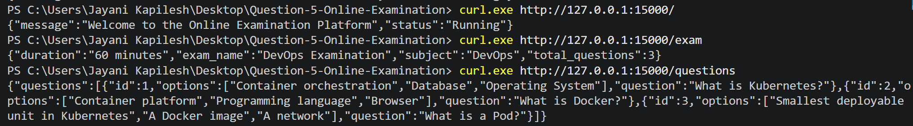

### Step 2: Build the Docker Image

The Flask application and its dependencies were packaged into a Docker image.

The Dockerfile specifies the Python base image, working directory, dependency installation, application files, exposed port, and startup command.

From the project root, the following command was executed to build the Docker image:

```powershell
docker build -t examination-app:v2 ./app
```

**Observed Output:** Docker successfully completed the image build process and created the image `examination-app:v2`.

The available Docker images were then verified using:

```powershell
docker images
```

**Observed Output:** The `examination-app` image with tag `v2` was visible in the local Docker image list.

**Screenshot — Docker Image Build**


**Screenshot — Docker Images**


### Step 3: Verify Minikube Cluster Status

Before deploying the application, the status of the Minikube cluster was checked.

The following command was executed:

```powershell
minikube status
```

**Observed Output:** The Minikube host, kubelet, and API server were running, and the kubeconfig was configured.

The Kubernetes node status was verified using:

```powershell
kubectl get nodes
```

**Observed Output:** The Minikube node was displayed with the status `Ready`.

This confirmed that the Kubernetes cluster was available for application deployment.

**Screenshot — Minikube Cluster Status**

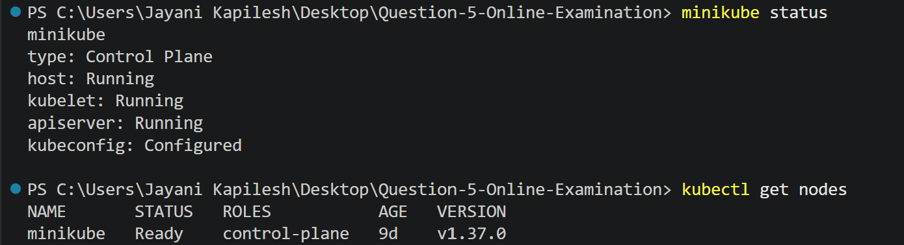

### Step 4: Deploy the Application Using Kubernetes

The locally built Docker image was loaded into Minikube so that the Kubernetes cluster could access it.

**Command:**

```powershell
minikube image load examination-app:v2
```

A Kubernetes Deployment manifest was created with the following configuration:

- Deployment name: `examination-deployment`
- Number of replicas: `3`
- Pod label: `app: examination`
- Container image: `examination-app:v2`
- Container port: `15000`
- Image pull policy: `Never`

The Deployment was created using:

```powershell
kubectl apply -f kubernetes/deployment.yaml
```

**Observed Output:** Kubernetes successfully created the examination Deployment.

The rollout status was checked using:

```powershell
kubectl rollout status deployment/examination-deployment
```

**Observed Output:** The Deployment rollout completed successfully.

The Deployment status was verified using:

```powershell
kubectl get deployments
```

**Observed Output:** The examination Deployment displayed `3/3` ready replicas.

**Screenshot — Deployment Status**

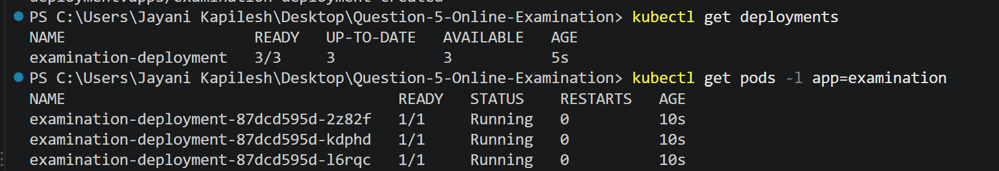

### Step 5: Verify the Running Application Pods

The application Pods were listed using:

```powershell
kubectl get pods -l app=examination
```

**Observed Output:**

Three examination Pods were displayed. Each Pod showed:

- READY: `1/1`
- STATUS: `Running`

This confirmed that all three desired application replicas were running successfully.

### Step 6: Expose the Application Through a Kubernetes Service

A Kubernetes Service named `examination-service` was configured with the type `NodePort`.

The Service selects Pods with the label `app: examination` and forwards incoming traffic to container port `15000`.

The Service was created using:

```powershell
kubectl apply -f kubernetes/service.yaml
```

**Observed Output:** Kubernetes successfully created the examination Service.

The available Services were checked using:

```powershell
kubectl get services
```

**Observed Output:** The examination Service was displayed with type `NodePort`.

The Service configuration was inspected using:

```powershell
kubectl describe service examination-service
```

**Observed Output:** The Service details showed the selector, service port, target port, and assigned NodePort.

The Service endpoints were verified using:

```powershell
kubectl get endpoints examination-service
```

**Observed Output:**

The Service was connected to three application Pod endpoints.

The observed configuration was:

| Property | Value |
|---|---|
| Service Name | examination-service |
| Service Type | NodePort |
| Cluster IP | 10.101.253.45 |
| Service Port | 15000 |
| Target Port | 15000 |
| NodePort | 30143 |
| Endpoints | 3 |

The three endpoint addresses observed during this run were `10.244.0.24:15000`, `10.244.0.25:15000`, and `10.244.0.26:15000`.

**Screenshot — Kubernetes Service Status and Endpoints**

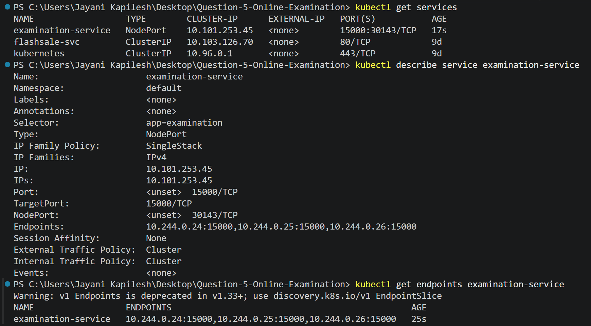

### Step 7: Verify External Access to the Application

The application was exposed outside the Kubernetes cluster using the Minikube Service command.

**Command:**

```powershell
minikube service examination-service --url
```

**Observed Output:** Minikube generated the following local access URL during the test:

```text
http://127.0.0.1:54922
```

The terminal running the Minikube Service command was kept open to maintain the local tunnel.

**Screenshot — Minikube Service URL**

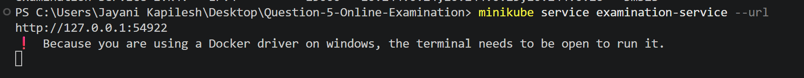

The application was then tested through the generated URL from another PowerShell terminal.

**Command 1 — Test application status:**

```powershell
curl.exe http://127.0.0.1:54922/
```

**Command 2 — Retrieve examination details:**

```powershell
curl.exe http://127.0.0.1:54922/exam
```

**Command 3 — Retrieve sample questions:**

```powershell
curl.exe http://127.0.0.1:54922/questions
```

**Observed Output:** All tested endpoints returned the expected JSON responses through the Minikube Service URL.

**Screenshot — External API Responses**

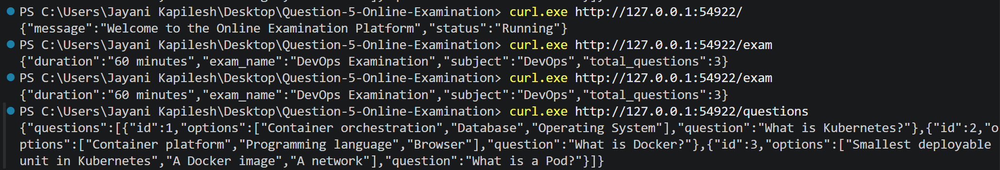

The application was also opened directly in a web browser using the same URL.

**Browser Verification — Application Status**

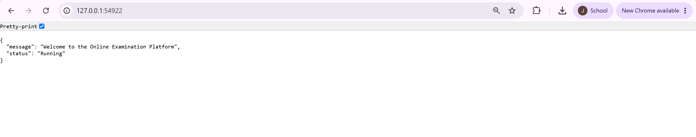

**Browser Verification — Examination Details**

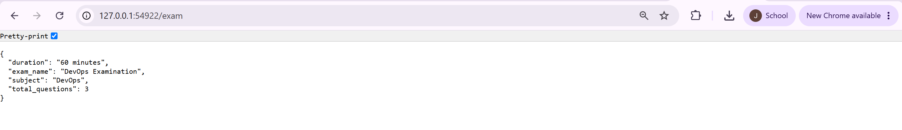

**Browser Verification — Sample Questions**

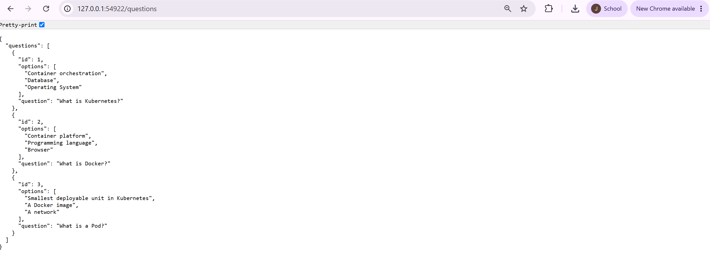

These tests confirmed that the application was accessible from outside the Kubernetes cluster through the configured Service.

**Note:** The local URL is generated by the Minikube service tunnel and may change after restarting the tunnel. The current URL must be used for subsequent tests.

### Step 8: Demonstrate Automatic Pod Recovery

Kubernetes Deployments maintain the desired number of application replicas. To demonstrate this self-healing capability, one of the running examination Pods was deleted.

First, the running Pods were listed:

```powershell
kubectl get pods -l app=examination
```

**Observed Output:** Three examination Pods were running successfully before deletion.

**Screenshot — Pods Before Deletion**

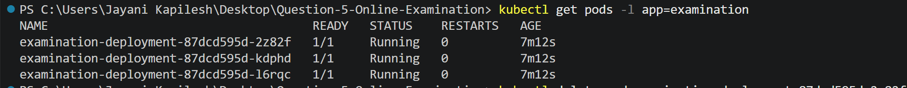

One of the running Pods was then deleted.

**Command:**

```powershell
kubectl delete pod examination-deployment-87dcd595d-2z82f
```

**Observed Output:** Kubernetes confirmed that the specified Pod was successfully deleted from the default namespace.

**Screenshot — Pod Deletion**

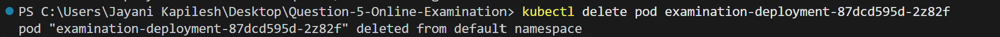

After deletion, the Pods were listed again:

```powershell
kubectl get pods -l app=examination
```

The Deployment status was also checked:

```powershell
kubectl get deployments
```

**Observed Output:** Kubernetes automatically created a replacement Pod with a new name:

`examination-deployment-87dcd595d-59n8d`

The Deployment returned to `3/3` ready replicas, and all three Pods were running.

**Screenshot — Automatic Pod Recovery**

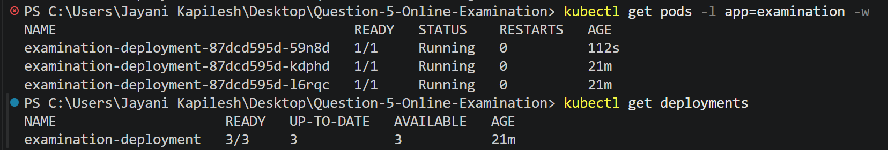

This demonstrates the self-healing behaviour of Kubernetes. When a Pod managed by a Deployment is deleted, the Deployment controller creates a replacement to maintain the desired replica count.

### Step 9: Introduce and Troubleshoot an Incorrect Service Selector

To demonstrate Service troubleshooting, the Service selector was temporarily modified.

The original selector was:

```yaml
selector:
  app: examination
```

It was temporarily changed to an incorrect value:

```yaml
selector:
  app: wrong-examination
```

The modified Service configuration was applied:

```powershell
kubectl apply -f kubernetes/service.yaml
```

**Observed Output:** Kubernetes accepted the updated Service configuration.

The Service EndpointSlice was inspected using:

```powershell
kubectl get endpointslices -l kubernetes.io/service-name=examination-service
```

**Observed Output:** The EndpointSlice had no matching application endpoints because the Service selector did not match the labels assigned to the examination Pods.

The incorrect selector `app: wrong-examination` did not match the Pod label `app: examination`.

**Screenshot — Service Selector Failure**

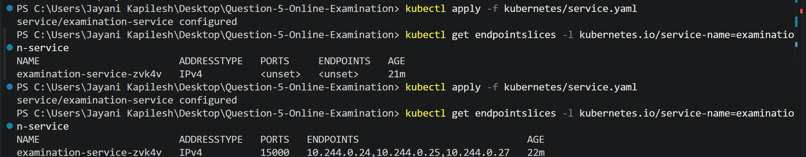

To resolve the issue, the Service selector was restored to:

```yaml
selector:
  app: examination
```

The corrected configuration was applied:

```powershell
kubectl apply -f kubernetes/service.yaml
```

The EndpointSlice was checked again:

```powershell
kubectl get endpointslices -l kubernetes.io/service-name=examination-service
```

**Observed Output:** The corrected Service again identified the three examination Pod endpoints on port `15000`.

**Screenshot — Service Connectivity Restored**

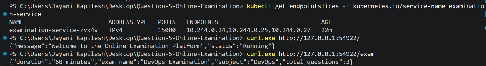

The application was tested again through the Minikube Service URL:

```powershell
curl.exe http://127.0.0.1:54922/
curl.exe http://127.0.0.1:54922/exam
```

**Observed Output:** Both API requests returned successful responses after the selector was corrected.

This demonstrated how an incorrect Service selector can prevent traffic from reaching application Pods and how restoring the correct selector resolves the connectivity issue.

### Step 10: Configure Prometheus Application Monitoring

Prometheus was configured to collect metrics from the Flask application's `/metrics` endpoint.

The Flask application uses the Prometheus client library to expose HTTP request counters and process metrics.

The Prometheus configuration included an application scrape job:

```yaml
- job_name: 'examination-app'
  metrics_path: '/metrics'
  static_configs:
    - targets: ['host.docker.internal:54922']
```

The Prometheus container was started using:

```powershell
docker run -d --name q5-prometheus -p 9090:9090 -v "${PWD}/prometheus/prometheus.yml:/etc/prometheus/prometheus.yml" prom/prometheus
```

**Observed Output:** Docker started the Prometheus container.

After updating the Prometheus configuration, the container could be restarted using:

```powershell
docker restart q5-prometheus
```

Prometheus was accessed through:

```text
http://localhost:9090
```

The target status page was opened at:

```text
http://localhost:9090/targets
```

**Observed Output:** Both the `prometheus` and `examination-app` targets showed the status `UP`, indicating that Prometheus was successfully scraping the configured targets.

**Screenshot — Prometheus Targets**

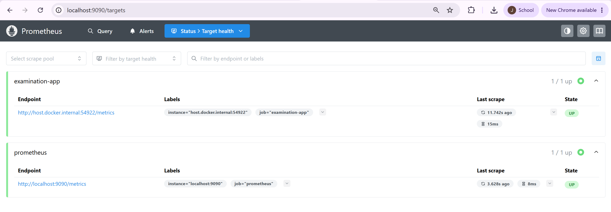

The following PromQL query was executed in the Prometheus query interface:

```promql
examination_http_requests_total
```

**Observed Output:** Prometheus returned the examination application's HTTP request counter, including endpoint labels. The graph displayed the collected metric values over time.

**Screenshot — Prometheus Application Metrics**

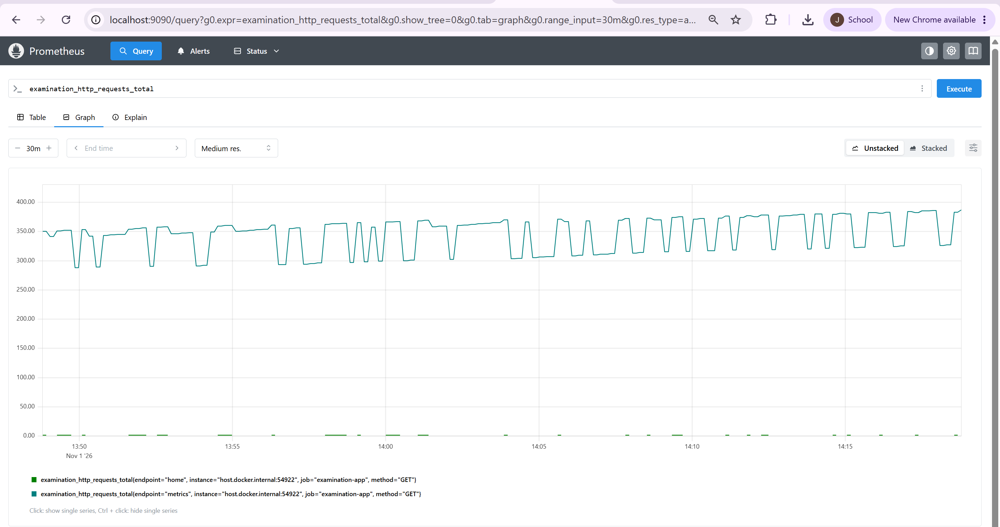

### Step 11: Configure the Grafana Monitoring Dashboard

Grafana was accessed through:

```text
http://localhost:3000
```

Prometheus was configured as the Grafana data source using the following URL:

```text
http://host.docker.internal:9090
```

The data source connection test succeeded.

A dashboard named **Online Examination Monitoring** was created with four monitoring panels.

| Panel | PromQL Query | Purpose |
|---|---|---|
| Prometheus Target Status | `up` | Displays the availability of configured Prometheus targets |
| Online Examination API Requests | `examination_http_requests_total` | Displays the application's HTTP request counter |
| Examination Application CPU Usage | `rate(process_cpu_seconds_total[1m])` | Displays application process CPU usage rate |
| Examination Application Memory Usage | `process_resident_memory_bytes{job="examination-app"}` | Displays application process resident memory |

**Observed Output:** All four panels displayed monitoring information in the Grafana dashboard.

**Screenshot — Online Examination Monitoring Dashboard**

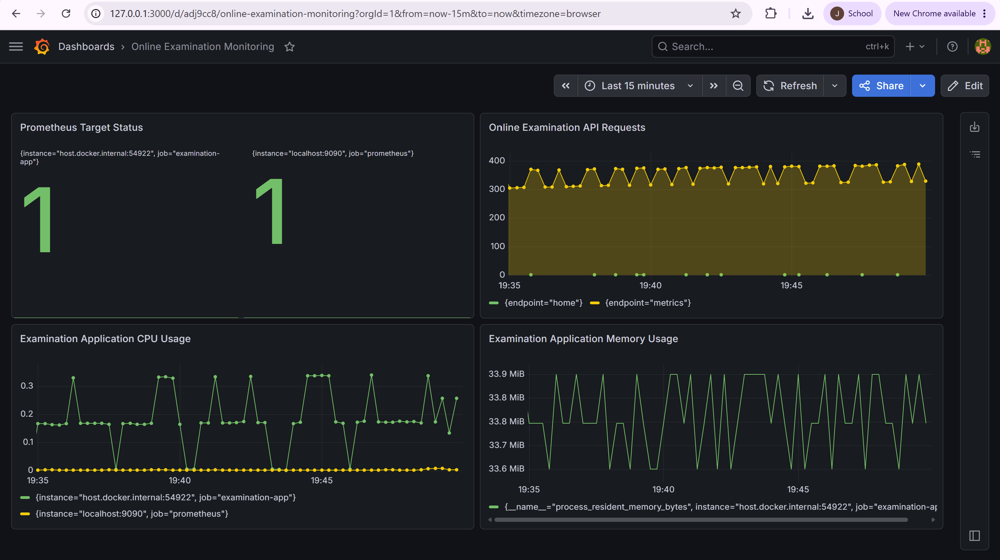

**Monitoring Note:** The CPU and memory panels in this Grafana dashboard represent Flask application-process metrics. They are not Kubernetes Pod CPU and memory metrics. Kubernetes Pod and node resource usage was monitored separately using Metrics Server.

### Step 12: Monitor Kubernetes Pod and Node Resource Usage

The Minikube Metrics Server add-on was enabled to obtain Kubernetes resource usage information.

**Command:**

```powershell
minikube addons enable metrics-server
```

**Observed Output:** Minikube enabled the Metrics Server add-on.

After allowing the metrics API to become available, the resource usage of the examination Pods was checked.

**Command:**

```powershell
kubectl top pods -l app=examination
```

**Observed Output:** The CPU and memory usage of the three examination Pods were displayed.

**Screenshot — Kubernetes Pod Resource Usage**

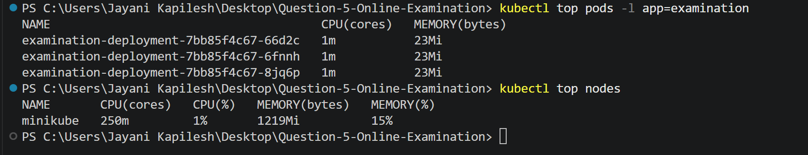

The node-level resource usage was also checked using:

```powershell
kubectl top nodes
```

**Observed Output during the recorded test:**

| Resource | Observed Usage |
|---|---:|
| Examination Pod 1 CPU | 1m |
| Examination Pod 2 CPU | 1m |
| Examination Pod 3 CPU | 1m |
| Each examination Pod memory | 23Mi |
| Minikube node CPU | 250m (1%) |
| Minikube node memory | 1219Mi (15%) |

These values represent the resource usage observed during the test and may vary depending on system load.

**Important:** Metrics Server supplied the data for `kubectl top`. It was not connected as a data source to the Grafana dashboard in this implementation. Therefore, Kubernetes Pod and node resource usage is demonstrated through the terminal output, while Grafana displays the Flask application metrics described in Step 11.

### Step 13: Configure a Grafana Memory Alert

A Grafana-managed alert rule named **Examination Application High Memory Alert** was configured using the application process memory metric.

The PromQL query used was:

```promql
process_resident_memory_bytes{job="examination-app"}
```

The alert condition was configured to trigger when memory usage exceeded:

```text
52428800 bytes (50 MiB)
```

The evaluation interval was set to 1 minute, with a pending period of 1 minute. The rule was associated with the contact point named `Examination Alert`.

**Observed Output:** The final alert rule page showed the alert in the `Normal` state.

During the captured monitoring period, application process memory was approximately 33.6–33.9 MiB, which was below the configured 50 MiB threshold.

The alert condition was tested by temporarily lowering the threshold to cause a firing state. The threshold was then restored to 50 MiB. The final screenshot shows the restored threshold and Normal state.

**Screenshot — Grafana High Memory Alert**

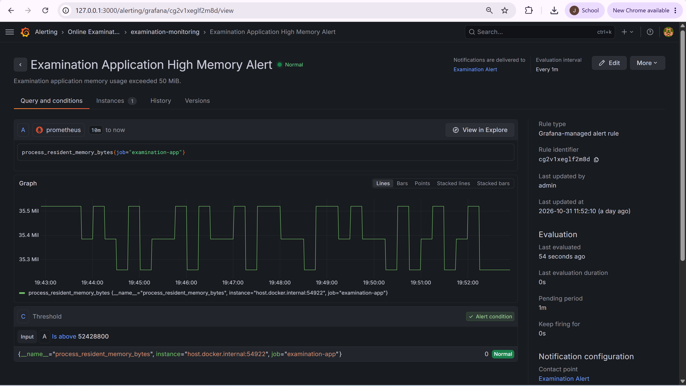

**Notification Note:** A contact point was configured with an email address, but SMTP delivery was not verified. Therefore, successful email notification delivery is not claimed.

## 8. Expected Outputs and Verification

| Requirement | Verification | Result |
|---|---|---|
| Flask API created | Tested `/`, `/exam`, and `/questions` | Successful JSON responses |
| Docker image created | `docker build` and `docker images` | `examination-app:v2` created |
| Minikube cluster available | `minikube status` and `kubectl get nodes` | Cluster running; node Ready |
| Three replicas deployed | `kubectl get deployments` and `kubectl get pods` | 3/3 replicas ready |
| Application exposed through Service | Service and endpoint inspection | NodePort Service with three endpoints |
| External access verified | Minikube Service URL and API tests | Application accessible |
| Pod recovery demonstrated | Delete a Pod and inspect Deployment | Replacement Pod created; 3/3 restored |
| Service fault corrected | Incorrect selector and EndpointSlice inspection | Endpoints restored |
| Prometheus monitoring configured | Targets page and PromQL query | Both targets UP; application metrics available |
| Grafana dashboard created | Online Examination Monitoring dashboard | Four panels displaying data |
| Kubernetes resource usage checked | `kubectl top pods` and `kubectl top nodes` | Pod and node metrics available |
| Grafana alert configured | High Memory Alert rule | Rule configured; final state Normal |

## 9. Result and Conclusion

The Online Examination Platform was successfully developed using Flask, containerized with Docker, and deployed on Minikube using Kubernetes YAML manifests.

The application was exposed through a NodePort Service and successfully accessed from outside the cluster. Three application replicas were maintained by the Kubernetes Deployment.

When one Pod was deleted, Kubernetes automatically created a replacement and restored the desired replica count. A Service selector fault was introduced, diagnosed through the absence of matching endpoints, and corrected by restoring the proper Pod label selector.

Prometheus successfully scraped application metrics, and Grafana displayed application request, CPU, memory, and target-status information. Kubernetes Metrics Server was used separately to inspect Pod and node resource consumption through `kubectl top`.

A Grafana high-memory alert was configured and its final Normal state was verified.

Thus, the exercise demonstrated application deployment, Service exposure, replica management, automatic Pod recovery, Service troubleshooting, monitoring, and alert configuration for the Online Examination Platform.
